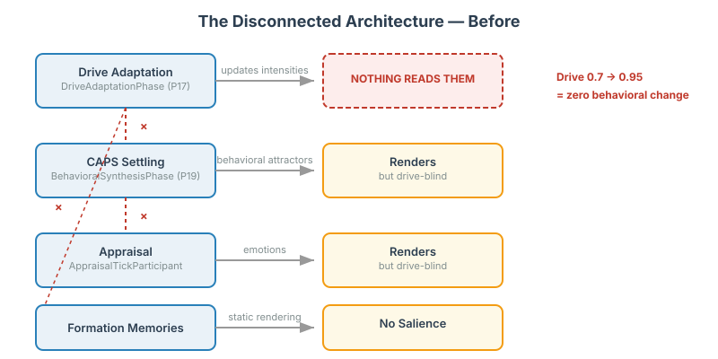
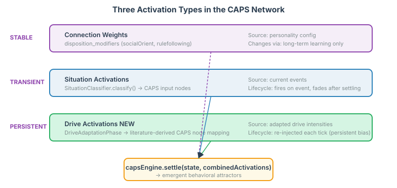
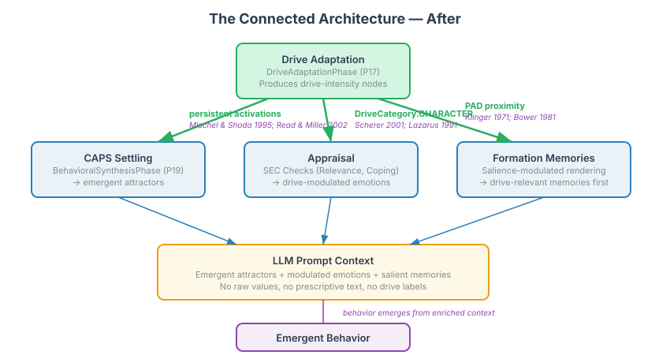

# Wiring the Missing Connections: How CAPS Theory, Appraisal Models, and Current Concerns Theory Guide Cognitive Agent Architecture

A character's proving-worth drive intensifies from 0.7 to 0.95 over 300 events of reinforcement. The adaptation takes hours of computation. The result: absolutely nothing changes in what the LLM sees.

I've spent the past two weeks building a cognitive architecture for LLM-based characters. Drives that adapt with experience. A CAPS personality network that settles to behavioral attractors. Scherer's appraisal model producing emotions from events. Formation memories grounding character identity. Each subsystem works. None of them talk to each other.

This entry documents how I found the disconnection, what the psychological literature says the wiring should look like, and the three wrong turns I took before arriving at a design grounded in published computational models.

## The Problem: Computation With No Output

The architecture has four cognitive subsystems, each built to solve a different problem at a different time:



**DriveAdaptationPhase** (priority 17 in the consolidation pipeline) processes experience events, matches them against reinforcement mappings in social-config.yaml, and updates drive-intensity nodes in the cognitive MindMap. The intensity formula is PAD-axis-weighted: `newIntensity = currentIntensity * (1 + effectiveReward * learningRate)`. It works. Drives adapt.

**BehavioralSynthesisPhase** (priority 19) runs CAPS settling. It reads graduated cognitive nodes, classifies them via `SituationClassifier.classify()` into CAPS input activations, and calls `capsEngine.settle(state, combinedActivations)`. The network settles to behavioral attractors rendered as felt-sense text: "Something deep-rooted — a tendency-to-protect, growing stronger." It works. Attractors emerge.

**AppraisalTickParticipant** runs Scherer's Sequential Evaluation Checks — relevance, implication, coping, normative significance. It produces emotions and action tendencies from events. It works. Emotions get generated.

**Formation memories** render unconditionally in CharacterCognition — every memory, every tick, in definition order. Age 5 through 17, always the same, regardless of what's happening in the character's life right now.

Each system is correct in isolation. The problem is the gaps between them. DriveAdaptationPhase produces intensity nodes at priority 17 — and BehavioralSynthesisPhase at priority 19 never reads them. The appraisal system accepts drives via `AppraisalContext`, but only SDT drives (curiosity, competence, affiliation, autonomy) reach it — character drives (gallantry, proving-worth, protection) are invisible. `DriveCategory.CHARACTER` exists as an enum value. It was never wired.

I found this by tracing the code with IntelliJ's find-references. The enum is defined, imported in zero production classes, and sits in a file that hasn't been touched since it was created. Someone clearly intended to connect character drives to appraisal. The connection was never made.

## The Prior Failure

This isn't my first attempt at making drives visible. Two weeks ago, I tried removing the prescriptive somatic text — the hand-written descriptions like "A warmth moves through you when courtesy matters" that told the LLM how to feel gallant. The idea was that drives should emerge from computation, not from prompt cues.

Gloating collapsed from 3.97 to 2.45 on our eval scale. A drop of 1.52 points. The LLM couldn't produce drive-appropriate behavior without being explicitly told what to feel. I wrote up the analysis in issue #115 and moved on to fixing dead ends in the rendering pipeline.

But the analysis revealed something I didn't see at first: the somatic text was the ONLY mechanism through which drives influenced the LLM. When I removed it, there was nothing computational to take its place. The systems were built to eventually connect. They never did.

## What the Literature Actually Says

The cognitive architecture is built on three established psychological models. Each model prescribes specific connections between subsystems. Each connection was missing.

### Mischel and Shoda's CAPS Theory (1995)

The Cognitive-Affective Processing System defines personality as the pattern of connection weights and activations across cognitive-affective units. Five types of CAUs: encodings, expectancies, affects, goals/motivating forces, and competencies. Behavioral "signatures" — the stable if-then patterns that distinguish individuals — emerge from network settling dynamics.

The key insight for this architecture: goals and motivating forces are one of the five CAU types. They participate in the network as activations that spread through weighted connections to bias behavior selection.

Read and Miller's *Virtual Personalities* (2002) — the most elaborated computational CAPS implementation — makes this explicit. Goals are activations. Connection weights represent stable personality traits from developmental history. What changes with current motivational state is which activations are present, not the weights themselves. Weights change through long-term learning (Hebbian and error-correcting). Activations change moment to moment.

This distinction matters. I got it wrong twice before the literature corrected me.

### Scherer's Component Process Model (2001)

Emotional appraisal through Sequential Evaluation Checks. The relevance SEC explicitly evaluates "goal/need relevance — its motivational consistency, i.e., its conduciveness to satisfy a need, reach a goal, or uphold a value" (Scherer, 2001; Ellsworth & Scherer, 2003).

Lazarus (1991) makes this even more direct: goal relevance is the primary appraisal dimension. Greater goal relevance produces more intense emotion. Smith and Kirby (2009) provide the empirical confirmation: motivational relevance drives emotion intensity.

The implication for the architecture is clear. When a character's protection drive is strong and a threat event occurs, the emotional response should be amplified — not because we prescribe it in prompt text, but because the SEC relevance check scores the event as highly goal-congruent. The infrastructure was there. The SEC checks were reading drives. But only the wrong drives.

### Klinger's Current Concerns Theory (1971, 2004)

Active motivational states — what Klinger calls "current concerns" — increase cognitive salience for concern-related stimuli. The effect operates across perception, attention, memory retrieval, and emotional reactivity. It's proportional to goal commitment.

This is the theoretical foundation I was missing for formation memory salience. When a character's protection drive is high, memories about protecting people should feel more vivid — not because I hand-rank them in the YAML, but because Klinger's theory predicts that active motivational states make related memories more accessible.

Bower's mood-congruent memory research (1981, over 6,000 citations) provides the mechanism: current emotional/motivational state activates associatively linked memories of similar valence. Rubin and Talarico (2009) confirmed that dimensional models (valence-arousal, closely related to PAD) outperform categorical models for predicting autobiographical memory retrieval.

## Three Wrong Turns

Getting from "the connections are missing" to "here's how to wire them" took three iterations. Each one felt right until the literature said otherwise.

### Wrong Turn 1: The PAD Bridge

My first proposal: use PAD (Pleasure-Arousal-Dominance) space as a shared mathematical foundation. Formation memories already have PAD values. Drives could have PAD centroids computed from their reinforcement history. CAPS input nodes could have PAD profiles derived from affect theory. Map everything through geometric similarity in PAD space.

It was elegant. The derivation chain was traceable. It felt principled.

The decision review caught the problem: PAD was designed as an emotion model (Mehrabian, 1996; Russell, 1980), not a motivation model. "Gallantry" and "scheming" are motivational dispositions, not emotions. Two drives with identical PAD profiles could be emotionally similar yet behaviorally opposite. And the ~30 CAPS input nodes (constructs like `secure_attachment`, `agency_granted`, `competence_recognition`) don't have published PAD profiles. Most would need to be researcher-derived values with a citation for legitimacy — not literature-sourced values.

The reviewer also pointed out that the CAPS topology was designed for situation-based activation. Adding a second activation pathway from drives would create unspecified interaction semantics with the existing situation activations.

I rejected the PAD bridge.

### Wrong Turn 2: Weight Modulation

The decision reviewer proposed an alternative: instead of injecting drives as input activations, modulate CAPS connection weights. The `disposition_modifiers` mechanism in caps-topology.yaml already scales connection weights based on personality dimensions. Drives could extend this mechanism. The argument: motivation creates processing biases, not phantom perceptions. Weight modulation is "more psychologically accurate."

I agreed. Enthusiastically. When asked if there was any reason not to do it, I said no — I couldn't find one.

Then I ran the literature review.

Read and Miller (2002) and Read et al. (2018) establish that in computational CAPS models, motivational states operate as activations flowing through the weighted network — NOT as modulators that change connection weights. Weights represent stable personality traits. They change through long-term learning. Real-time processing operates through activation dynamics.

Riddell, Wolf, and Lappe (2026, *Communications Psychology*) provided additional evidence: motivation biases behavioral responses without altering perception. This supports drives as activations (biasing output), not as weight changes (altering processing structure).

The weight modulation approach was intuitively appealing and categorically wrong. The people who built the computational models of CAPS — the theory our architecture is based on — made the opposite choice. I had reasoned from "what sounds psychologically accurate" instead of checking how the theory has actually been implemented by its authors.

### The Correction: Persistent Dispositional Activations

The literature points to a clear answer. Three types of activation coexist in the CAPS network:



**Connection weights** are stable personality. Set from disposition configuration, changed only by long-term learning. These are who the character IS — their enduring traits.

**Situation activations** are transient. Produced by `SituationClassifier.classify()` when events occur, they represent what's happening RIGHT NOW. They fire and fade.

**Drive activations** are the missing piece. Persistent baseline biases, re-injected each tick based on current drive intensities from DriveAdaptationPhase. They represent the character's ongoing motivational state — not what happened, but what they care about.

The behavioral attractor that the network settles to emerges from the interaction of all three. No single source determines the output. This is genuinely emergent behavior — shaped by personality (weights), situation (events), and motivation (drives), producing patterns no single input prescribed.

## The Connected Architecture



### Integration 1: Drive → CAPS (Persistent Activations)

Each character drive type maps to CAPS nodes it activates. The mappings are universal (same for all characters) and derived from published motivational psychology for each specific construct:

| Drive | Literature | CAPS Nodes Activated |
|-------|-----------|---------------------|
| Gallantry / prosocial motivation | Batson, 1991; Penner et al., 2005 | `other_safety`, `acceptance`, `approach` |
| Proving-worth / achievement | McClelland, 1961 | `mastery`, `competence_recognition`, `self_efficacy` |
| Protection / caregiving | George & Solomon, 2008 | `other_safety`, `physical_threat`, `approach` |
| Scheming / Machiavellianism | Christie & Geis, 1970 | `dominance`, `social_cognition`, `distrust` |

The activation strength: `mapping_weight x drive_intensity x dampening_factor`. The dampening factor (configurable, default 0.3) prevents persistent drive activations from overwhelming transient situation activations. Existing activation clamping [-1, 1] provides a hard ceiling.

The implementation is straightforward: `BehavioralSynthesisPhase.run()` reads drive-intensity nodes from the cognitive subgraph (already produced by DriveAdaptationPhase two priorities earlier) and adds them to `combinedActivations` before calling `capsEngine.settle()`. No changes to the CAPS engine itself. No schema changes. Just reading data that was already there.

### Integration 2: Drive → Appraisal (Call-Site Merge)

`AppraisalTickParticipant.tick()` already calls `driveOrchestrator.currentDrives()` and passes the result to all four SEC checks via `AppraisalContext`. The `RelevanceCheck` already keyword-matches on `drive.name()` and `drive.trigger()` to determine motivational relevance.

The gap: only SDT drives reach the SEC checks. Character drives are invisible.

The fix: at the call site in `AppraisalTickParticipant`, read character drive-intensity nodes from MindMap, convert them to `appraisal.Drive` objects with `DriveCategory.CHARACTER`, and merge with the SDT drive list. The merged list flows through existing SEC checks without modification.

Character drives need keyword lists for relevance detection (drive names like "gallantry" don't naturally appear in event narratives the way "curiosity" does). Each drive gets a `triggers` field in social-config.yaml:

```yaml
drives:
  - type: gallantry
    intensity: 0.9
    triggers: ["help", "courtesy", "rescue", "protect", "defend"]
```

The `RelevanceCheck` matches these keywords against event narratives using the same scoring pattern already used by `RuleBasedSituationClassifier`. When a threat event narrative contains "protect" or "defend," a character with a strong protection drive appraises it as highly relevant — producing a stronger emotional response.

### Integration 3: Drive → Memory Salience (Klinger's Current Concerns)

Formation memories currently render unconditionally. All nine of Peter Perfect's memories — ages 5 through 17 — appear in the same order every tick, regardless of whether his protection drive just spiked from a threat event.

Klinger's current concerns theory says active drives should make related memories more salient. The operationalization uses PAD proximity (Mehrabian, 1996), validated by Bower's mood-congruent memory work (1981) and Rubin and Talarico's dimensional model findings (2009).

Formation memories already have PAD values (pleasure, arousal, dominance). Drives get initial PAD profiles in social-config.yaml, evolving through reinforcement history. The similarity function is a weighted dot product with valence emphasis — the literature shows valence is the strongest predictor of memory retrieval, followed by dominance, then arousal.

Three rendering strategies, all configurable at runtime:

- **Prominence ordering** — memories sorted by salience, highest first. All still render. Attention guided, no information lost.
- **Threshold filtering** — memories below a salience threshold don't render. Focuses context.
- **Enrichment injection** — high-salience memories get contextual framing.

The optimal combination is an empirical question. Runtime configurability lets us run experiments with different blends and measure the impact on drive expression scores.

## Why This Will Be Different

The prior attempt at emergence failed because removing prescriptive text removed the ONLY mechanism through which drives influenced the LLM. There was no computational fallback.

This time, the computational connections exist before the prescriptive text is removed. Each connection replaces a specific function that somatic cues previously served:

| What somatic text did | What computation now does |
|---|---|
| "A warmth when courtesy matters" → told LLM to feel gallant | Drive→CAPS: gallantry activation biases toward prosocial attractors → LLM sees emergent "Something deep-rooted — a tendency-to-protect" |
| Somatic cues made threats feel important | Drive→Appraisal: protection drive amplifies relevance for threat events → LLM sees stronger emotional responses |
| All backstory equally present | Drive→Memory: high protection drive surfaces protection-related formation memories first |

Park et al.'s *Generative Agents* (2023) confirmed that emergence works in LLM agents when architectural support — memory, reflection, planning — is present. Each component critically contributes; ablation shows this. Our architecture provides computational enrichment through three independent channels. The emergence literature's known failure mode (static prompts with no computational pipeline) is exactly what we're fixing.

And the phasing makes regression impossible. Implementation follows a strict order: wire the computational pipeline first, verify each integration point produces measurable drive expression through micro experiments, THEN remove prescriptive text. If computation doesn't produce sufficient drive expression, the somatic text stays.

## The Literature-First Lesson

I got wrong turn #2 confidently wrong. Weight modulation was "better in every way" — until the literature showed it contradicted how the theory's own authors built their computational models. The lesson stung enough to add it to the project's CLAUDE.md:

> Never guess at psychological, cognitive, or architectural models. Always base design decisions on literature, using empirically proven and respected models. Search the internet and Google Scholar to find the literature to undertake review and verification before committing to an approach.

Intuitive reasoning about what "sounds psychologically accurate" is not sufficient for foundational architectural choices. The published computational models are the authority. Check them first, not after.

## References

### Primary Theory
- Mischel, W. & Shoda, Y. (1995). A cognitive-affective system theory of personality. *Psychological Review*, 102(2), 246-268.
- Read, S.J. & Miller, L.C. (2002). Virtual Personalities: A neural network model of personality. *Personality and Social Psychology Review*, 6(4), 357-369.
- Read, S.J., Brown, A.D., Wang, P. & Miller, L.C. (2018). The neurobiological basis of personality. *Personality Neuroscience*, 1, e10.
- Scherer, K.R. (2001). Appraisal Considered as a Process of Multilevel Sequential Checking. In Scherer, Schorr & Johnstone (Eds.), *Appraisal Processes in Emotion*. Oxford UP.
- Lazarus, R.S. (1991). *Emotion and Adaptation*. Oxford UP.
- Klinger, E. & Cox, W.M. (2004). Motivation and the Theory of Current Concerns. In *Handbook of Motivational Counseling*.

### Supporting Evidence
- Bower, G.H. (1981). Mood and memory. *American Psychologist*, 36(2), 129-148.
- Rubin, D.C. & Talarico, J.M. (2009). A comparison of dimensional models of emotion. *Memory*, 17(8), 802-808.
- Moors, A. et al. (2013). Appraisal Theories of Emotion: State of the Art. *Emotion Review*, 5(2), 119-124.
- Smith, C.A. & Kirby, L.D. (2009). Putting appraisal in context. *Cognition and Emotion*, 23(7), 1352-1372.
- Mehrabian, A. (1996). Pleasure-arousal-dominance: A general framework for describing and measuring individual differences in Temperament. *Current Psychology*, 14, 261-292.
- Park, J.S. et al. (2023). Generative Agents: Interactive Simulacra of Human Behavior. *UIST 2023*.
- Riddell, H., Wolf, C. & Lappe, M. (2026). Motivation biases behavior not perception. *Communications Psychology* (Nature).

### Drive-Specific Mapping Sources
- Batson, C.D. (1991). *The Altruism Question*. Lawrence Erlbaum.
- Penner, L.A. et al. (2005). Prosocial Behavior. *Annual Review of Psychology*, 56, 365-392.
- McClelland, D.C. (1961). *The Achieving Society*. Van Nostrand.
- George, C. & Solomon, J. (2008). The Caregiving System. In *Handbook of Attachment*.
- Christie, R. & Geis, F.L. (1970). *Studies in Machiavellianism*. Academic Press.

### Memory and Affect
- Bradley, M.M. & Lang, P.J. (1999). Affective Norms for English Words (ANEW). Technical Report C-1, University of Florida.
- Warriner, A.B. et al. (2013). Norms of valence, arousal, and dominance for 13,915 English lemmas. *Behavior Research Methods*, 45, 1191-1207.
