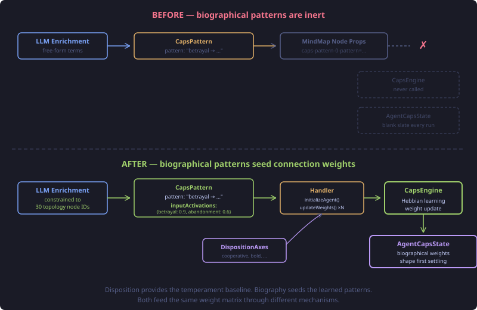
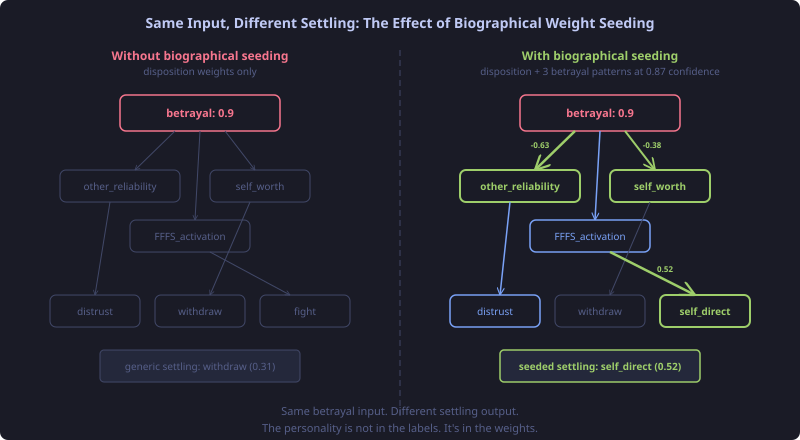

# The Import That Wasn't: Closing the Loop Between Biography and CAPS

We had biographical CAPS patterns in the corpus data for months. Six patterns for Frida Kahlo alone — betrayal leading to autonomy assertion, confinement leading to creative sublimation, pain leading to artistic transformation. The enrichment pipeline extracted them. The importer stored them. And the CAPS engine never saw any of it.

The patterns were landing as flat string properties on MindMap nodes: `caps-pattern-0-pattern=physical_immobility_or_confinement → isolation_threat + loss_of_agency → CREATIVE_SUBLIMATION`. Inert key-value pairs. The CAPS engine, which actually computes behavioural settling from connection weights, starts from a blank slate every evaluation. All those rich biographical patterns? Decoration on a node that the settling algorithm never reads.

## Why This Matters More Than It Looks

Mischel and Shoda's CAPS model (1995) makes a specific claim about personality: it is not a set of trait scores — not "Frida is 0.85 curious" — but a *pattern of situation-response connections*. Two people can have identical average behaviour across many situations and radically different personalities, because their if-then signatures differ. Person A responds to betrayal with withdrawal. Person B responds with defiance. That difference IS the personality, not a downstream effect of it.

Read and Miller (2002) translated this into computational terms: personality is the connection weight matrix in a constraint-satisfaction network. Input nodes represent situations (betrayal, threat, mastery, acceptance). Output nodes represent behavioural tendencies (approach, withdraw, fight, freeze, trust, distrust). The weights between them — and the mediating nodes that modulate the signal (self-worth, threat sensitivity, BAS/BIS activation) — determine which inputs produce which outputs. Change the weights, change the personality.

Our CAPS topology implements exactly this: 30 input nodes grounded in Bowlby, Gray, McClelland, Bandura, and Deci & Ryan. Every connection has empirical provenance — "van IJzendoorn 1995, r=.24-.32" for secure attachment to self-worth, "ACE 4+ OR=12.2" for physical threat to fight-flight-freeze. The `DispositionWeightMapper` initialises a character's weights from their disposition axes — cooperative vs. competitive, bold vs. conservative — giving each character a distinct baseline settling pattern.

But disposition is the *trait-level* personality. The disposition mapper says "this character is bold, so BAS connections are amplified." It does not say "this character has been betrayed repeatedly and learned to assert autonomy in response." Disposition gives you the temperament. Biography gives you the learned patterns. Without biographical seeding, a character with a rich history of betrayal-driven autonomy assertion settles identically to one who has never been betrayed. The life experience is filed away as documentation. The CAPS engine operates as if the character were born yesterday.



## The Data Flow Gap

The enrichment pipeline produces patterns like this from corpus data:

```json
{
  "pattern": "romantic_betrayal_or_abandonment → trust_violation + emotional_devastation → AUTONOMY_ASSERTION + INDEPENDENT_ACHIEVEMENT",
  "frequency": 3,
  "confidence": 0.87
}
```

The CAPS engine's `updateWeights()` method expects this:

```java
AgentCapsState updateWeights(AgentCapsState state,
                             Map<String, Double> inputActivations,
                             double outcomeIntensity,
                             double outcomeValence,
                             double salienceMultiplier,
                             String reinforcementSchedule);
```

The gap is obvious once you see both sides. The pattern string uses narrative terms — `romantic_betrayal_or_abandonment` — while the engine operates on topology node IDs — `betrayal`, `abandonment`. The narrative is for humans. The engine needs coordinates in its own vocabulary.

No amount of string-property storage bridges this gap. You need structured activations that reference the topology's own node IDs: `{"betrayal": 0.9, "abandonment": 0.6}`.

## Closing the Loop

The fix has three parts, each at a different layer.

**The enrichment prompt** now provides the 30 topology input node IDs directly — relationship nodes (betrayal, abandonment, rejection, neglect, secure attachment, inconsistent care), threat nodes, achievement nodes, social nodes, resource nodes, autonomy nodes, and consequence nodes. The LLM maps the biographical narrative onto these coordinates, producing `input_activations` alongside the pattern string. The narrative stays for documentation. The activations feed the engine.

**The data model** carries both. `CapsPattern` gained two fields: `inputActivations` (the structured map) and `confidence` (how certain the pattern is, from the enrichment). `convert_corpus.py` passes both through instead of stripping them.

**The importer** does the actual work. `EntityEnrichmentHandler` now injects a `CapsEngine`. When a biography profile contains caps patterns with structured activations, it reads the agent's disposition axes from the profile, calls `initializeAgent()` to create the baseline weight matrix, then iterates every pattern and calls `updateWeights()`. The parameters map naturally:

- `inputActivations` — from the structured pattern data
- `outcomeIntensity` — frequency / 5.0 (a pattern that fires 5/5 times has full intensity)
- `outcomeValence` — positive (these are learned patterns, reinforced through repetition)
- `salienceMultiplier` — confidence (a 0.87-confidence pattern shapes weights more than a 0.5 one)
- `reinforcementSchedule` — variable ratio (biographical patterns don't reinforce on a fixed schedule)

After all patterns are applied, `saveState()` persists the result.



## What Changes at Runtime

Before this change, every character starts with disposition-derived weights. Bold characters have amplified BAS connections. Cooperative characters have boosted acceptance-to-self-worth paths. But they all start from the same *experiential* baseline — which is none.

After this change, Frida Kahlo's CAPS network arrives at the first runtime event with strengthened betrayal-to-autonomy connections. A betrayal stimulus activates her abandonment and betrayal input nodes, and the signal propagates through a weight matrix that has already been shaped by three biographical instances of this exact pattern at 0.87 confidence. The settling result differs measurably from a character who shares Frida's disposition but lacks her history.

This is Mischel's point made computational. The same situation — betrayal — produces different behavioural outputs for different characters, not because of different trait scores, but because their connection weights encode different histories. The personality is not in the labels. It's in the weights.

## The Vocabulary Problem

I expected the hard part to be the engine wiring. It wasn't — `CapsEngine` already has `initializeAgent()` and `updateWeights()`, and the `DispositionWeightMapper` shows exactly how to construct the initial state. The hard part was the vocabulary gap.

The enrichment LLM, left to its own devices, produces narrative trigger terms: `physical_immobility_or_confinement`, `intellectual_or_artistic_underrecognition`, `environmental_mismatch_or_inauthenticity`. Rich descriptions. Useless as engine input. You can't pass `physical_immobility_or_confinement` to a topology that has `controlled` and `powerlessness` as its vocabulary.

The fix is not mapping or parsing. It's constraining the prompt. Give the LLM the 30 node IDs and tell it to map biography onto those coordinates. The narrative pattern string remains for human readers. The structured activations speak the engine's language. One enrichment call produces both.

This is a general principle for LLM-computational hybrid systems: when LLM output feeds a computational model, give the LLM the model's vocabulary upfront. Don't generate free-form labels and try to map them later. The mapping is lossy, non-deterministic, and a maintenance burden. Constraining the output vocabulary at generation time is cheaper and more reliable than parsing it at consumption time.

## What This Opens Up

CAPS weight seeding from biography is the second leg of personality initialisation, after disposition. The third leg — not built yet — is weight seeding from formative experiences. A character who grew up in poverty should have strengthened scarcity-to-BIS connections before encountering any runtime resource scarcity. The mechanism is identical to biographical pattern seeding; the input data is different.

Beyond initialisation, these seeded weights interact with runtime learning. `updateWeights()` is the same method called during consolidation when the character processes new experiences. A character whose biography already strengthened betrayal-to-autonomy will learn from runtime betrayals differently than one starting from baseline weights — the prior pattern amplifies subsequent reinforcement. This is the computational analogue of what developmental psychologists call "sensitisation" — prior experience makes you more responsive to similar future experience, not less.

The CAPS topology is literature-grounded. The seeding mechanism is Hebbian. The enrichment constrains its vocabulary to the model's coordinates. For the first time, biographical narrative translates into computational personality through a pipeline where every step has a citation.
