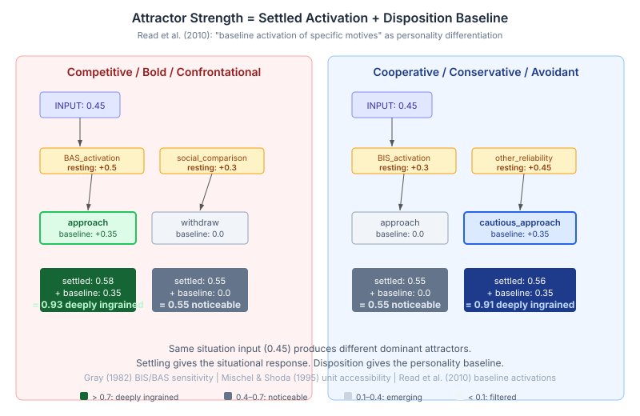

# The Baseline That Wasn't There

Yesterday I wrote about getting biographical attractors into the BEHAVIORAL subgraph — the data was there, stored as flat properties on the wrong node, invisible to everything downstream. That fix was structural: put the data where the pipeline can find it.

Today's problem is subtler. The CAPS settling engine produces output, the attractors are real, the tiers are labelled correctly. But every character — competitive, cooperative, bold, cautious — settles into the same "noticeable" band. Hooded Claw and Peter Perfect get identical profiles. The personality is in the weights, but it's not in the output.

## Why Weight Differences Wash Out

The settling algorithm propagates activation through a three-layer network: INPUT nodes receive situational signals, MEDIATING nodes (BIS/BAS activation, self-worth, threat sensitivity) process them, OUTPUT nodes (approach, withdraw, fight, flight) produce behavioral tendencies. Each hop multiplies the signal by a connection weight in the 0.3–0.6 range, then compresses it through the logistic function.

The disposition system already seeds differentiated connection weights. A competitive character has stronger BAS connections; a cooperative character has stronger BIS connections. But watch what happens to a weight difference of 0.2 across two hops:

```
Competitive:  INPUT(0.45) × 0.50 = 0.225  → logistic(0.225) = 0.556
Cooperative:  INPUT(0.45) × 0.30 = 0.135  → logistic(0.135) = 0.534
                                                     delta: 0.022
```

A 67% weight difference produces a 2.2% activation difference at the mediating layer. The second hop compresses it further. At the output, the difference between competitive approach and cooperative approach is roughly 0.01 — invisible against the tier thresholds.

The logistic function is doing exactly what it should. Smooth, bounded, differentiable. It's a fine activation function. It's also a fine personality eraser.

## The Literature Says Weights Aren't Enough

Read, Monroe, Brownstein, Yang, Chopra and Miller published the computational CAPS model in Psychological Review in 2010. They modelled personality as a constraint-satisfaction network — same architecture we use. Their key finding for individual differences: traits are modelled "in terms of differences in the sensitivities of the motivational systems, the **baseline activation of specific motives**, and inhibitory strength."

Baseline activation. Not just connection weights — the resting level of each motivational unit before any input arrives. A person with high BAS sensitivity doesn't just have stronger approach connections. Their approach system is tonically more active. It's already partly on before the situation starts.

This maps to Gray's Reinforcement Sensitivity Theory (1982). BIS and BAS are not just wiring patterns — they're sensitivity levels. A competitive person's BAS rests higher. A cautious person's BIS rests higher. The resting level determines the attractor basin the network tends toward, independent of the current situation.

Mischel and Shoda's original CAPS paper (1995) called this "unit accessibility" — how readily available a cognitive-affective unit is for activation. A unit with higher accessibility fires more easily in response to weaker input. This is not a threshold change or a weight change. It's a baseline shift in the unit's resting state.

## The Fix: Strength = Settled + Baseline

The settling dynamics are correct for their purpose — computing the situational modulation of behavior. Given this input, what does the network tend toward? That's what settling does. It shouldn't also be responsible for the personality baseline. These are two different timescales: tonic (always present, changes slowly) and phasic (situation-specific, changes per event).



The implementation separates them cleanly. `CapsSettler.extractAttractors()` now computes attractor strength as the sum of the settled activation (phasic, from the network dynamics) and the resting activation (tonic, from the disposition):

```java
double settled = activations.getOrDefault(node.id(), 0.0);
NodeState ns = agentState.nodeStates()
                         .getOrDefault(node.id(), NodeState.DEFAULT);
double strength = Math.min(1.0, settled + ns.restingActivation());
```

`DispositionWeightMapper.setRestingActivations()` now seeds both MEDIATING and OUTPUT nodes from the five disposition axes. The values are additive — a character who is both competitive (approach +0.2) and bold (approach +0.15) compounds to approach +0.35. Same inputs, different personality baselines, different dominant attractors.

The result: a competitive/bold character settles with approach at 0.93 ("deeply ingrained"). A cooperative/conservative character settles with cautious_approach at 0.91. Same situation input. Different personality. The tier label finally reflects the disposition.

## What This Changes Downstream

`BehavioralPromptSection` renders the top attractors into the character's cognitive observation. Before this fix, every character got five "noticeable" attractors with near-identical strengths — the prompt text was generic regardless of personality. Now a competitive character's observation leads with a "deeply ingrained" approach tendency. A cooperative character leads with cautious approach. The LLM receives different cognitive material and produces different behavioral signatures.

This is the last piece of the biographical import pipeline. Phase 8 seeded the weight matrix from disposition and biography. Phase 9 (yesterday) imported the named attractors into the BEHAVIORAL subgraph. This phase gives the dimensional attractors — the abstract approach/withdraw/fight/flight tendencies — the personality differentiation that the weights alone couldn't carry through the logistic compression.

The three-part import is now complete: weights give the network its structure, biographical attractors give the character its specific patterns, and resting activations give the dimensional outputs their personality baseline. Biography becomes cognition at every level.
