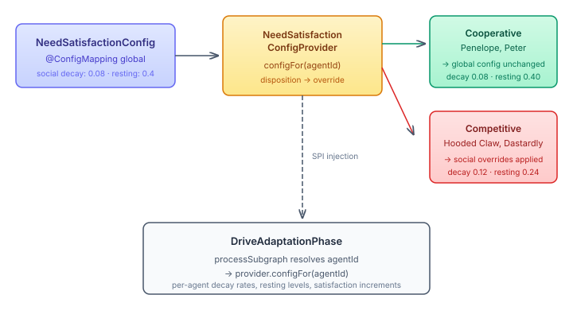

# When Villains Decay Differently

Every character in Wacky Manor has a needs pyramid — five tiers from safety to understanding, each with a satisfaction level that decays toward a resting point between consolidation passes. Until now, that decay was identical for every character. Penelope Pitstop's social need decayed at the same rate as the Hooded Claw's. Affiliation saturated to 1.0 for anyone whose drives touched the social tier, regardless of whether they were a cooperative hero or a competitive villain.

This is the kind of thing that works fine in early development and becomes visibly wrong at scale. When you watch a 300-event scenario run, the villains behave too socially. Their drives adapt as if belonging matters to them as much as it does to Penelope. It doesn't — and the need satisfaction dynamics should reflect that.

## The SPI Pattern

The fix follows the same pattern we used for `NeedTierMappingProvider` — a service provider interface in neocortex that the manor-specific code implements:

```java
public interface NeedSatisfactionConfigProvider {
    NeedSatisfactionConfig configFor(String agentId);

    static NeedSatisfactionConfigProvider global(NeedSatisfactionConfig config) {
        return agentId -> config;
    }
}
```

The `global()` factory preserves backward compatibility — callers that don't need per-agent overrides pass the existing `@ConfigMapping` bean and get identical behaviour to before. The interesting work happens in the manor implementation.

## Disposition as the Override Signal

Each character already carries a `Disposition` record in their social config — five axes including `socialOrient`, which is either `cooperative` or `competitive`. The `ManorNeedSatisfactionConfigProvider` reads these dispositions and wraps the global config with per-tier overrides for competitive characters:

- Social decay rate × 1.5 (belonging dissipates faster when you don't value it)
- Social resting level × 0.6 (the equilibrium point is lower — a villain doesn't gravitate toward affiliation)

Non-social tiers are untouched. Cooperative characters get the global config passed through unchanged.



The override is a wrapper, not a replacement. `DispositionOverrideConfig` delegates every method to the global config and only intercepts `decayRate(SOCIAL)` and `restingLevel(SOCIAL)`. The `DriveAdaptationPhase` in neocortex doesn't know or care that the config is disposition-aware — it calls `configFor(agentId)` once per subgraph after resolving the agent identity, and threads the result through `applyDecay`, `accumulateTierSatisfaction`, and `applyDecayAndSave`.

## Why This Matters Beyond the Fix

The broader principle here is that cognitive parameters should be personality-derived, not globally tuned. A single decay rate for all characters is a statement that all characters have the same relationship with belonging. That's false in any interesting fiction, and it's false in the real social cognition literature — attachment theory alone predicts wildly different social need dynamics across individuals.

The SPI pattern lets us push this further without touching neocortex internals. The next obvious step is deriving override multipliers from the cognitive index rather than hardcoding them — letting the derivation engine compute social decay rates from personality facets the same way it already computes trust formation rates. The 1.5x and 0.6x values are starting points. The architecture supports replacing them with empirically validated, per-character values without changing the interface.

## The Cleanup Alongside

The same session addressed four long-standing code review findings: a `BufferedWriter` leak in `CognitiveSnapshotRecorder` (now `AutoCloseable` with a `finally` block), incomplete JSON escaping in `ManorResource` where manual `replace()` calls missed backslash, tab, CR, and Unicode control characters (replaced with Jackson's `ObjectMapper`), a `SessionPipeline` that was never shut down in scripted mode (wrapped in `try-finally`), and a hardcoded five-minute interval in `ManorConsolidationBeans` that used to be a config property before someone extracted it wrong.

The session also externalized the `clearAtTokens` parameter that controls when the session pipeline clears its context. Three call sites hardcoded `80_000`. Now it's a config property with format parsing — `80k`, `80000`, or `40%` of the model's context window all resolve to the same integer at startup.

Small things. But resource leaks in a 300-event scenario compound, and hardcoded values in configurable systems are how you end up debugging the wrong layer.

## Fifty-Six Orphaned Goals

A separate data integrity problem surfaced from the cognitive workbench: 56 goals in the GOAL subgraph with zero edges between them. The 3D ego view couldn't reach any of them from the subject person node — BFS from the ego found 2 goals out of 56.

The corpus extraction pipeline produces `goal_coherence` data per entity — conflicts and synergies between goals, each with a natural-language description of the relationship. Frida Kahlo has four conflicts (e.g., pursuing motherhood vs. transforming pain into art — physical constraints from the 1925 accident make both impossible simultaneously) and four synergies (artistic autonomy enabling self-expression, which enables international recognition).

The gap was a three-layer pipeline hole. The Python enrichment script produced the data. The Python converter (`convert_corpus.py`) silently dropped it — `_map_entity_enrichment()` handled drive baselines, CAPS patterns, behavioural attractors, and relationship stages, but had no case for `goal_coherence`. The Java record (`EntityEnrichmentEntry`) had no field for it. The Java handler had no processing for it. The `field-registry.yaml` even marked it as `status: gap` across all three stages.

The fix mirrors the gap: add the passthrough in the Python converter, add `GoalCoherence` and `GoalRelation` records to the Java entry, and add `storeGoalCoherence()` to the handler. Conflicts become `blocks` edges. Synergies become `enables` edges. A new `aspires-to` edge type in `GoalVocabulary` connects the person node to every goal in the subgraph. The 56 orphaned goals are now reachable — and the conflict/synergy structure gives the cognitive workbench something meaningful to visualize beyond isolated nodes floating in space.
