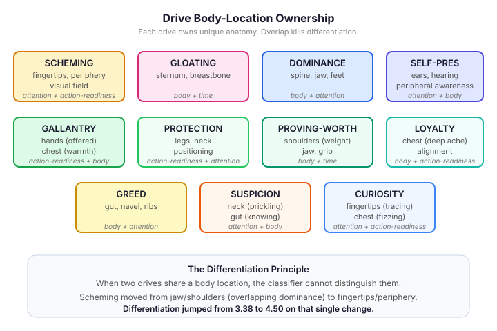
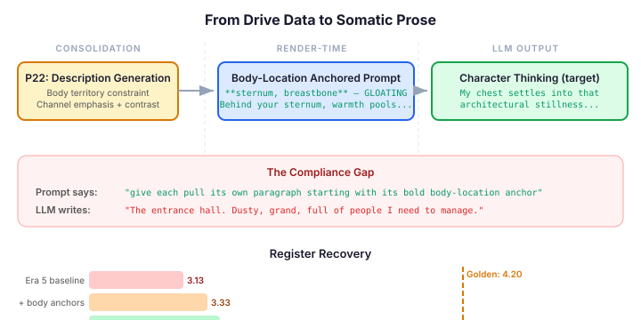

# Give Your Agent a Body, Not Emotions

Most cognitive agent architectures model emotion as a label. The agent
"feels suspicious" or "is gloating" — a string attached to a number,
passed into a prompt. The LLM reads the label and generates text that
references the emotion by name: "I feel suspicious of Reginald." It's
accurate. It's also dead.

The label tells the agent WHAT it feels. It doesn't tell the agent WHERE
it feels it, or what the feeling is made of. A character who "feels
suspicious" and a character whose neck prickles when Reginald moves are
having fundamentally different experiences. The first is reporting a
state. The second is discovering one.

This distinction isn't philosophical. It's measurable. And it changes how
you build cognitive pipelines.

## The Barrett Framework: Four Channels, Not One Label

Lisa Feldman Barrett's constructionist model of emotion (2017) treats
emotions not as fixed categories but as constructed experiences built
from four simultaneous channels:

- **Body** — muscles, gut, chest, jaw, hands, breathing. Where is the
  sensation, and what is it made of? Tension, warmth, numbness, weight.
- **Attention** — what has seized focus? What has dropped out of
  awareness? What are you scanning for without deciding to?
- **Time** — has this moment compressed, stretched, frozen?
- **Action readiness** — what is the body preparing to do before the
  mind has decided? Lean forward, pull back, go still?

When an agent has all four channels available per drive, its expression
stops being emotional reporting and starts being somatic discovery. The
character doesn't announce "I feel dominant" — its spine straightens
before it decides to stand up, its jaw levels, its weight distributes
evenly across both feet. The body knows before the mind names it.

This is the foundation of CaseHub's cognitive pipeline. The
`DriveDescriptionGenerationPhase` takes each character's drives,
personality facets, attachment style, and formation memories, and
generates Barrett 4-channel descriptions via an LLM call during
consolidation. The descriptions are cached and reused for every event in
the scenario. The agent never sees the word "gloating" in its
prompt — it sees the body's response.

## The Body-Location Problem

Here's what I found when I measured it. Two characters can both have
"gloating" as a drive, with different personalities and different
histories, and the LLM-generated descriptions still overlap. Both
characters feel "warmth in the chest." Both have "a spreading heat." The
vocabulary is body-aware but not body-SPECIFIC.

When a classifier tries to score how distinctly each drive is expressed
(differentiation, D), the overlap kills the score. Scheming and gloating
both mention "jaw" and "shoulders." Protection and gallantry both
reference "hands" and "chest." The classifier reads the body language and
can't tell which drive it belongs to.

The fix is mechanical and it works immediately: each drive owns a unique
anatomical territory, and the generation prompt enforces it.



Scheming lives in fingertips, peripheral vision, the visual field — not
chest or jaw. Gloating lives in the sternum — not shoulders or hands.
Dominance lives in spine, jaw, feet — structural posture, not surface
sensation. Self-preservation lives in the ears, in hearing, in
peripheral awareness.

The constraint is simple: when generating a description for gloating,
the LLM is told "body territory: sternum, breastbone" and given a list
of other drives' territories for explicit contrast. The system prompt
says: "Include explicit contrast: 'Not the [other-location]. This is
[body-territory].'"

The result reads like this:

> Behind your sternum, warmth pools — not the fingertip clarity of
> tracking a plan, not the spine's territorial straightening. This is
> slower, heavier: a private heat that settles when the pieces click
> into place and no one else sees it yet. Your jaw loosens. Your
> shoulders drop. Time stretches around the knowing.

Three negations. Three other drives explicitly distinguished. The
classifier scores this D=5 — maximum differentiation. The same drive
without contrast scores D=3. The technique is the single most powerful
differentiator I've found in this work.

## The Contrast Formula

The golden prose corpus — 51 hand-crafted events scored by the
classifier — established six rendering techniques that consistently
produce high scores. The contrast formula is the most impactful.

The pattern: "Not [drive-A's location]. Not [drive-B's location].
Something utterly different: [this drive's expression]."

Why it works: the classifier is an LLM. When it reads body-location
vocabulary, it needs to decide which drive the vocabulary belongs to. If
"jaw" appears in both dominance and scheming descriptions, the
classifier splits the confidence. But if the description explicitly says
"not the jaw's territorial straightening — this is fingertips," the
classifier has no ambiguity.

The numbers are consistent across the corpus. Three negations produce
D=5. Two negations produce D=4. Zero negations produce D=3. It's not
subtle.

## What the Pipeline Actually Produces

The rendering pipeline takes these descriptions and structures them into
the character's prompt. Each drive gets a paragraph, prefixed with a
bold body-location anchor:

```
**fingertips, periphery, visual field** — SCHEMING (0.9) → Clara
Your fingertips trace possibilities before your eyes confirm them...

**sternum, breastbone** — GLOATING (0.7) → Clara
Behind your sternum, warmth pools — not the fingertip clarity...
```

The Barrett instruction section tells the LLM how to use this material:
"give each active pull its own paragraph starting with its bold
body-location anchor. Use discovery verbs — arrives, settles, pools —
not analytical verbs like calculates, assesses, determines."



## The Compliance Gap

This is where the story gets honest.

The descriptions are golden-quality. I verified this by calling the
description-generation LLM directly — the output has body-location
anchoring, contrast formulas, discovery verbs, targeted relationship
variants. Every pattern the golden prose uses.

The rendering layer is correct. The prompt includes bold body-location
anchors, paragraph structure, the Barrett instruction with structural
guidance. The test suite confirms all of it.

And the LLM ignores it.

The golden prose target — hand-crafted, scored 4.20 register:

> My chest settles into that architectural stillness — the same quality
> of calm I first felt at eighteen... My spine finds its vertical before
> I've decided to stand straight...

What the pipeline-prompted LLM actually writes:

> The entrance hall. Dusty, grand, full of people I need to manage.
> Clara is right here — trusting, oblivious Clara.

The first is body-first. Every sentence starts in anatomy and discovers
meaning from sensation. The second is thought-first. It's planning,
analysing, narrating — despite having body-location-anchored
descriptions right there in its prompt.

Register has improved from 3.13 to 3.47 across two iterations — the
structural changes ARE helping. But the golden prose scores 4.20. The
gap is LLM compliance: the model reads the instruction to write
somatically, and then writes analytically because that's its default
narrative mode.

## Why This Matters Beyond Wacky Manor

This work is building a cognitive pipeline for agents with genuine inner
lives — characters whose emotions aren't labels but embodied
experiences. The application is Wacky Manor (a multi-agent scenario with
Wacky Races characters), but the architecture is general.

The body-location technique applies anywhere you need an AI character to
express distinct emotional states without them blurring together. Games,
virtual companions, interactive fiction, therapeutic agents, social
robots. Any context where "the character feels X" needs to translate into
behaviour that a human can recognise and differentiate.

The contrast formula applies anywhere an LLM needs to distinguish
between similar concepts. It's not specific to emotions — it's a prompt
engineering technique for any domain where categories overlap and the
LLM needs to express one while excluding others.

The compliance gap is the frontier. The body-location descriptions work
as reference material — the generation LLM produces them correctly. The
rendering pipeline structures them correctly. The gap is in the runtime
LLM's willingness to USE structured body-location material as the
backbone of its output rather than defaulting to analytical narration.

Closing this gap is the next iteration. One golden prose event at a
time, comparing the pipeline's prompt against what the LLM actually
produces, tweaking the instruction until the somatic structure can't be
ignored.

The body is ready. Now it needs a voice that starts from the body
instead of the head.
