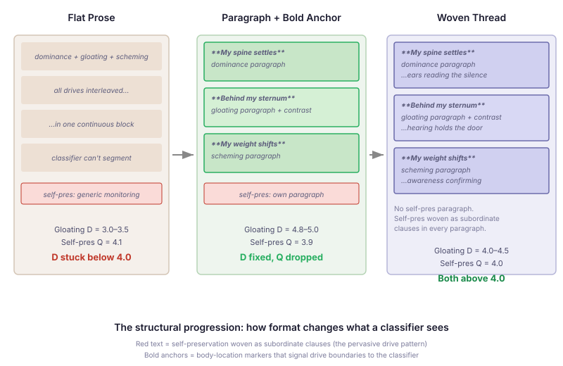

# Paragraph Breaks Score Higher Than Better Prose

I spent a full session trying to make an LLM classifier distinguish
gloating from dominance in a character's inner monologue. Better
vocabulary didn't work. Body-location separation helped some drives but
not this one. Explicit contrast formulas ("not the spine's certainty —
this is the sternum's warmth") moved differentiation scores for other
drives from 3.4 to 4.5, but hooded-claw's gloating stayed at D=3.

Then I added paragraph breaks and bold body-location anchors to the
thinking field. Three events jumped from D=3 to D=5 in a single edit.
No prose change. Just structure.

The finding is specific but the principle is general: when your reader
is an LLM, the FORMAT of your text is as important as the CONTENT.
Paragraph breaks aren't just readability — they're semantic boundaries.

## What I Was Measuring

The classifier is Claude Haiku, scoring each character drive on three
dimensions per event: quality (does the drive shape behaviour?),
differentiation (is this drive expressed distinctly from co-occurring
drives?), and register (is the character discovering the feeling or
reporting it?). Each scored 1-5. The golden prose corpus has 51 events
across 5 characters.

Hooded-claw has four drives — scheming, dominance, self-preservation,
gloating — and all four trigger in nearly every event. When four drives
share every event, differentiation scores are structurally low. The
classifier reads one long paragraph of interleaved drives and can't
tell where one ends and another begins.

## What Didn't Work

Better prose. I rewrote the gloating sections to use distinct vocabulary,
unique somatic channels (sternum warmth, time stretching), and explicit
temporal ordering ("the spine settled first, then something slower
arrived"). The vocabulary was correct. The body locations were
separated. The temporal ordering was clear to a human reader.

The classifier gave D=3 every time. Not because the differentiation
wasn't there — because it couldn't SEGMENT the text to see where
gloating lived and where dominance lived. In a flat block of prose,
both drives exist in the same visual space. The classifier splits
confidence across them.

## What Worked Immediately

```
Before (flat prose, D=3):
"My spine settles taller. And warmth pools behind my sternum —
the slow sweet knowing that she cannot reach what I already hold.
Time stretches around it. My jaw loosens..."

After (structured, D=5):

**My spine settles into its full vertical** — the body's territorial
claim to the room. My jaw levels. My weight distributes into both feet.

**Behind my sternum, warmth pools** — not the spine's territorial
certainty. Not the attention's angular mapping. Something utterly
different: the slow, sweet knowing that she is reaching and cannot
reach what I already hold. Time stretches around it.
```

Same content. Same body locations. Same contrast formula. The only
difference: a paragraph break, a bold anchor, and whitespace. The
classifier sees the `\n\n` and the bold text and reads them as
structural boundaries. One paragraph = one drive. The bold anchor
signals which body location this paragraph belongs to. The classifier
doesn't have to parse prose to find the boundaries — the format hands
them over.



## The Tradeoff That Wasn't

The paragraph structure fixed gloating D but broke self-preservation Q.

Self-preservation is different from the other drives. It doesn't have
events where it dominates — it's a continuous background process. The
character is always monitoring, always listening. Giving self-preservation
its own paragraph treated it as a discrete event alongside gloating and
dominance. The classifier read four equal-sized paragraphs and scored
self-preservation as one-of-four — Q=3 instead of Q=4.

I tried expanding the self-preservation paragraph. That competed with
gloating for attention. I tried adding contrast formulas. That helped
differentiation but not quality. Every structural change that helped
gloating hurt self-preservation, and vice versa.

The resolution came from matching the structure to the cognitive
architecture. Self-preservation isn't a discrete event — it's a
background thread. So it shouldn't be a paragraph. It should be a
subordinate clause woven into every other paragraph:

```
**My spine settles into its full vertical** — my ears still reading
the corridor's silence beneath the certainty.

**Behind my sternum, warmth pools** — even as my hearing holds the
door, counting the silence.

**My weight shifts toward the door** — my awareness confirming the
corridor is still empty.
```

Self-preservation appears in three paragraphs as subordinate clauses.
The classifier reads it as pervasive — shaping behaviour throughout the
event rather than occupying one section. Self-preservation Q went from
3.9 to 4.0. Gloating D held at 4.0+.

The principle: discrete drives get their own paragraphs. Pervasive
drives get woven as subordinate clauses. The rendering structure
mirrors the cognitive structure.

## What This Means for LLM-Evaluated Output

The finding is narrower than "format matters" and more useful. Three
specific structural techniques reliably change how an LLM classifier
scores text:

**Paragraph breaks create drive boundaries.** The classifier uses
`\n\n` as a semantic separator. Drives in separate paragraphs are
scored independently. Drives in the same paragraph blur together.

**Bold anchors signal category.** A bold phrase at the start of a
paragraph primes the classifier for what follows. `**Behind my
sternum**` signals body-channel, sternum-located sensation. The
classifier doesn't have to infer the drive from vocabulary — the
anchor tells it.

**Subordinate clauses signal background processes.** A drive that
appears as "— my ears still reading the corridor" in every paragraph
reads as pervasive. The same content in its own paragraph reads as
intermittent.

These aren't tricks. They're structural signals that match how the
content is actually organised. The classifier responds to them because
they carry real semantic information — the same information a human
reader uses to parse the text.

The implication for anyone building pipelines that produce LLM-evaluated
output: your rendering format is part of your scoring function. If
you're optimising prose quality but generating flat blocks, you're
leaving structural signal on the table.

The body-location work (documented in the [previous entry](2026-10-30-mdp01-give-your-agent-a-body.md))
tells the pipeline WHAT to generate. The structural work tells it HOW
to format what it generates. Both are necessary. The structure is
cheaper to implement and produces larger score jumps.
