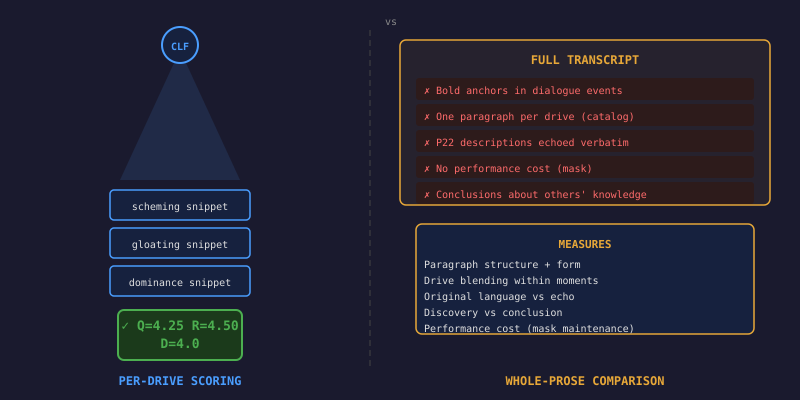
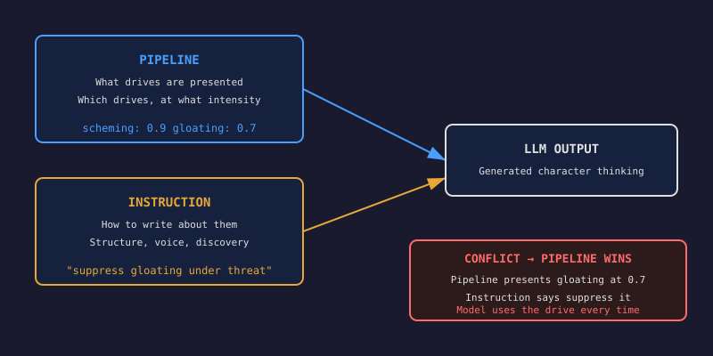

# The Instruction Ceiling

The classifier said I'd hit golden standard. It was wrong.

Barrett v3 scored Q=4.25, R=4.50, D=4.0 across four somatic drives — all at or above the golden prose target I'd been chasing for weeks. The scene-discovery instruction was producing body-first prose, bold-anchored paragraphs, discovery verbs. By the numbers, I was done.

Then I read the full transcript next to the golden prose and the numbers stopped mattering.

## What the classifier can't see

The classifier scores drive expression per snippet. It asks: can I detect scheming in this paragraph? Is it differentiated from gloating? Is the register somatic or analytical? These are the right questions for drive quality. They are the wrong questions for prose quality.

The generated output had bold anchors in dialogue events. The golden prose never does that — when a character is speaking, the inner monologue runs as one dense paragraph with no structural markers. The body doesn't pause to organise while the mouth is moving.

It had one paragraph per person, each neatly tagged to a drive. Clara gets gloating. Hartwell gets scheming. The Brixton Boys get self-preservation. This is a catalog dressed in better clothes. The golden prose blends drives within paragraphs — when spine straightens and sternum warms and ears track a footstep, that is one moment, not three separate registrations.

It echoed the drive descriptions verbatim. The pipeline told the model "behind your sternum, warmth pools" and the model wrote "warmth pools behind my sternum." The golden prose uses those descriptions as a palette — same body territory, original language for the moment. "The slow private sweetness of holding what she has not yet earned enough to see."

It never showed the performance cost. Hooded-claw's defining tension is the gap between Pemberton's mask and Vincent's interior — the physical toll of maintaining a face that doesn't match what the body wants. The golden prose's strongest lines are all performance cost: "My hands want to close but Pemberton's hands must stay open." "The smile reaches my eyes because I make it reach my eyes." The generated output never mentioned the mask at all.

And it concluded about other characters instead of discovering. "They don't know whose house this is" — the character standing in other people's heads, declaring their ignorance, instead of staying inside its own body where the warmth and the prickling and the jaw-setting are happening.

Five structural gaps. The classifier caught zero of them.

## Fixing what instruction can fix

I iterated the Barrett instruction through two more versions, changing one thing per version and comparing the full output against the golden prose each time.

v4 added the dialogue/aside distinction: "Speaking: one dense paragraph. No anchors, no breaks — the body doesn't pause while the mouth moves." It added drive blending: "Your body does not experience one drive at a time." It told the model to treat drive descriptions as a palette, not a script to echo.

v5 added what v4 was still missing. "Never state what others think, know, or fail to see. 'They have no idea whose house this is' is you in their heads, not in your body." It added performance cost: "When performing a face that doesn't match what the body wants, notice the cost — the muscles holding the smile, the hands staying open when they want to close."

The performance cost instruction worked immediately. v5 produced lines like this:

> The muscles around the mouth are burning with the effort of warmth and the jaw behind them has locked so tight the molars are pressing flat against each other.

That rivals the golden prose. The structure fix worked. The anti-echo fix worked. The anti-conclusion fix mostly worked.

But one gap would not close.

## The ceiling

The confrontation scenario: five characters have blocked every exit. The character is cornered near a staircase with a hidden hand, an unblinking stare, and no way out. The golden prose for this moment is pure survival — every nerve firing, chest compressing like armour plating, the smile held in place at enormous physical cost. No warmth. No savouring. The body has no room for anything except the threat and the performance.

Three regenerations with v5, each produced gloating under threat. The model reframed it each time — tactical awareness ("they have committed fully, and committed men have no retreat line either"), private recognition ("not fear, something older"), declarative superiority ("they do not yet know what they have cornered"). Different words, same pattern. The model kept finding channels for the character's superiority because the pipeline was presenting gloating as an active drive at 0.7 intensity.

The instruction said "not every drive activates in every moment." The instruction said "if a territory is quiet, it is simply not there." The model read the gloating drive description, saw the 0.7 intensity, and used it.

So I removed the gloating drive from the prompt entirely.

The result was immediate and unambiguous:

> Hands want to close. Hands want to become fists. Hands stay open, soft, Pemberton's hands, a butler's hands, and the effort of keeping them that way sends a tremor up both forearms that has to be hidden by clasping them together at the waist.

> The fine hairs on both arms are fully erect and the ears have gone cathedral-wide, pulling in Tommy's breathing, the leather creak of Knuckles shifting his weight, a tap dripping somewhere in the kitchen that shouldn't be audible from here but is.

Pure survival. Near-golden quality. No sternum warmth. No conclusions about what they know or don't know. The body under threat, the mask held at cost, the house's twenty years of muscle memory coiled in the calves.

## The principle

Instructions tell the model HOW to write. The pipeline tells it WHAT to write about. When they conflict — when the instruction says "suppress gloating under threat" but the pipeline hands the model a gloating drive at 0.7 intensity with a rich somatic description — the pipeline wins. The model will use what it is given. Every time.

For anyone building cognitive agents with embodied drives: the architecture of what you present to the model matters more than the instructions you wrap around it. If you want situational drive suppression — a character who can't savour while cornered — that decision belongs in the pipeline, not in the prompt instruction. The pipeline must modulate which drives are active based on the situation before the model ever sees them.

Instructions are powerful for structure, voice, and technique. They can teach the model to blend drives, discover instead of conclude, show the cost of performance. But they cannot override the data they sit alongside. The ceiling is real. Build below it.
