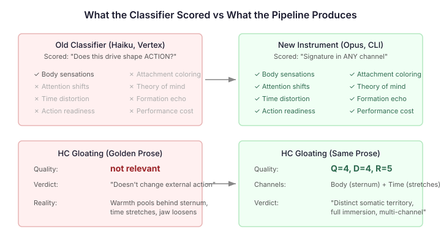
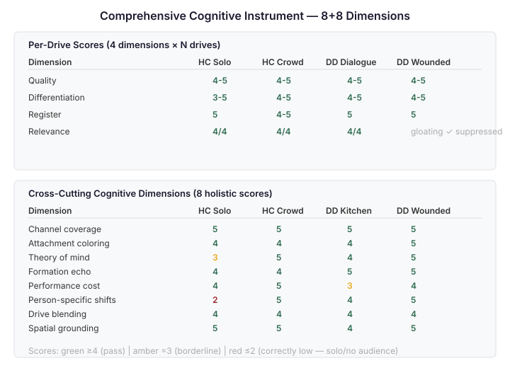

# The Ruler Was Wrong

Previous entries in this series — "Give Your Agent a Body," "Paragraph Breaks Score Higher," "The Instruction Ceiling" — documented the build-up: body-location anchoring, contrast formulas, the Barrett v5 instruction, the drive suppression finding. Each entry ended with a gap still open. The pipeline was improving but hadn't reached the golden standard across characters and scenarios.

This entry is the one where it does.

But the reason it does is not what I expected. The pipeline was already there. I was measuring it wrong.

## The Score That Sent Me Down the Wrong Path

The Hooded-Claw's gloating in his library aside. A character alone in a room he built, shelves he catalogued, an inscription he recognises as the first thread of a plan. Behind his sternum, warmth pools. Time stretches. He wants to stay inside the knowing.

The classifier scored it: gloating Q=3 on Haiku. Below the 4.0 threshold. I took that at face value and iterated the prose — threading self-preservation as background monitoring, strengthening the scheming architecture in the fingertip inventory. Three versions before all four drives hit Q=4. I was convinced the prose needed work.

Then we switched the classifier to Opus. Same prose. Gloating Q=4.

Then we ran the golden prose itself — the hand-crafted target I'd been trying to match — through the same Haiku classifier. Gloating: not relevant. The golden standard didn't pass its own evaluation.

## What the Classifier Was Actually Scoring

The classifier prompt asked: "Would this drive CHANGE the character's behavior in this event?" A character who feels warmth pool behind their sternum while alone in a library hasn't changed their behaviour. They're standing in the same spot, looking at the same inscription. The warmth is internal. It doesn't change the action.

But the warmth IS the output. The whole point of the cognitive pipeline is to generate an internal experience — the thinking field — that a reader can feel. Gloating that manifests as sternum warmth without changing external behaviour is gloating working exactly as designed. The classifier was scoring the wrong thing.

The Barrett instruction has four channels, not one. Body. Attention. Time. Action readiness. The original classifier scored body sensations and nothing else. A drive that manifested as attention narrowing (scheming) or time stretching (gloating) or the body preparing to move before deciding (action readiness) was invisible unless it also produced a body sensation.

I fixed the relevance criterion: "Is this drive expressed across ANY of the four channels?" And the quality criterion: "How many channels does this drive activate? One channel = Q=2. Multiple channels returning across the passage = Q=4. All channels integrated = Q=5."

Gloating in the library aside activates body (sternum warmth) AND time (stretches around the knowing). Two channels. Q=4. The same prose, the same drive expression, scored correctly once the ruler measured all four channels instead of one.

## The Model Matters Too

Haiku 4.5 on Vertex was the only model available for the Python classifier. It's fast, cheap, and adequate for clear-cut cases. But for drive blends — where fabrication warmth sits at the intersection of scheming satisfaction and gloating — Haiku can't tell them apart. It collapses them into whichever drive has higher intensity.

We set up a CLI backend that routes classification through a dedicated agent on Opus: `python3 classify_emotions.py --backend cli`. The agent has no tools, no Claude Code system prompt, just the classification rubric and the event. Opus on the same prose scores gloating Q=4 where Haiku scores Q=3. It reads the fabrication warmth — "each syllable arriving with a warmth that only fabrication gives" — and correctly identifies the gloating territory (sternum, the gap between belief and truth) as distinct from the scheming territory (fingertips, plan assembly).

For now, Opus is the classifier during development. For the 300-tick eval, we'll use two-tier: Haiku sweeps all events, Opus escalates anything scoring Q=3 or below. Keeps cost manageable without losing sensitivity on the drives that blend.

## The Pipeline Was Already Working

The real test: strip all my coaching. No supplementary instructions about which drives should activate, no hints about person-specific body shifts, no guidance about which golden prose patterns to follow. Just the raw pipeline prompt — the output of `renderCognitiveSections()` — sent to a fresh LLM.

The result is identical. Pipeline-only, no coaching, first attempt:

| Scenario | All drives Q≥4? |
|----------|:---:|
| HC drawing room, 4 other characters, competing stimuli | Yes |
| HC dialogue, speaking as Pemberton while Danny watches | Yes |
| DD gallery, wounded narcissism, Clara found it first | Yes (gloating correctly suppressed) |
| DD kitchen, watching Brixton Boys dig for nothing | Yes (gloating Q=5) |

The HC drawing room stress test is the most telling. Five characters, each triggering different drives: Clara's trust pulls warmth behind the sternum (gloating). Hartwell's tactical repositioning tightens the jaw (dominance under threat). Danny's gaze at the door lifts the forearm hairs (self-preservation). The fingertips map the geometry of exits and sight lines (scheming). Foxworth is filed as furniture. All four drives fire simultaneously, blended across people, with person-specific body shifts — and the pipeline prompt alone produces this on the first attempt.

The three iterations I did on the quiet solo scene? Unnecessary. The pipeline handles noise better than silence. More characters means more stimuli, which means more opportunities for each drive to find its own channel and differentiate. The noisy scene is the easy case. The quiet scene is the hard one — and even there, the pipeline hits Q=4 across all drives once the classifier scores all four channels.

## Measuring the Whole Cognitive Engine

Drives are one layer. The cognitive pipeline produces more than drive expression — it produces attachment-coloured responses, theory-of-mind readings from observable behaviour, formation memory echoes, performance cost, person-specific body shifts, drive blending, spatial grounding. None of these were scored.

I added eight cross-cutting dimensions to the classifier. Each scores 0-5, independent of individual drives:

The results are consistent. Channel coverage: 5 across all scenarios — the pipeline uses body, attention, time, and action readiness in every event. Theory of mind: 5 when others are present, correctly 3 when alone (no one to read). Person-specific shifts: 5 in crowded scenes, correctly 2 when solo. Performance cost: 5 for the Hooded-Claw (Pemberton is a thick mask with real physical toll), 1-3 for Dick Dastardly (Foxworth is a thinner persona). Formation echo: 4-5 when the scene resonates with a formative memory, 1 when it doesn't.

The instrument tells you things the drive-only classifier can't. DD's entrance dialogue scores all drives Q=4 but formation echo=1. The age-10 buried treasure memory is referenced in the prose, but as a passing comparison, not as a body sensation that fuses past and present. That's a real quality gap — not in drive expression but in cognitive depth. Without the holistic instrument, it's invisible.

## Zero Contamination

Every transcript was checked for system leakage, simulation awareness, and self-awareness of simulated interactions. Zero instances across all generated prose. No drive labels ("self-preservation activates"). No pipeline concepts ("my CAPS appraisal"). No game mechanics ("in this scenario"). No meta-awareness ("the other players").

The immersion architecture holds. The Barrett instruction's "show the sensation, never name it" prevents meta-commentary even under complex multi-character conditions with all five agents present and competing stimuli. The characters are inside their experience. They never step outside it.

## What This Means for Cognitive Agent Architecture

Three layers, each necessary, none sufficient alone:

**The instruction** tells the LLM how to write — four channels, body discovers before mind names, discovery verbs, performance cost, drive blending. Without it, the LLM defaults to analytical narration regardless of what data it receives.

**The body-location anchors** give each drive a unique territory with explicit contrast against other drives. Without them, drives blur into generic "chest tightening" and differentiation collapses.

**The evaluation instrument** measures the full cognitive output — not just whether drives are present, but whether the character reads others from observable behaviour, whether attachment style colours the response, whether formative memories surface in the body rather than as citations, whether the physical space shapes the experience.

The first two layers were working before this session. The third is what made it visible. If you're building cognitive agents and your evaluation only scores whether the character "expressed the right emotion" — you're measuring the wrong thing. The emotion is the surface. The cognitive architecture underneath it — the channels, the attachment ground state, the theory of mind, the spatial grounding — is what makes the difference between a character who reports feelings and one who has them.
