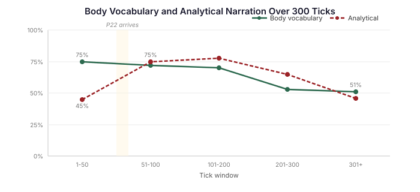

# The Body Forgets

The micro-tests were perfect. Eight scenarios, two characters, three forms, four conditions. Every drive scored Q≥4. Every cognitive dimension — channel coverage, theory of mind, attachment coloring, formation echo — scored 4-5. The pipeline prompt alone, with no coaching, produced golden-quality embodied prose on every first attempt. I had the numbers. I had the comprehensive instrument to prove them. I had the blog post written.

Then I ran the 300-tick eval.

## What the Numbers Actually Said

336 events. Five characters moving through six rooms for the equivalent of a full evening. The Barrett instruction in place. The P22 drive descriptions generated at consolidation. Everything wired up.

53% of the thinking field was analytical narration. "I need to find Clara." "My plan is to redirect Hartwell." "I should check the library." The characters weren't feeling their way through the house — they were planning their way through it. Narrating instead of discovering.

44% of the thinking had zero body vocabulary. No chest, no jaw, no spine, no breathing, no hands. The Barrett instruction says "body discovers before mind names." But in 44% of events, the body wasn't mentioned at all.

The instruction worked. The instruction also faded.

## Echo Loss

The Barrett instruction sits at the top of the system prompt. It says: four channels. Body, attention, time, action readiness. Discovery verbs. Show the sensation, never name it. Blend drives. The drive descriptions below are a palette.

At tick 10, 75% of thinking includes body vocabulary. The instruction is fresh. The model pays attention to it. Spines straighten. Jaws tighten. Fingertips map the geometry of exits.

At tick 100, 70%. Still holding.

At tick 200, 53%. The instruction is the same words in the same position. But the model has processed hundreds of turns of dialogue, action, and scene description. The instruction's voice gets quieter relative to the accumulated weight of everything that came after it. The model drifts back to what it does by default: analytical narration.

By tick 300, body vocabulary has dropped to 51%. Nearly half the instruction's effectiveness gone — not because the instruction changed, but because the context grew.

This is a known property of transformer attention. Tokens at the start of a long context lose influence relative to tokens near the generation point. Prompt engineering mitigates it but can't eliminate it. The Barrett instruction is fighting physics.

## The P22 Arrival Spike

The second finding was unexpected. Analytical narration starts at 45% in the first 50 ticks (before consolidation generates the P22 drive descriptions). When the descriptions arrive at tick 50, analytical narration jumps to 75%.

The drive descriptions ADD cognitive content to the prompt. Each description is 3-5 sentences of body-location-anchored prose — "Your fingertips trace possibilities before your eyes confirm them." The model reads this material and, for a stretch, shifts toward analysis rather than discovery. It has more body vocabulary available but uses it analytically: "My fingertips are tingling. The self-preservation drive is firing hard." Naming the drive. Reporting the state. Exactly what the Barrett instruction prohibits — using the body vocabulary as labels rather than as lived experience.

This settles by tick 300 (analytical drops back to 46%) but by then body vocabulary has degraded past the point where the recovery matters.

## Why Micro-Tests Can't See This

A micro-test operates on a single event. Fresh prompt, fresh context, no history. The Barrett instruction is right there — loud, unburied. The model complies because there's nothing competing for its attention.

The 300-tick eval proves the instruction works. It also proves the instruction isn't enough. These are different claims, and confusing them cost me a session of false confidence.

The micro-tests are still valuable — they prove the instruction CAN produce embodied prose, which sets the quality ceiling. The question is no longer "can the pipeline produce this quality?" but "can the pipeline SUSTAIN this quality over hundreds of events?"

## The Fix Is Architectural

I spent three sessions tuning the Barrett instruction. Each iteration improved something: dialogue form, drive blending, own words, performance cost, anti-conclusion rules. Each produced measurable gains on single-event tests. And each was irrelevant to the 300-tick degradation curve, because the instruction was never the bottleneck — context accumulation was.

The fix is periodic context reset. Every N ticks (synced with consolidation), clear each character's LLM context. Re-inject the Barrett instruction at the top of a fresh, short prompt. The instruction is loud again. Body vocabulary stays at 75%.

The hard part: the context clear destroys information. The character has been conversing, discovering, scheming for 50 ticks. If you wipe that and start fresh, they've lost everything they learned.

The solution is a three-tier memory architecture:

**Tier 1: Structured brief.** Generated asynchronously during consolidation. A compact summary: who was in each room, what happened, how the character felt. Written in the character's voice so it doesn't contaminate the Barrett instruction with analytical prose. Injected into every fresh context after a clear. This is what the character ALWAYS knows.

**Tier 2: RAG over timestamped chat logs.** Every conversation the character has had is stored with timestamps and entity references. The character can recall specific moments — "what did Clara say in the library?" — by windowing into the relevant section of the log. Not the whole conversation. Just the window they need.

**Tier 3: Sub-agent deep dive.** When the character needs to cross-reference multiple conversations — "have I seen Marsh near the inscription more than once?" — a sub-agent reads the relevant windows, synthesises an answer, and injects it as a thought. Expensive, dispatched on demand, results cached.

The tiers map to different costs and different needs. Tier 1 is cheap and always present. Tier 2 is on-demand and scoped. Tier 3 is expensive and rare. The character doesn't need to remember everything — it needs to know where to look when it needs to remember.

## What This Means for Cognitive Agent Builders

If you're building agents with embodied cognition — any system where the agent's internal experience is more than a label — you will hit echo loss. It doesn't matter how good your instruction is. Transformers attend to what's recent. Your carefully crafted body-discovery instruction will fade under the weight of 200 turns of dialogue.

The fix isn't a better instruction. The fix isn't a longer context window (more room to forget). The fix is context management: periodic resets with structured memory so the instruction stays fresh and the character doesn't lose what it learned.

The body knows how to feel. It just forgets if you let the context grow too long.
