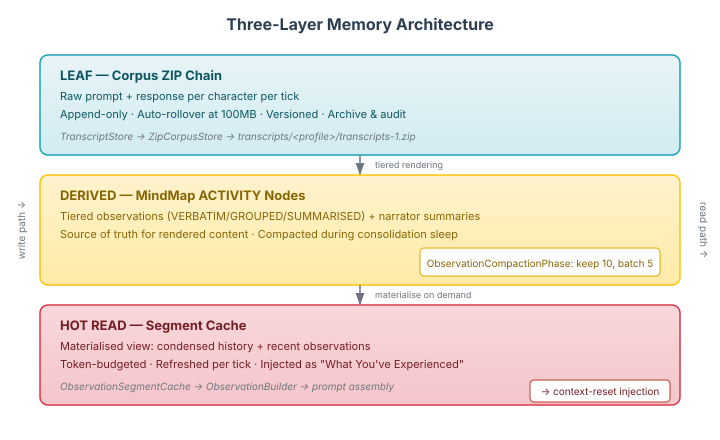
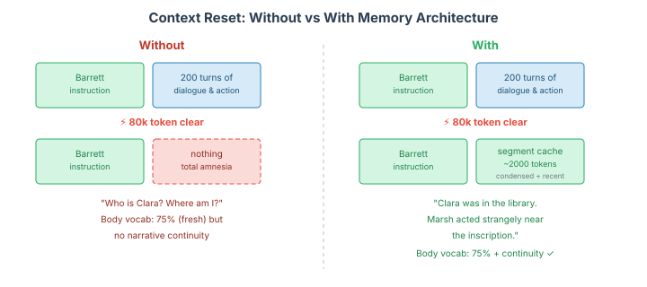

# Three Layers Deep

*Continues from [The Body Forgets](2026-10-31-mdp02-the-body-forgets.md), where a 300-tick eval showed body vocabulary dropping from 75% to 51% as context windows filled up.*

Two days ago I had a diagnosis. The Barrett instruction fades because transformer attention favours recent tokens over distant ones. The proposed fix was periodic context reset with a three-tier memory architecture so characters don't lose what they know when the context clears.

Today we built it.

## The Problem, Restated

Context windows are not memory. They're working memory at best — a scratchpad that fills up and must eventually be cleared. At 80,000 tokens, the session resets. Everything the character said, heard, and discovered evaporates. The Barrett instruction comes back fresh at the top of a clean context, body vocabulary jumps back to 75%, and the character has no idea who Clara is or why Marsh was acting strangely near the inscription.

This is the fundamental tension in any long-running LLM agent: you need the context short enough that instructions stay effective, but long enough that the agent remembers what happened. You can't have both. Unless you build memory outside the context window.

## Three Layers

The architecture we built separates concerns that context windows collapse into one undifferentiated stream.

### The Leaf Layer: Raw Transcripts

Every tick, every character generates a prompt (what they see, know, feel) and receives a response (what they say, think, do). These are the raw materials from which everything else derives.

We persist them as JSON documents into a ZIP-chain corpus store — the same infrastructure neocortex uses for document ingestion. One entry per character per tick. `penelope/tick-0042.json` contains the exact prompt that was sent and the exact response that came back. Append-only, auto-rollover at 100MB, versioned.

This is the audit trail. The leaf data from which all derived layers can be reconstructed. If a higher layer produces wrong results, you go back to the transcripts.

The writes happen on virtual threads — the tick loop doesn't wait for disk I/O. A 300-tick run with 17 characters produces ~5,100 transcript entries. At ~4KB each, that's roughly 20MB before ZIP compression. The corpus store handles this without thinking about it.

### The Derived Layer: Compacted Observations

The observation service already persists tiered renderings as MindMap ACTIVITY nodes. Each drain — when a character processes what they've seen since last they acted — produces a node with the rendered text, the tier (verbatim, grouped, or summarised), the room, and the event count.

The problem: these nodes grow linearly. Four nodes per character per five ticks. At 300 ticks with 17 characters, that's roughly 4,000 nodes. The MindMap is in-memory, so this doesn't crash anything, but it's unbounded growth with no compaction.

We added an `ObservationCompactionPhase` that runs during consolidation — the same sleep cycle where drives adapt and relationships evolve. The algorithm is mechanical, not LLM-based. It keeps the last 10 observation nodes untouched (the recent window), groups older nodes in batches of 5, concatenates their content with room tracking, and erases the originals. The condensed node carries a `Condensed` trait so subsequent passes skip it.

After compaction, a character that's been running for 300 ticks has ~10 recent nodes plus ~16 condensed nodes instead of ~240 originals. Bounded growth. The content is already lossy — the tiered renderer compressed raw events into prose summaries — so condensation adds no additional information loss. It's temporal grouping of already-processed material.

### The Hot Read Layer: Segment Cache

The segment cache is the materialised view that actually gets injected into prompts. It reads the MindMap — condensed nodes for older history, recent nodes for what just happened — and produces a capped text summary per character.

Token budget: 2,000 tokens. That's 1/40th of the 80k clear threshold. Enough to carry continuity without competing with the Barrett instruction for attention.

The cache refreshes per tick, before observation assembly. The text arrives in the prompt as a "What You've Experienced" section — between goals and recent activity. The character reads it and knows: I was in the Library talking to Clara. Marsh has been near the inscription twice. Dick tried to steal the key.

When the session clears at 80k tokens, the Barrett instruction is fresh, body vocabulary returns to 75%, and the character still knows who Clara is. Not because the context remembers — because the memory architecture does.

## Why This Matters Beyond Wacky Manor

If you're building LLM agents that persist beyond a single prompt-response cycle, you have this problem. Maybe not today — maybe your conversations are short enough. But the moment your agent needs to maintain coherent personality, relationships, or knowledge across hundreds of interactions, the context window stops being enough.

The three-layer pattern generalises:

**Leaf layer** — raw, append-only, cheap. Every interaction preserved for re-derivation. You want this even if you never read it, because when the derived layers produce wrong results, the leaf data is your ground truth. Corpus stores, event logs, chat archives — the format doesn't matter. What matters is that it's lossless and immutable.

**Derived layer** — processed, bounded, authoritative. The result of applying domain-specific transformations to leaf data. In our case, tiered observation rendering followed by temporal compaction. In a customer service agent, it might be summarised ticket histories. In a coding assistant, it might be project-state snapshots. The key property: this layer is lossy but bounded. It can't grow forever.

**Hot read layer** — materialised, budgeted, injected. A view over the derived layer, capped to fit within whatever token budget you can afford. This is what the agent actually sees. It's not the memory — it's the memory's projection into the agent's current attention window.

The layers map to different costs and different audiences. The leaf layer is for debugging and auditing. The derived layer is for the memory system. The hot read layer is for the LLM.

## The Three-Way Tension

There's a tension that's easy to miss if you only think about instruction effectiveness. You're actually optimising across three competing concerns at once:

**Instruction adherence** wants short context. The Barrett instruction is loudest when there are 2,000 tokens after it, not 80,000. Every turn of dialogue that accumulates pushes the instruction further from the generation point. Attention drops. Body vocabulary drops. The fix is obvious: clear early, clear often.

**Narrative continuity** wants long context. The character's sense of who Clara is, what Marsh was doing, why the inscription matters — all of that lives in the accumulated conversation history. Clear the context and the character wakes up with amnesia. The fix is obvious and contradictory: never clear.

**Prompt caching** wants a stable prefix. LLM providers cache the beginning of prompts. If your first 50,000 tokens are identical to the previous call, the provider serves them from cache — faster, cheaper. But accumulated conversation history is the opposite of stable: it grows by several thousand tokens every tick. Cache hit rate degrades with every turn. The prompt is different enough each time that the cache can't help you.

The standard approach — let context grow until it's too big, then clear it — loses on all three. Instructions fade as context grows. Continuity is destroyed when context clears. Cache hit rate declines as the variable portion of the prompt expands tick over tick.

The three-layer architecture resolves this because it changes what the prompt is made of. Instead of a growing conversation history, the prompt has a stable system prompt (cached), a slowly-changing segment cache (semi-stable — updates when compaction runs, not every tick), and a variable per-tick observation (the only part that changes each call). The stable prefix stays in the LLM's cache. The variable suffix is small. Instructions stay near the generation point because the total prompt stays short. And continuity survives because it's encoded in the segment cache, not in the conversation history.

Short context. Stable prefix. Memory outside the window. All three, not a trade-off between them.

## What's Next

The architecture is wired but not empirically validated under context-reset conditions. The 30-tick Phase 2 run confirmed observation persistence. The next step is a longer run — 100+ ticks — with context resets occurring naturally at the 80k token threshold. The question: does body vocabulary stay above 70% throughout, even as contexts clear and refill?

The compaction parameters (window of 10, batch of 5) are defaults chosen to be reasonable. Empirical runs will tell us whether they need tuning — whether 10 recent nodes is too many or too few, whether the condensed content is too dense or too sparse for the segment cache to produce useful injection text.

The 80k clear threshold is itself an assumption that needs testing. The three-way tension means the optimal clear point isn't just "when instructions start fading" — it's where instruction adherence, cache hit rate, and injection quality intersect. Clear too late and the Barrett instruction has already faded. Clear too early and you're paying for context resets (and segment cache materialisations) more often than necessary, with a smaller conversation window for the LLM cache to amortise across. The sweet spot is somewhere in between, and the only way to find it is to run the same scenario at different thresholds — 40k, 60k, 80k, 120k — and measure body vocabulary, cache hit rate, and output quality across each. I expect the curve isn't linear. There's probably a knee where instruction effectiveness drops sharply, and the optimal clear point is just before that knee.

I'm also watching for an interaction I haven't seen yet: how the segment cache text interacts with the Barrett instruction. The cache is factual prose — "You were in the Library. Clara mentioned the inscription." If the Barrett instruction says "show, don't tell" and the segment cache tells, there's a potential register conflict. The fix might be generating the cache text in the character's voice rather than in neutral prose. But that's an optimisation for after the baseline numbers come in.

The body knows how to feel. Now it also knows how to remember.
