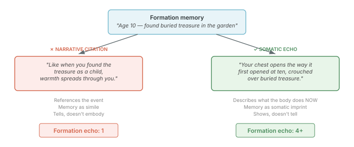
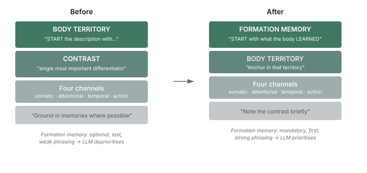

# The Body Remembers What the Prompt Forgot

A character whose gallantry was shaped by watching their father kneel to help a stranger should feel that memory in their chest — not reference it like a footnote. But that's exactly what was happening. The drive description generator produced "like when your father helped the stranger, warmth spreads" — a narrative citation, a simile pointing at the past. Not a body sensation living in the present.

The aside scenes got it right. When a character had room to develop an inner monologue — private thoughts for the audience — formation memories surfaced as full somatic experiences. "Your chest opens the way it first opened at ten." Formation echo scores of 4 and 5 out of 5. But in dialogue-form scenes, where the drive description had to do the heavy lifting in a single dense paragraph, the same character scored formation echo of 1. The memory was mentioned. It wasn't felt.

## The distinction that matters

Lisa Feldman Barrett's constructionist framework — the model behind the drive description generator — describes emotion through four channels: somatic (where in the body, what sensation), attentional (what seized focus), temporal (compressed, frozen, urgent), and action tendency (what the body prepares to do). The generator uses all four. That part works.

What Barrett's framework also implies, though less explicitly, is that emotional experience is *constructed* from prior instances. The body doesn't compute an emotion from first principles each time. It predicts one, based on what it learned from similar past situations. Formation memories aren't context for a drive — they're the training data the body used to calibrate its response.



The difference between "like when you found the treasure" and "your chest opens the way it first opened at ten" isn't literary polish. It's the difference between referencing a memory and embodying one. The first treats the formation experience as a source to cite. The second treats it as a somatic pattern the body re-enacts. One is recall. The other is the body's own prediction loop, running again.

For dialogue-form scenes — where a character gets one paragraph to express a drive, not a full inner monologue — the drive description IS the body's memory. If the description treats formation memories as citations, the character loses its formative texture in exactly the moments where personality should be most compressed and potent.

## Why the prompt structure was the problem

The generator's system prompt had four emphasis tiers, and formation memory was last:



BODY TERRITORY led: "START the description with where this pull lives in the body." CONTRAST followed: "This is the single most important differentiator." Both got bold headers, imperative verbs, and structural emphasis. The four Barrett channels came third with a detailed breakdown. Formation memory came last, as a single line: "Ground in specific formation memories where possible."

"Where possible." Two words that make the entire instruction optional. An LLM reads prompt structure the same way a human reads a requirements document — position, emphasis, and phrasing signal priority. Bold headers with imperative verbs outrank a casual suggestion at the bottom. The LLM was doing exactly what the prompt told it to: start with body territory, emphasise contrast, weave channels, and maybe mention a memory if there's room.

The user prompt compounded this. Formation memories were passed as a bare numbered list:

```
Formation memories that shaped this pull:
1. Your father knelt to help the stranger
```

No instruction on *how* to render them. The LLM had the memory text but no guidance that it should surface as a body sensation rather than a narrative reference. So it defaulted to the natural language pattern for connecting present to past: simile. "Like when you were ten."

## The fix: merge, not just reorder

The obvious move would be to put formation memory at the top and push everything else down. But the problem wasn't just ordering — it was that the prompt treated formation memory and body territory as separate concerns. Four independent sections competing for 3-5 sentences. The LLM satisfied them sequentially and ran out of budget before reaching the last one.

The restructured prompt *merges* formation memory and body territory into one integrated concept:

> FORMATION MEMORY: START with what the body LEARNED from them — not what happened, but the somatic imprint left behind.

> BODY TERRITORY: Anchor the description in that territory — the formation memory echo lives HERE, in this part of the body.

The body territory is no longer a standalone instruction about *where* the pull lives. It's the location *of the formation echo*. "Your chest opens the way it first opened at ten" satisfies both — formation memory as a somatic pattern, anchored in the assigned territory. One sentence, two requirements, no trade-off.

Contrast dropped from "the single most important differentiator" with its own detailed instruction block to a brief note: "note the contrast briefly." The four Barrett channels remain unchanged — they were never the problem.

The user prompt now gives per-memory rendering instructions:

```
Formation memories — describe what the body LEARNED from each, not what happened:
1. Your father knelt to help the stranger
   → What does your body do NOW when this pull arrives, because of this memory?
```

The arrow cue per memory forces the LLM to think about somatic encoding rather than narrative reference. "What does your body do NOW" is Barrett's prediction loop made explicit — the body doesn't recall the memory, it runs the learned pattern.

## Why this matters beyond this project

Anyone building agents with personality persistence — characters that carry formative experiences across interactions — will hit this problem. The issue isn't whether the LLM *can* produce somatic body-memory prose. It clearly can; the aside-form scores prove that. The issue is whether the prompt *asks* for it in a way the LLM treats as primary rather than optional.

Prompt emphasis hierarchy is not about adding more instructions. It's about which instructions the LLM treats as load-bearing and which it treats as garnish. Position in the prompt, strength of phrasing, imperative vs suggestive verbs, bold headers vs inline text — these structural signals determine what the LLM optimises for when it can't satisfy everything in a constrained output window.

A 3-5 sentence budget forces trade-offs. The LLM will hit body territory, hit contrast, hit channels, and run out of room before it reaches "ground in memories where possible." Invert the hierarchy, and the same budget produces descriptions that start from the body's learned response and anchor it in the assigned territory — formation echo and body location in the same sentence, instead of one displacing the other.

The principle generalises: when an LLM-generated description must carry personality in compressed form, the formative content has to be structurally primary in the prompt. Optional grounding produces optional personality.l
