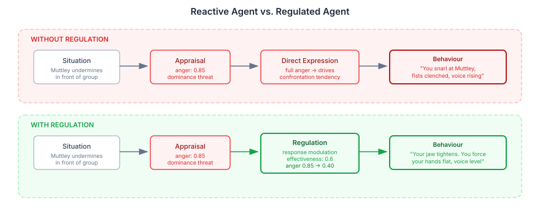

# The Gap Between Feeling and Acting

Every AI agent that models emotion has the same problem. It can feel — appraise a situation, construct an emotional response, assign intensity and valence. What it cannot do is the thing humans do hundreds of times a day without noticing: regulate that feeling before acting on it.

A customer service agent that detects frustration and immediately escalates. A game NPC that appraises anger and instantly attacks. A conversational companion that senses anxiety and reflexively reassures. These agents are emotionally reactive. They confuse having a feeling with being controlled by it.

Real people are not like this. A person who feels anger at a colleague's remark might suppress it because the meeting isn't the place. Another person might reappraise — "they're under pressure, this isn't about me." A third might leave the room. Same anger, same intensity, three different outcomes. The gap between feeling and acting is where personality lives, where social intelligence operates, and where character depth comes from.

This is the single largest gap in most computational emotion architectures. Not more emotions, not better appraisal, not richer personality models. Regulation. The "I wanted to but held back" moment.

## Why This Matters Beyond Character Simulation

Emotion regulation is not a niche concern for character-driven games. It is fundamental to any system that models agents with internal states.

Multi-agent simulations produce unrealistic dynamics when every agent acts on every appraisal. Without regulation, high-intensity situations cascade — anger begets confrontation, confrontation begets more anger, until the simulation converges on extreme states. Real social groups stabilise because individuals regulate, and they regulate differently based on personality, context, and history.

Conversational AI systems need regulation to model appropriate emotional expression. A therapeutic chatbot that mirrors user distress without modulating its response fails at the core task. An agent that suppresses its own frustration signals when the conversation demands patience — that requires a regulation system, not just a sentiment filter.

Believable NPCs in interactive narrative need regulation to produce the dramatic tension that makes stories work. The villain who restrains their contempt. The ally who swallows fear to stay supportive. The rival who channels jealousy into competitive motivation rather than sabotage. These are regulation strategies, and without a principled model, they're hand-authored responses to specific triggers — they don't generalise, they don't adapt, and they break when the narrative goes somewhere the author didn't predict.

The field of affective computing has the models for this. They are well-formalised, empirically validated, and almost entirely ignored by the AI agent community.

## What the Literature Actually Says

I went into this expecting to find a simple model: feel something, dampen it, done. What I found is a surprisingly well-formalised field with computational models that map directly onto agent architectures.

James Gross's 1998 process model is the foundation. He identifies five families of regulation strategy, each intervening at a different point in the emotion generation sequence:

The key insight is the antecedent/response distinction. Situation selection and modification happen before the emotion fully forms — you avoid the party because you know it will make you anxious. Attentional deployment, cognitive change, and response modulation happen after — you're already at the party, feeling the anxiety, and now you need to deal with it.

Gross's 2015 extended model adds a control loop: identify the discrepancy between what you feel and what you want to feel, select a strategy, implement it, monitor whether it's working, loop back if not. This is not a one-shot decision — it's continuous evaluation.

Then things get computational. Bosse, Pontier and Treur (2010) formalised the whole thing as differential equations — homeostatic baselines, persistence factors, adaptation rates. Regulation effectiveness decays with repeated use. An agent who keeps suppressing anger doesn't just feel suppressed anger — the suppression itself degrades over time, and the physiological cost accumulates. This is the kind of dynamic that produces emergent character behaviour — the moment when suppression finally fails.

Petter et al. (2025) added the strategy selection model: high-intensity emotions favour distraction (attentional deployment), low-intensity emotions favour reappraisal (cognitive change). Cognitive load gates the complex strategies — when you're overwhelmed, you can't reframe, you can only look away. This maps directly onto personality-driven regulation.

These are not theoretical sketches. They are quantitative models with published parameters. The gap is not in the science — it's in engineering adoption.

## The Design Choice That Matters Most

We had a fork in the road. The Bosse equations are fully specified — you could implement regulation as pure computation, the way we already do drive intensities. Mechanical. Deterministic. Testable.

But we've been burned before. Mechanical keyword filtering for an earlier system produced output that was technically correct and completely unconvincing. The difference between "anger intensity reduced by 0.35 via response modulation" and a character whose jaw tightens as they force their expression neutral — that difference is the whole point.

So the decision was LLM-first for quality, with the literature providing structured prompt context rather than direct computation. The Bosse model tells the LLM about homeostatic baselines and adaptation. Petter's model tells it about intensity-driven strategy selection. Personality traits tell it about regulation tendencies — high neuroticism means more suppression, high openness means more reappraisal. The LLM integrates all of this and produces both the strategy choice and the embodied narrative.

If empirical testing shows the LLM's strategy selections become formulaic — if it always picks reappraisal for low-intensity anger regardless of personality — that's the signal to mechanise that specific decision. Quality first. Mechanise what's proven.

## Architecture: Regulation as a Decision Layer

The architectural insight came from pushing back on an initial instinct to split environmental strategies (situation selection, modification) from internal strategies (distraction, reappraisal, suppression). They seemed like different integration points — one affects goals, the other affects drive rendering.

But all five strategies share the same trigger. An agent appraises their current emotional state, detects a discrepancy from what they want to feel, and decides to regulate. The decision happens at one point. What differs is where the implementation targets — internal state or the environment.

Regulation is a decision system, not an execution system.

One `EmotionRegulationTickParticipant` in the DERIVED phase selects from all five strategies via an LLM call. Internal strategies (distraction, reappraisal, suppression) flow to `renderInternalState()`, where they modify how drives appear in the agent's prompt — a suppressed gloating drive gets text like "the triumph is there but you hold it back, your jaw tightens with the effort." Environmental strategies (situation selection, modification) flow to the goal pipeline as `DriveGoalProposal` instances, where they become avoidance constraints or situation-change goals.

Same participant. Same LLM call. Same data model. Two downstream consumers. The architecture stays clean because the abstraction is right: decide here, execute there.

## What This Actually Produces

The implementation is complete — nine classes across two modules, 1283 tests passing. Here is the concrete difference it makes:

A character with high neuroticism encounters Muttley undermining them in front of the group. Appraisal fires — anger at 0.85 intensity, well above the regulation threshold. The regulation participant activates.

The LLM receives: the anger emotion, the character's personality profile (high neuroticism, low openness), the intensity-strategy guidance from Petter (high intensity → distraction), and the last three ticks of regulation history (the character has been suppressing frustration for two ticks already — effectiveness is declining).

It selects response modulation — suppression. The character's "dominance" drive gets regulation-coloured text: the somatic channel shows physical cost (tension, clenched hands), the temporal channel shows duration pressure (this can't last), and the action tendency shifts from confrontation to controlled withdrawal.

Compare that with a high-openness character in the same situation. Same anger. But this character reappraises — cognitive change. The anger is reframed as competitive motivation. The "scheming" drive shifts from hostile to strategic. The narrative feels different because the personality is different, and the LLM has the structured context to produce that difference.

This is what mechanical computation cannot give you. The specific somatic texture of holding back. The difference between someone who suppresses because they can't do anything else and someone who reappraises because they see a better frame. These aren't different parameters to the same equation — they're fundamentally different experiences that need different language.

## The Activation Gate: When Not to Regulate

Not every emotion needs regulation. A character who regulates joy at seeing a friend is pathological, not nuanced. The system needs to fire selectively.

The implementation uses a discrepancy threshold from Bosse et al. (2010): regulation activates when the distance between current emotional intensity and homeostatic baseline exceeds a threshold. Baseline is 0.3 (mild positive affect — people at rest are slightly content, not neutral). The activation threshold starts at 0.4 — meaning an emotion needs to reach 0.7 intensity before regulation even considers engaging.

This is a calibration estimate, not a magic number. The A/B evaluation framework will tune it. Too low, and regulation dominates every tick, producing characters who feel nothing because they modulate everything. Too high, and regulation never fires, which is what we had before. The sweet spot is where regulation adds visible depth to high-intensity moments without suppressing the everyday emotional life that makes characters feel alive.

## Regulation History: Continuity Across Ticks

A regulation system without memory is a regulation system without consequences. If a character suppresses anger on tick 5 and the system has no memory of that on tick 6, it cannot model suppression fatigue, strategy switching, or the dramatic moment when regulation fails.

Every regulation result is persisted to the MindMap as a cognitive node — strategy, target emotions, effectiveness, narrative. The next regulation tick loads the last five results and includes them in the LLM prompt. The LLM can see that this character has been suppressing for three consecutive ticks with declining effectiveness, and choose a different strategy — or produce a narrative where the suppression finally breaks.

This is where the emergent behaviour lives. Not in the architecture diagrams or the strategy enums, but in the temporal continuity that lets regulation evolve within a scene.

## What the Community Should Take From This

The affective computing literature has been producing well-formalised, empirically validated models of emotion regulation for over twenty-five years. Gross 1998, Bosse 2010, Petter 2025 — these are not speculative. They are quantitative, they are computational, and they produce measurably different agent behaviour when implemented.

The AI agent community has largely ignored this work. Multi-agent systems model beliefs, desires, intentions, plans. Some model emotions. Almost none model what happens between feeling an emotion and acting on it. The result is agents that are sophisticated reasoners and emotional toddlers — they feel, therefore they do.

Three specific things that any agent system with emotional modelling should consider:

**1. Regulation is not suppression.** Five strategy families, each with different cognitive demands, personality correlations, and downstream effects. Reducing regulation to "dampen the intensity" discards most of the model and most of the behavioural richness.

**2. Strategy selection is personality-dependent.** Neurotic individuals favour suppression. Open individuals favour reappraisal. Conscientious individuals favour situation selection. If your agents have personality models, the regulation literature tells you exactly how those personalities should modulate emotional expression — and the mappings are empirically validated, not intuitive.

**3. Regulation has temporal dynamics.** Effectiveness decays with repeated use. Suppression accumulates physiological cost. Strategy switching happens when the current strategy stops working. These dynamics produce the emergent moments that make agent behaviour surprising and interesting — but only if regulation has memory and continuity.

The implementation demonstrated here is specific to the CaseHub cognitive architecture, but the principles are general. Any system that appraises emotions can add a regulation phase. Any system that renders agent state into prompts or behaviour can modify that rendering based on regulation results. Any system that tracks agent goals can create regulation-motivated goals for environmental strategies.

The science exists. The computational models exist. The engineering is straightforward. The gap is adoption.

## What's Next

The A/B evaluation framework will produce the first empirical data: same scenario, same characters, regulation enabled vs. disabled. The existing drive expression scores must not regress — if regulation crowds out the signal that makes characters feel alive, the prompt needs tuning, not the architecture. A new regulation dimension will measure strategy appropriateness, personality consistency, and selectivity.

Beyond that, social regulation is the natural extension. A character who confides in a friend to manage anxiety. A character who deliberately provokes someone to manage their own boredom. A character who withdraws from interaction to cool down. These are the most dramatically interesting regulation strategies, and they require the intrapersonal system implemented here to exist first.

The design is extensible. The strategy enum accepts new families. The LLM prompt structure accommodates new guidance. The rendering pipeline handles new narrative types. When social regulation arrives, it plugs into the same decision layer.

---

*References: Gross, J.J. (1998). The emerging field of emotion regulation. Review of General Psychology, 2(3), 271-299. Gross, J.J. (2015). Emotion regulation: Current status and future prospects. Psychological Inquiry, 26(1), 1-26. Bosse, T., Pontier, M. & Treur, J. (2010). A computational model based on Gross' emotion regulation theory. Cognitive Systems Research, 11(3), 211-230. Petter, J. et al. (2025). Emotion regulation, fast or slow. Emotion, 25(5), 1273-1292.*
