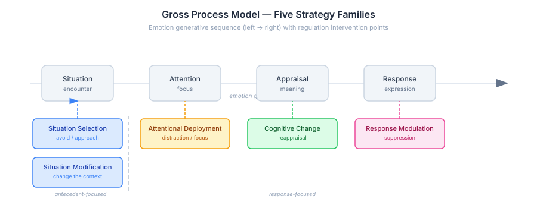
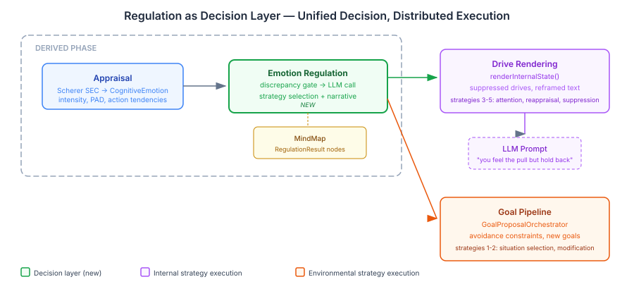

# The Gap Between Feeling and Acting

Our characters feel emotions. They appraise situations through Scherer's component process model, construct discrete emotions with intensity and valence, and those emotions feed into drives that shape behaviour. What they can't do is the thing that makes real people interesting: hold back.

A character who feels anger and immediately acts on it is reactive. A character who feels anger, recognises it, considers the consequences, and deliberately suppresses it — or reframes the situation as a challenge instead of an insult — that character has depth. The gap between feeling and acting is where personality lives.

This is the single largest gap in the cognitive architecture. Not more emotions, not better appraisal, not richer drives. Regulation. The "I wanted to but held back" moment.

## What the Literature Actually Says

I went into this expecting to find a simple model: feel something, dampen it, done. What I found is a surprisingly well-formalised field with computational models that map directly onto our architecture.

James Gross's 1998 process model is the foundation. He identifies five families of regulation strategy, each intervening at a different point in the emotion generation sequence:

The key insight is the antecedent/response distinction. Situation selection and modification happen before the emotion fully forms — you avoid the party because you know it will make you anxious. Attentional deployment, cognitive change, and response modulation happen after — you're already at the party, feeling the anxiety, and now you need to deal with it.

Gross's 2015 extended model adds a control loop: identify the discrepancy between what you feel and what you want to feel, select a strategy, implement it, monitor whether it's working, loop back if not. This is not a one-shot decision — it's continuous evaluation.

Then things get computational. Bosse, Pontier and Treur (2010) formalised the whole thing as differential equations — homeostatic baselines, persistence factors, adaptation rates. Regulation effectiveness decays with repeated use. A character who keeps suppressing anger doesn't just feel suppressed anger — the suppression itself degrades over time, and the physiological cost accumulates.

Petter et al. (2025) added the strategy selection model I'd been looking for: high-intensity emotions favour distraction (attentional deployment), low-intensity emotions favour reappraisal (cognitive change). Cognitive load gates the complex strategies — when you're overwhelmed, you can't reframe, you can only look away. This maps directly onto the personality-driven regulation we need.

## The Design Choice That Matters Most

We had a fork in the road early on. The Bosse equations are fully specified — you could implement regulation as pure computation, the way we already do drive intensities. Mechanical. Deterministic. Testable. The published model gives you the parameters.

I was tempted. We already use mechanical computation for drives, and the drive descriptions that come out of the LLM rendering are the richest textual output in the system. Same split for regulation: compute the strategy mechanically, render the narrative with the LLM.

But we've been burned before. Mechanical keyword filtering for an earlier system produced output that was technically correct and completely unconvincing. The difference between "anger intensity reduced by 0.35 via response modulation" and a character whose jaw tightens as they force their expression neutral — that difference is the whole point of this work.

So the decision was LLM-first for quality, with the literature providing structured prompt context rather than direct computation. The Bosse model tells the LLM about homeostatic baselines and adaptation. Petter's model tells it about intensity-driven strategy selection. Personality traits tell it about regulation tendencies — high neuroticism means more suppression, high openness means more reappraisal. The LLM integrates all of this and produces both the strategy choice and the embodied narrative.

If empirical testing shows the LLM's strategy selections become formulaic — if it always picks reappraisal for low-intensity anger regardless of personality — that's the signal to mechanise that specific decision. Quality first. Mechanise what's proven.

## Regulation as a Decision Layer

The second design choice was architectural, and it came from first principles rather than the literature.

My initial framing was to split the five strategies into two batches: post-appraisal strategies (distraction, reappraisal, suppression) as Batch 1, goal-level strategies (situation selection, situation modification) as Batch 2 — because the latter affect goals, not internal state, and that felt like a different integration point.

Claude pushed back. From first principles: all five strategies share the same trigger. A character appraises their current emotional state, detects a discrepancy from what they want to feel, and decides to regulate. The decision happens at one point. What differs is where the implementation targets — internal state or the environment.

This is the insight that cleaned up the design: regulation is a decision system, not an execution system.

One `EmotionRegulationTickParticipant` selects from all five strategies. Internal strategies (distraction, reappraisal, suppression) flow to `renderInternalState()`, where they modify how character drives appear in the LLM prompt — a suppressed gloating drive gets text like "the triumph is there but you hold it back, your jaw tightens with the effort." Environmental strategies (situation selection, modification) flow to the goal pipeline, where they become avoidance constraints or situation-change goals.

Same participant. Same LLM call. Same data model. Two downstream consumers. The architecture stays clean because the abstraction is right: decide here, execute there.

## What Regulation Actually Looks Like

A character with high neuroticism encounters Muttley undermining them in front of the group. Appraisal fires — anger at 0.85 intensity, well above the regulation threshold. The regulation participant activates.

The LLM receives: the anger emotion, the character's personality profile (high neuroticism, low openness), the intensity-strategy guidance from Petter (high intensity → distraction), and the last three ticks of regulation history (the character has been suppressing frustration for two ticks already — effectiveness is declining).

It selects response modulation — suppression. The character's "dominance" drive gets regulation-coloured text: the somatic channel shows physical cost (tension, clenched hands), the temporal channel shows duration pressure (this can't last), and the action tendency shifts from confrontation to controlled withdrawal.

Compare that with a high-openness character in the same situation. Same anger. But this character reappraises — cognitive change. The anger is reframed as competitive motivation. The "scheming" drive shifts from hostile to strategic. The narrative feels different because the personality is different, and the LLM has the structured context to produce that difference.

This is what mechanical computation can't give you. The specific somatic texture of holding back. The difference between someone who suppresses because they can't do anything else and someone who reappraises because they see a better frame. These aren't different parameters to the same equation — they're fundamentally different experiences that need different language.

## Empirical Validation, Not Faith

None of this works on design alone. The plan includes an A/B evaluation framework: same scenario run with regulation disabled (baseline) and enabled. The existing drive expression eval must not regress — if regulation crowds out the signal that makes characters feel alive, the prompt needs tuning, not the architecture.

A new regulation eval dimension measures strategy appropriateness, narrative coherence, personality consistency, and selectivity. Does a neurotic character regulate differently from a stable one? Does regulation fire at the right moments, or does it dominate every tick? These are the questions that empirical runs will answer.

The activation threshold — when regulation fires at all — starts as a calibration estimate and gets tuned against the eval. Bosse's homeostatic baseline gives us the framework, but the actual values emerge from running the system and observing where regulation adds depth versus where it adds noise.

## What This Opens Up

Emotion regulation is where character depth lives, but it's also the foundation for something larger. Social regulation — seeking comfort, co-regulation, social sharing of emotion — is the natural extension. A character who confides in a friend to manage anxiety, or who deliberately provokes someone to manage their own boredom, or who withdraws from social interaction to cool down. These are the most dramatically interesting regulation strategies, and they require the intrapersonal system to exist first.

The design is extensible. The strategy enum accepts new families. The LLM prompt structure accommodates new guidance. The rendering pipeline handles new narrative types. When social regulation arrives, it plugs into the same decision layer — the character decides to seek comfort the same way they decide to suppress anger, and the execution routes to social interaction rather than drive rendering.

For now, the implementation plan is written and the architecture is validated. Ten tasks across six batches, from data model through to A/B evaluation. The next session starts building.
