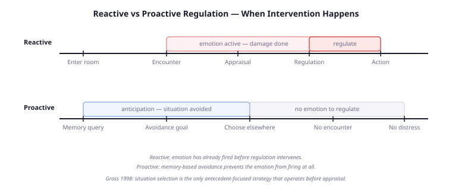
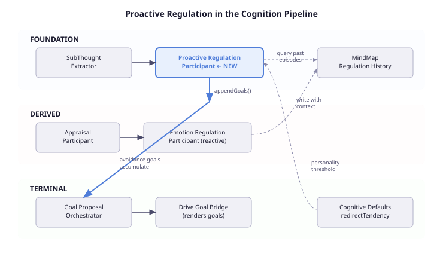
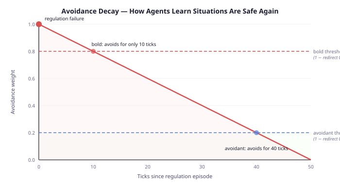

# Your Agent Should Be Afraid of the Library

A character walks into the library. Last time they were here, Muttley humiliated them in front of the group. The appraisal system fires: shame at 0.72, well above baseline. The regulation system kicks in — cognitive change, reframe the situation, suppress the urge to flee. The regulation is successful. The character stays. The narrative reads well.

But the character should never have walked into the library.

A real person who was humiliated in a room does not need to re-enter the room, re-experience the shame, and re-regulate it to avoid future humiliation. They feel reluctance *before* they walk in. The memory of the last visit creates anticipatory avoidance — a pull away from the situation before any emotion fires. This is not a conscious strategy they select after detecting a feeling. It is the feeling-before-the-feeling: the body's early warning system, built from experience.

Every emotion regulation system I have seen in the agent literature — including the one I built — handles the response after the fact. The character enters, feels, regulates. What none of them do is the thing that happens first in human emotion regulation: not going there in the first place.

## The Strategy That Nobody Implements

Gross's 1998 process model identifies five families of emotion regulation strategy. They are not equal. They differ in a way that matters architecturally: *when* they intervene.

Four of the five strategies are response-focused. They fire after the emotion has already been generated — after appraisal has run, after the feeling exists. Attentional deployment: look away from the trigger. Cognitive change: reframe the meaning. Response modulation: suppress the expression. These are the strategies that cognitive agent architectures implement, because they fit neatly into a post-appraisal pipeline.

The fifth strategy — situation selection — is fundamentally different. It operates before appraisal. You avoid the party because you know it will make you anxious. You take the long route to skip the corridor where your ex sits. You decline the meeting because last time it ended in a fight. The emotion never fires because the situation never occurs.

Situation selection is the only antecedent-focused strategy in Gross's model that requires no emotion to be active. It runs on memory, not appraisal. And it is, by a comfortable margin, the most common regulation strategy people use in daily life. We avoid far more situations than we reappraise.

Agent architectures universally skip it. The reason is structural: it does not fit the reactive pipeline. Reactive regulation needs an emotion to regulate. Situation selection needs a *memory* of an emotion that hasn't happened yet.

## Why This Is Hard

Implementing proactive avoidance requires three things that most agent architectures do not have:

**Emotional memory with context.** When a regulation episode occurs — the character suppresses anger in the library, reappraises shame after Muttley's taunt — the system needs to record not just what was felt and how it was regulated, but *where* it happened, *who* was involved, and *what* triggered it. Most regulation systems store strategy and effectiveness. They do not store context. Without context, there is nothing to match the next time the character approaches the library.

**Pre-appraisal intervention point.** The proactive check needs to run before the emotion generation pipeline, not after it. In pipeline terms, this means a new participant in an earlier phase — one that queries memory and generates avoidance signals before appraisal has a chance to fire. This is a different kind of participant than the reactive regulation system, which reads from appraisal output. This one reads from memory directly.

**Personality-modulated thresholds.** Not every character should avoid the library. A competitive, bold character who was humiliated might go back specifically to prove they can handle it. An avoidant, conservative character might never go back. The same emotional memory, modulated by personality, produces opposite behaviours. Without personality modulation, proactive avoidance is either too aggressive (everyone avoids everything) or too weak (no one avoids anything).

## The Design

The architecture adds a single new participant — `ProactiveRegulationParticipant` — in the FOUNDATION phase of the cognition pipeline. FOUNDATION runs before appraisal, before drive computation, before any emotion is generated. It is the earliest point where a cognitive participant can influence the tick.

The participant does four things:

**1. Read the current context.** Where is the agent right now? Who is nearby? What are they doing? This context — location, interacting agents, topic — flows through a structured record on the tick context. The caller provides it; the participant consumes it.

**2. Query emotional memory.** Load recent regulation episodes from the MindMap and filter for context matches. "Have I regulated a strong emotion in this location before?" The regulation nodes store three context dimensions — location, agents, topic — written at regulation time by the reactive system. A configurable mode controls which dimensions are active: start with location-only, promote to location-and-agents or full as the system matures.

**3. Compute avoidance weight.** For each matching episode, compute how strongly the agent should avoid. The formula has two components: how badly regulation failed (`1 - effectiveness`) and how recent the episode is (linear decay over a configurable horizon). A regulation failure yesterday weighs more than one last week.

**4. Personality-gate the avoidance.** Compare the avoidance weight against the agent's `redirectTendency` — a personality-derived threshold already computed by the cognitive derivation engine from five disposition axes. High redirect tendency (avoidant conflict, conservative risk, low autonomy) means the threshold is low — the agent avoids readily. Low redirect tendency (bold risk, analytical conflict, high autonomy) means the threshold is high — most episodes don't trigger avoidance.

If the avoidance weight exceeds the personality-gated threshold, the participant generates a `DriveGoalProposal` — an avoidance goal that enters the goal pipeline and influences the agent's action selection. The agent doesn't avoid because it was told to. It avoids because its memory produced a goal that competes with the goal to enter the library — and personality determines which goal wins.

## The Trap: Permanent Avoidance

The first design had no decay. A regulation failure in the library at tick 10 would produce avoidance at tick 10, tick 100, tick 1000 — forever. The character would never return. Which means the character would never have a positive experience there. Which means the avoidance would never be contradicted by evidence. Which means it would persist forever.

This is not a bug. It is a well-documented pathology.

Bonanno and Burton's 2013 work on regulatory flexibility identifies rigid avoidance as a marker of maladaptive regulation. Healthy regulation requires the capacity to update beliefs about situations based on new evidence. A system that only records failures and never gets counter-evidence becomes permanently rigid — the computational equivalent of a phobia.

The fix is temporal decay. Avoidance weight decays linearly from full strength to zero over a configurable horizon (default: 50 ticks). If the agent does not re-encounter the situation, the avoidance naturally lapses. The memory fades.

The decay interacts with personality in the right way. An avoidant character (redirect tendency 0.8) has a low threshold — avoidance weight only needs to exceed 0.2 to trigger. Even a decayed memory triggers avoidance. The character avoids for roughly 40 ticks before the weight drops below threshold. A bold character (redirect tendency 0.2) has a high threshold — only fresh, high-intensity episodes trigger avoidance. The same memory only produces avoidance for about 10 ticks.

Same memory. Same decay curve. Different personalities produce different avoidance durations. This is not a parameter we tuned. It falls directly out of the interaction between linear decay and personality-derived thresholds.

If the agent does re-enter the library and has a successful regulation experience — effectively managing the emotion this time — the new positive episode counterbalances the old negative one. The agent can learn that the library is safe. Not because the avoidance timer expired, but because new evidence updated the memory.

## What This Actually Means for Agent Design

Three practical points for anyone building cognitive agents:

**Memory is architecture, not data.** The difference between an agent with emotion regulation and one with proactive regulation is not the regulation model — it is whether the system records context with its emotional experiences. If your regulation system stores strategy and effectiveness but not where and who, you cannot build anticipatory behaviour. Context-aware memory is a prerequisite for anticipatory cognition.

**Personality is not a modifier — it is a threshold.** Many agent architectures treat personality as a multiplier on behaviour intensity. "More neurotic = stronger reaction." The proactive regulation design shows personality as a gating function: it determines *which experiences produce avoidance at all*, not how much avoidance they produce. An avoidant personality does not avoid harder — it avoids more situations, because its threshold is lower. The distinction matters because it produces qualitatively different behaviour, not just quantitatively different behaviour.

**Decay is not forgetting — it is learning.** A system without decay learns that dangers are permanent. A system with decay learns that dangers are temporary until proven otherwise. This matches the clinical evidence: most emotional associations naturally attenuate without re-exposure. The exceptions — trauma, phobias — are characterised precisely by their failure to decay. A decay mechanism is not a simplification. It is a model of how emotional memory actually works in healthy cognition.

## The Bigger Picture

Proactive regulation closes a loop that has been open since the first emotion regulation paper. Gross identified situation selection in 1998 as the earliest intervention point — before attention, before appraisal, before the feeling exists. Twenty-eight years later, it remains unimplemented in computational emotion architectures.

The reason is not that the model is unclear. The model is straightforward: query memory, match context, generate avoidance. The reason is that it requires three capabilities that agent architectures typically treat as separate concerns: emotional memory (usually owned by the memory system), personality modulation (usually owned by the personality system), and goal formation (usually owned by the planning system). Proactive regulation sits at their intersection.

Building it forced us to connect systems that had been independent: regulation results writing context to memory nodes, personality thresholds gating memory-driven goals, the goal pipeline accepting anticipatory proposals alongside drive-based ones. The feature is small — one participant, one record type, one new method. The integration surface is where the real work lives.

The implementation is designed for the CaseHub cognitive architecture, but the pattern generalises. Any system that (a) records emotional experiences, (b) has personality-modulated parameters, and (c) supports goal-based action selection can add proactive avoidance. The three capabilities already exist in most sophisticated agent frameworks. What is missing is connecting them in the right order: memory before appraisal, personality as threshold, decay as learning.

Your agent should be afraid of the library. Not because you told it to be afraid. Because it remembers what happened last time, and its personality determines how long that memory shapes its choices.

---

*References: Gross, J.J. (1998). The emerging field of emotion regulation. Review of General Psychology, 2(3), 271-299. Gross, J.J. (2015). Emotion regulation: Current status and future prospects. Psychological Inquiry, 26(1), 1-26. Bonanno, G.A. & Burton, C.L. (2013). Regulatory flexibility: An individual differences perspective on coping and emotion regulation. Perspectives on Psychological Science, 8(6), 591-612. Bosse, T., Pontier, M. & Treur, J. (2010). A computational model based on Gross' emotion regulation theory. Cognitive Systems Research, 11(3), 211-230. Mischel, W. & Shoda, Y. (1995). A cognitive-affective system theory of personality. Psychological Review, 102(2), 246-268.*
