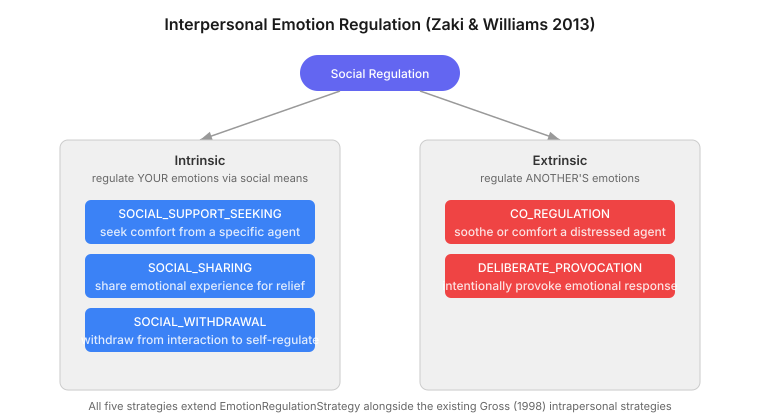
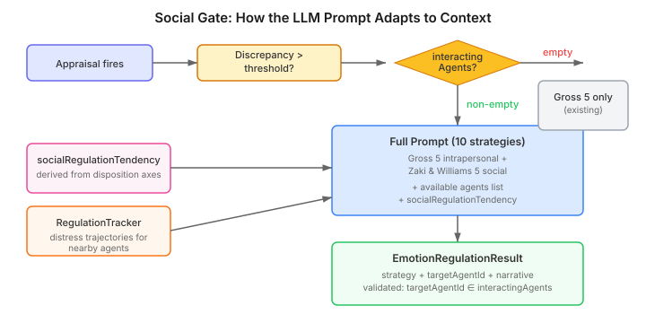

# Your Agent Needs to Know Who to Call

A character is anxious. The appraisal system has fired, the discrepancy exceeds threshold, and the regulation system selects a strategy. Cognitive change. The character reframes the situation. Anxiety drops from 0.78 to 0.45. Regulation succeeds.

But what the character actually wanted to do was find Penelope and talk to her about it.

Every emotion regulation system in the agent literature — including the one I built — treats regulation as a solitary act. The character feels, then the character manages the feeling internally: suppress it, reframe it, distract from it, avoid the trigger. All five of Gross's 1998 strategies are intrapersonal. The character regulates alone, even when surrounded by other agents.

This is not how people regulate emotions. The most common thing a person does when they feel bad is talk to someone. Seek comfort. Share the experience. Ask for advice. And the most observable thing a person does for someone they care about who is distressed is try to help — soothe them, comfort them, sit with them. These are not exotic strategies. They are the ones that happen most visibly and most often.

Cognitive agent architectures skip them entirely.

## The Missing Half of Regulation

Zaki and Williams published a framework in 2013 that splits emotion regulation into two dimensions that nobody in computational architecture seems to have picked up.

The first dimension is direction. **Intrinsic** regulation uses social means to manage your own emotions — seeking comfort, sharing your experience, withdrawing from interaction. **Extrinsic** regulation manages someone else's emotions — soothing a friend, co-regulating a distressed companion, or (less prosocially) deliberately provoking someone.

The second dimension, which Zaki and Williams emphasise but which matters less architecturally, is whether the regulation is response-dependent or -independent. What matters for implementation is simpler: social strategies target specific agents and produce social goals.

The existing intrapersonal system produces internal state changes (suppress the drive, reframe the appraisal) or environmental goals (avoid the location, change the situation). Social strategies produce a third kind of output: interpersonal goals. Seek out agent X. Talk to agent Y about topic Z. Withdraw from the group. Comfort agent W.

## Why This Is Not Just More Enum Values

The temptation is to treat social regulation as a simple extension: add five strategy names to the enum, update the prompt, done. The strategy names are the easy part. The architecture has three requirements that intrapersonal regulation does not.

**Social strategies need a target.** COGNITIVE_CHANGE operates on the character's internal state — no target required. SOCIAL_SUPPORT_SEEKING needs to name a specific agent. The regulation result must carry a `targetAgentId`, and that ID must come from somewhere the LLM can reference. If the LLM hallucinates an agent name, the downstream goal is meaningless.

The solution is the `RegulationContext` — built for proactive regulation — which already carries `interactingAgents` into the tick pipeline. The LLM receives the list of available agents as structured context and selects from it. The participant validates the output against the list. A target not in the list is discarded.

**Social strategies should not always be available.** A character alone in a room cannot seek comfort from anyone. The intrapersonal strategies are always available; social strategies are context-dependent. This means the LLM prompt itself must adapt — presenting ten strategies when others are present, five when the character is alone.

The social gate is a conditional block in the prompt builder. When `RegulationContext.interactingAgents()` is non-empty, social strategy descriptions, the agent list, and the character's social regulation tendency are appended. When empty, the prompt looks exactly as it did before — the existing intrapersonal system is unmodified.

**Social strategies need personality modulation that intrapersonal strategies do not.** A gregarious character seeks social support readily. A reserved character prefers to self-regulate even when others are available. The existing `RegulationDefaults` record carries three personality-derived capacities (reappraisal, suppression, redirect tendency). Social regulation adds a fourth: `socialRegulationTendency`, derived from the same disposition axes that drive the others.

The derivation follows the existing pattern — weighted lookups against disposition axis values, clamped to 0.0–1.0:

| Axis | Value | Weight | Rationale |
|------|-------|--------|-----------|
| socialOrient | gregarious | +0.20 | Seeks social interaction for regulation |
| socialOrient | reserved | -0.15 | Prefers solitary regulation |
| conflictMode | harmonizing | +0.15 | Values social connection |
| conflictMode | confrontational | -0.10 | Less likely to seek support |
| autonomy | dependent | +0.15 | Seeks support readily |
| autonomy | independent | -0.10 | Self-regulates |

A character with gregarious + harmonizing + dependent dispositions scores 0.50 + 0.20 + 0.15 + 0.15 = 1.0. They will almost always prefer a social strategy when one is available. A reserved + confrontational + independent character scores 0.50 - 0.15 - 0.10 - 0.10 = 0.15. They will self-regulate even surrounded by friends. Same emotional state, same available agents, different personality — qualitatively different regulation choices.

## Extrinsic Regulation: The Observation Problem

Intrinsic social regulation is architecturally straightforward: the character feels something, social context exists, the LLM picks a social strategy. Extrinsic regulation — regulating someone else's emotions — is harder because it requires observing that the other agent is distressed.

The observation layer already exists. The `RegulationTracker` computes distress trajectories for observed agents: IMPROVING, STABLE, or WORSENING, with a numeric delta. It was built for Theory of Mind — allowing characters to perceive whether another agent's emotional state is changing. What it did not have was a consumer that acted on the observation.

The design connects observation to action through the existing appraisal pathway. A character does not co-regulate because a mechanical check detected distress. A character co-regulates because observing another's distress produces an empathic response — which is an appraisal event. The appraisal fires, the regulation system activates, and CO_REGULATION becomes a candidate strategy because the LLM receives the trajectory data.

This means a character with low agreeableness who observes another's distress may not experience a strong empathic appraisal — and therefore may not attempt co-regulation. A character with high agreeableness will appraise the distress strongly and be drawn toward helping. The personality modulation happens at the appraisal level, not at the regulation level, which is the right place: the character has to care before it can help.

*Note: the distress trajectory prompt enrichment — feeding `RegulationTracker` data into the LLM prompt for extrinsic strategy selection — is designed but not yet implemented. The current implementation supports CO_REGULATION and DELIBERATE_PROVOCATION selection based on the available agents list and social regulation tendency, without trajectory-informed context. Trajectory enrichment is planned follow-up work.*

## Goal Routing: appendGoals, Not registerGoals

One detail that matters more than it looks. The existing environmental regulation goal bridge uses `registerGoals()` — replace semantics. When SITUATION_SELECTION fires, it overwrites whatever goals were previously registered. This is correct for environmental strategies: they are the primary goal output of the regulation system.

Social regulation goals use `appendGoals()` — additive semantics, built for proactive regulation. A character can simultaneously have a proactive avoidance goal (from memory-based anticipation) and a social regulation goal (from current emotional state). Neither should clobber the other. The goal pipeline sees both, and the character's action selection resolves the competition.

This is a small implementation detail but it illustrates a broader principle: as cognitive systems become richer, the interactions between subsystems matter more than any subsystem in isolation. Proactive regulation, reactive regulation, and social regulation all produce goals. They must coexist without interference. Additive semantics is the mechanism that allows it.

## The Design Choices That Matter

Three decisions shaped this design, and they generalise beyond this specific system.

**Unified strategy selection over separate decision layers.** One LLM call considers all ten strategies — five intrapersonal, five social — and picks the best one for the situation. The alternative was a two-stage process: first select intrapersonal, then decide whether to also deploy a social strategy. The unified approach is simpler (one call, one result) and produces better strategy selection because the LLM can weigh social against intrapersonal holistically. A character who is moderately anxious with a trusted friend nearby should seek comfort, not reappraise — the unified model captures this.

**Appraisal-driven extrinsic trigger over mechanical detection.** Co-regulation fires because the character empathically responds to another's distress, not because a threshold checker noticed the distress. This means characters with low empathy do not co-regulate, which is correct. It also means extrinsic regulation uses the same activation pathway as intrapersonal — no new pipeline, no parallel participant, no new configuration wiring.

**Personality as strategy selection, not strategy availability.** All ten strategies are presented to the LLM when social context exists. Personality influences which strategy is selected, not which strategies are available. A reserved character can seek comfort — they just almost never do, because their `socialRegulationTendency` is low and the LLM receives that as a selection factor. The rare exception — a reserved character so overwhelmed that they reach out — is dramatically interesting and should not be mechanically impossible.

## What This Means for Agent Builders

If you build agents that interact with each other, the social dimension of regulation is where observable personality emerges. Intrapersonal regulation is invisible to other agents — it happens inside the character's state. Social regulation is visible: the character approaches someone, talks to them, withdraws, comforts them, provokes them. It is, by a wide margin, the most dramatically readable form of emotion regulation in a multi-agent simulation.

The components needed are not exotic. You need: a way to know who is nearby (we call it `RegulationContext`), a way to observe emotional states in others (we call it `RegulationTracker`), personality parameters that modulate social preference (we call it `socialRegulationTendency`), and a goal pipeline that accepts social goals alongside other goal types (we call it `appendGoals()`).

The pattern is: extend the decision layer with social options, gate them on social context, modulate them with personality, and route the results through the existing goal pipeline. The specifics of our implementation — the enum extension, the prompt builder, the disposition-axis derivation — are CaseHub details. The pattern is general.

Your agent knows how to suppress anger, reframe shame, and avoid the library. Teach it to call a friend.

---

*References: Zaki, J. & Williams, W.C. (2013). Interpersonal emotion regulation. Emotion, 13(5), 803-810. Gross, J.J. (1998). The emerging field of emotion regulation. Review of General Psychology, 2(3), 271-299. Niven, K. et al. (2009). A classification of controlled interpersonal affect regulation strategies. Emotion, 9(4), 498-509. Rimé, B. (2009). Emotion elicits the social sharing of emotion: Theory and empirical review. Emotion Review, 1(1), 60-85. Bonanno, G.A. & Burton, C.L. (2013). Regulatory flexibility. Perspectives on Psychological Science, 8(6), 591-612.*
