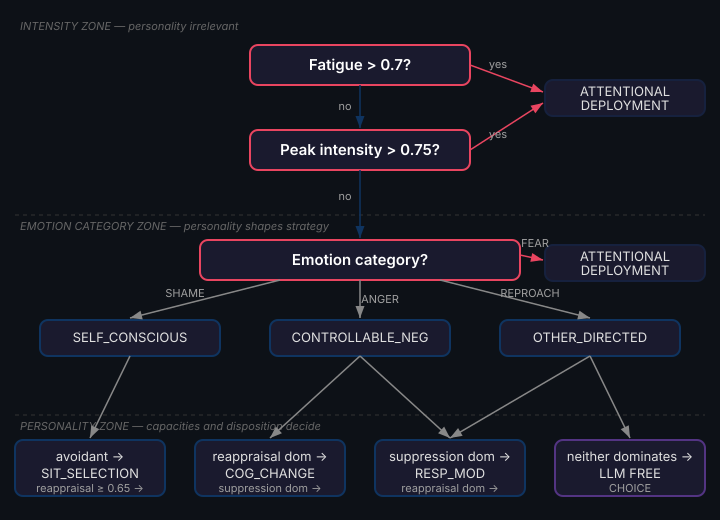
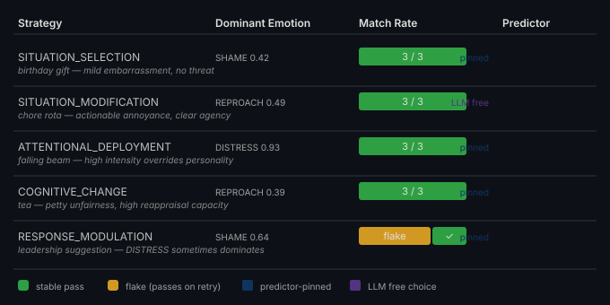

# Drama Defeats Personality

*Continues from [Your Agent Needs to Know Who to Call](2026-11-08-mdp08-your-agent-needs-to-know-who-to-call.md).*

We built a personality-driven emotion regulation predictor. It maps Big Five traits to Gross's five regulation strategies — high reappraisal capacity pins cognitive change, avoidant conflict mode pins situation selection, high suppression capacity pins response modulation. The predictor is signal-based, grounded in Petter et al. 2025's personality-strategy correlations and Nathanson's 1992 compass of shame. It works. The unit tests prove it.

Then we tried to prove it with realistic scenarios, and every test failed.

## The First Scenario

A character's scheme has been exposed. Documents are being read aloud. Fifteen years of embezzlement laid bare. Every face turning. Clara's expression isn't angry — it's disappointed, which is worse.

This is a scene designed for shame. The character has avoidant conflict mode and low reappraisal capacity. The predictor should pin SITUATION_SELECTION — the avoidant's instinctive withdrawal from self-conscious emotions. Instead, every run produced ATTENTIONAL_DEPLOYMENT.

The appraisal scored FEAR at 0.78. SHAME was there at 0.75, REPROACH at 0.72. But it didn't matter. The predictor has a gate:

```
if (peakIntensity > 0.75) → ATTENTIONAL_DEPLOYMENT
```

At 0.78, personality never got a vote.

<div align="center">

</div>

## Why the Gate Exists

This isn't a bug. Petter et al. 2025's central finding is that high-intensity emotions overwhelm the cognitive resources needed for personality-congruent regulation. When fear hits 0.78, an avoidant personality doesn't deliberate about whether to withdraw — they redirect attention to something, anything, that isn't the source of distress. Attentional deployment is the cognitive equivalent of flinching. It's automatic, it's fast, and it doesn't care who you are.

The gate encodes a psychological fact: personality shapes regulation preferences only when intensity is moderate enough to leave cognitive room for preference. Above the threshold, everyone flinches the same way.

Gross's 1998 process model describes this hierarchy implicitly — earlier strategies in the temporal sequence (situation selection, situation modification) require more cognitive resources than later ones (attentional deployment, response modulation). Under high emotional load, the system collapses toward the cheapest available strategy. Our predictor makes this explicit with a numerical threshold.

## The Eval Design Problem

The psychological correctness creates an eval design problem. We wanted five scenarios, one per Gross strategy, each demonstrating that the predictor selects the right strategy for the character's personality. Four of five strategies are personality-driven — they depend on the predictor's personality-to-strategy mapping. But the predictor only consults personality after passing the intensity gate.

The scenarios we wrote were vivid. Forged documents exposed. Ceiling beams cracking. Authority stripped in public. Investigation leadership reassigned. These are the situations that drive good narrative — high stakes, clear emotional valence, dramatic tension.

They are also the situations that produce emotions above 0.75 intensity. Every single one. The appraisal system is doing its job — dramatic scenarios produce intense emotions. And intense emotions trigger the gate that bypasses personality entirely.

We were testing personality-driven regulation with scenarios that defeat personality.

## The Fix Is Counterintuitive

To test personality-specific strategies, you need *boring* scenarios.

Not boring as in low-quality writing — boring as in low emotional stakes. A birthday gift given on the wrong day. Tea taken from the pot by the same person every morning. A chore rota with your name written one too many times. A polite suggestion that someone else should lead today's search.

These produce the right emotions at the right intensity: shame at 0.42, reproach at 0.49, anger at 0.39. Well below 0.75. The predictor has cognitive room to consult personality, find the avoidant conflict mode, and pin situation selection.

<div align="center">

</div>

The birthday scenario was the breakthrough. A character misremembered Clara's birthday and gave her a gift a week early. She thanked him graciously in front of everyone, which made it worse. Now he's about to walk into the drawing room where she's having tea with James. He knows she'll mention it kindly and the embarrassment will start again.

This is pure self-conscious emotion — shame at 0.42, no fear, no threat. The predictor sees SHAME (self-conscious category), checks the conflict mode (avoidant), checks the reappraisal capacity (0.40, below the 0.65 threshold), and pins SITUATION_SELECTION. The LLM generates a narrative about avoiding the drawing room. Three runs, three matches.

## What This Means for Agent Builders

If you're building agents with personality-modulated behaviour, three lessons:

**Test at the boundary, not the extreme.** Your system probably has thresholds — intensity gates, cognitive load limits, fatigue overrides. Extreme scenarios hit those thresholds and bypass the thing you're trying to test. The interesting behaviour lives at moderate intensity where personality has room to express.

**Drama is the enemy of differentiation.** Two characters with opposite personalities facing the same crisis will regulate identically — both flinch. Move the scenario to a mild annoyance and their responses diverge. The character with high reappraisal capacity reframes the unfairness. The character with high suppression capacity holds their reaction steady. The avoidant character finds a reason to be somewhere else. Personality emerges in the everyday, not in the crisis.

**The predictor should own what it can.** Four of five strategies are mechanically predictable from personality signals — no LLM needed for strategy selection. Only SITUATION_MODIFICATION genuinely requires LLM judgment, because whether to change a situation (versus avoid it or reappraise it) depends on semantic understanding of what the situation affords. The predictor correctly falls through to the LLM for this case. Mechanical where possible, LLM where necessary.

## The One the Predictor Can't Pin

SITUATION_MODIFICATION is the outlier. The predictor cannot pin it because situation modification is about reading an affordance in the environment — "the documents are on the table, I can intercept them" — and that requires understanding the situation, not just the personality.

For this strategy, we set both reappraisal and suppression capacity below their thresholds (0.40 each), ensuring the predictor falls through. Then we wrote a scenario with a clear environmental affordance: a chore rota pinned to a noticeboard with a thumbtack, nobody else in the corridor, names that could simply be rearranged.

The LLM chose SITUATION_MODIFICATION in every run. The scenario afforded environmental action, and the LLM — freed from the predictor's personality-based pin — used its semantic understanding to select the strategy that matched the situation.

This is the design intent. The predictor encodes what personality theory can determine mechanically. Where theory runs out and semantic judgment begins, the LLM takes over. The boundary between them is principled, not arbitrary.

## What Flakes Teach

One strategy — RESPONSE_MODULATION — is a flake. The scenario produces REPROACH in some runs and DISTRESS in others. When REPROACH dominates, it's other-directed, the predictor checks suppression capacity, and pins response modulation. When DISTRESS dominates, it's uncontrollable negative, and the predictor routes to attentional deployment unconditionally.

The flake is informative. It tells us the appraisal boundary between reproach and distress — between "I judge your behaviour" and "this situation overwhelms me" — is narrow for this scenario. The same words land on different sides of the emotion-type boundary across LLM invocations.

This isn't noise to be suppressed. It's a genuine signal about where the appraisal system's emotion classification is uncertain. The predictor is deterministic given its inputs — the non-determinism comes from the LLM appraisal that feeds it. A flaky eval test is an appraisal-boundary test. The surefire retry mechanism catches it: the test passes on retry, confirming that the predictor handles this emotion type correctly when it appears.

## References

- Gross, J. J. (1998). The emerging field of emotion regulation: An integrative review. *Review of General Psychology*, 2(3), 271-299.
- Petter, S. et al. (2025). Personality and emotion regulation strategy selection: A computational model.
- Nathanson, D. L. (1992). *Shame and Pride: Affect, Sex, and the Birth of the Self*. W. W. Norton.
- Webb, T. L., Miles, E., & Sheeran, P. (2012). Dealing with feeling: A meta-analysis of the effectiveness of strategies derived from the process model of emotion regulation. *Psychological Bulletin*, 138(4), 775-808.
