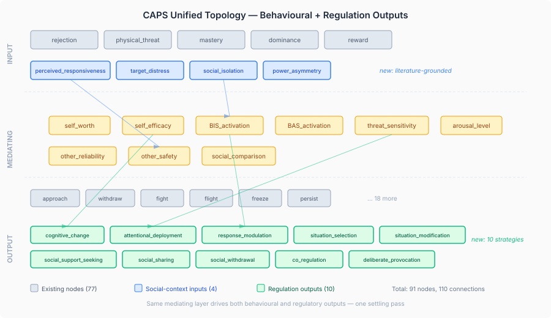
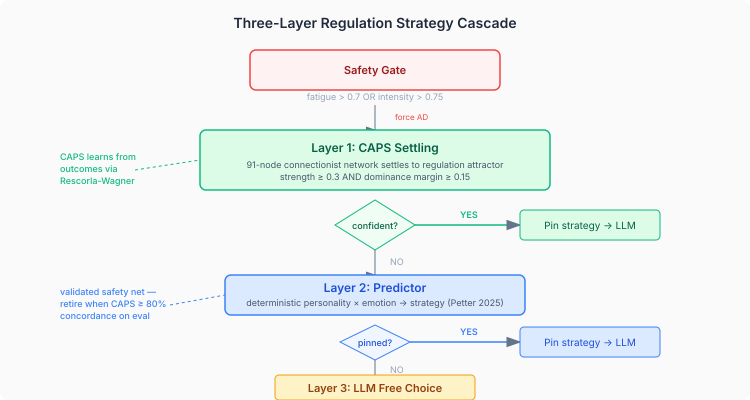
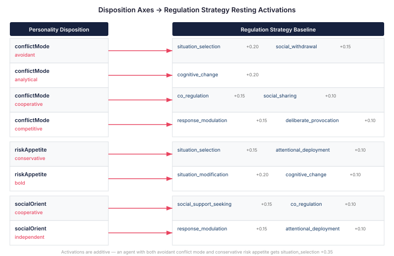
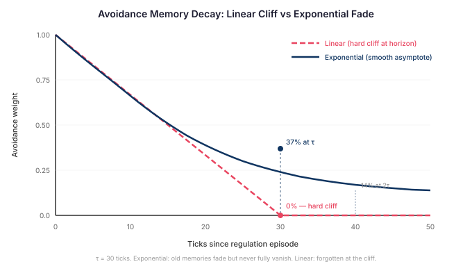
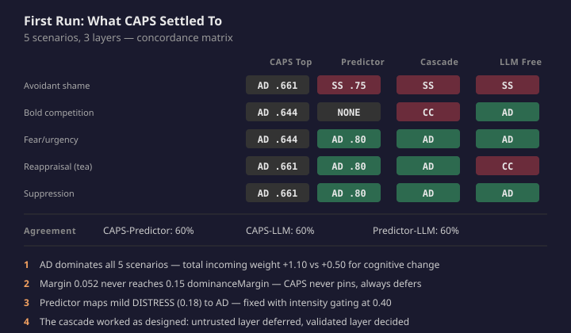

# When Regulation Joins the Network

The last post described the problem: a regulation predictor that maps personality to strategy works for single episodes but gets stuck under compounding pressure. The fix was experience-modulated capacity — feedback that degrades effective capacity when strategies fail and recovers it when they're not needed.

That fix solves the stuck-agent problem. But it's still a scalar overlay on a deterministic if/else cascade. The predictor checks personality axes, checks the emotion category, and picks the strategy with the dominant capacity score. The modulation adjusts the score. The architecture is the same: a lookup table with softer edges.

CAPS — Mischel and Shoda's cognitive-affective processing system — is not a lookup table. It is a connectionist network where the same internal state that drives behavioural tendencies also drives regulatory responses. The network settles. What it settles toward depends on how the weights interact across dozens of connections, modulated by the personality of the specific agent running on it. What I have been building is the integration of regulation into that network. The topology is extended. The disposition modulation is wired. The social-context inputs are computing. What remains is wiring the cascade into the tick loop and running the evaluation.

## 1. The Same Internal State Drives Both Responses

The existing CAPS topology had 77 nodes across three layers. Input nodes represent situations — rejection, physical threat, mastery, dominance, reward. Mediating nodes represent internal models — self-worth, self-efficacy, BIS and BAS activation, threat sensitivity. Output nodes represent behavioural tendencies — approach, withdraw, fight, flight, freeze, persist, rebel.

When an agent encounters a situation, the situation classifier activates the relevant input nodes. Those activations flow through the mediating layer, modulated by personality-derived connection weights. The network iterates until it converges on a stable pattern of output activations — the behavioural attractors.

The observation behind the CAPS regulation design is that the same mediating nodes that drive behavioural outputs also contain the information needed for regulation strategy selection. High BIS activation plus high arousal pushes both the "withdraw" behavioural output AND the decision to deploy attention away from the threat. High self-efficacy pushes both "persist" AND the decision to reappraise the situation. The personality state does not select behaviour and regulation separately. It does both at once.

Ten regulation strategies become output nodes in the same network: five from Gross's 1998 process model (situation selection, situation modification, attentional deployment, cognitive change, response modulation) and five from Zaki and Williams's 2013 interpersonal taxonomy (social support seeking, social sharing, social withdrawal, co-regulation, deliberate provocation). They settle alongside the behavioural outputs in a single pass. No separate regulation system. No second network. One settling step produces a personality-coherent pattern of what to do AND how to regulate.

The topology is now 91 nodes and 110 connections. The 34 new connections carry literature-derived weights with `consensus` provenance — meaning derived from published effect sizes, not guessed. `arousal_level → attentional_deployment` carries a weight of +0.45, sourced from Baranczuk's 2019 meta-analysis where neuroticism-to-attentional-deployment correlates at r ≈ .30–.40. `self_efficacy → cognitive_change` carries +0.45, sourced from Gross and John (2003) where openness-to-reappraisal correlates at r = .36. Every connection in the regulation subnetwork has a citation. That matters because these weights are the initial condition — the starting point from which per-agent learning diverges.

I renamed `BehavioralAttractor` to `CapsAttractor` across the codebase. The name mattered. The old name implied that CAPS outputs are exclusively behavioural. They are not. A regulation strategy is a CAPS output — an activation pattern that the network settled toward based on personality-weighted internal state. The `category` field on the attractor distinguishes behavioural from regulatory. The settling algorithm does not need to know the difference.

## 2. Social Context Needs Its Own Inputs

Intrapersonal strategies — reappraisal, suppression, attention redirection — can be driven by existing mediating nodes. BIS activation pushes suppression. Self-efficacy pushes cognitive change. The connections map naturally from the meta-analysis data.

Social strategies require something the topology did not have: knowledge of who is present and what state they are in.

An agent deciding between social support seeking and social withdrawal needs to know whether a trusted partner is available. One deciding whether to co-regulate needs to know whether another agent is in distress. The CAPS network cannot differentiate between five social strategy outputs if every social strategy node receives the same undifferentiated signal.

I spent time searching the literature on this. Reis, Clark, and Holmes (2004) established perceived partner responsiveness as the organising construct for intimacy processes. Ruan and colleagues (2019) showed that perceived responsiveness directly predicts emotional expression and support-seeking behaviour. Main, Yung, Chen, and Zawadzki (2025) confirmed in a 3,158-assessment experience sampling study that closeness to the interaction partner predicts strategy choice — less closeness produces more suppression. Reeck, Ames, and Ochsner (2016) formalised the social regulatory cycle, where the target's emotional state is the primary trigger for extrinsic regulation. Niven, Totterdell, and Holman (2009) used hierarchical cluster analysis on 378 interpersonal regulation strategies and found the primary dimension was affect-improving versus affect-worsening intent.

No published computational model has encoded these social-context dimensions as CAPS-like input activations. CASPER (Camacho, Deshpande, and Perino 2025) provides the closest theoretical decomposition — cognitive control, affective reactivity, social processing, and regulatory processes as interacting subsystems — but no network implementation exists. This is novel territory.

Four social-context input nodes, each grounded in the empirical evidence and implemented as concrete formulas:

**Perceived responsiveness** — how responsive the present interaction partner is (Reis et al. 2004, Main et al. 2025). Computed as `clamp01(0.6 × trust + 0.4 × trajectorySignal)` where trust is the normalised relationship trust from MindMap and trajectory is 1.0 for IMPROVING, 0.5 for STABLE, 0.0 for WORSENING affect trajectory. Multiple interacting agents: max trust dominates. Discriminates social support seeking from social withdrawal.

**Target distress** — observable distress in another agent (Reeck et al. 2016). Computed as `clamp01((−pleasure + arousal) / 2.0)` from the target's PAD state. High negative pleasure combined with high arousal signals distress. Zero if no interacting agents. Discriminates co-regulation from other social strategies.

**Social isolation** — absence of social contact (Rimé 2009, Williams 2007). Computed as a gradient: `1.0 − clamp01(agentCount / 3)`. Zero agents produces full activation. Three or more agents produces zero. The saturation at three is a design choice — beyond three present agents, additional presence does not further reduce the isolation signal. Drives social withdrawal.

**Power asymmetry** — relational power advantage (Schilke, Reimann, and Cook 2021; Tedeschi and Felson 1994). Computed as `clamp01((dominanceScore − submissionScore + socialComparisonBias) / 2.0)`. Discriminates deliberate provocation via perceived impunity. An agent with a power advantage over the target can provoke with reduced retaliation risk — the power differential IS the enabling condition.

These inputs route through the existing mediating layer. Perceived responsiveness flows through `other_safety` and `other_reliability`. Social isolation flows through `BIS_activation` and `arousal_level`. The mediating layer is where personality-weighted processing happens, so routing social-context signals through it makes social regulation personality-sensitive through the same mechanism as everything else. Two direct connections bypass the mediating layer: `target_distress → co_regulation` and `power_asymmetry → deliberate_provocation`. These are justified exceptions — caregiving response to distress and provocation under power advantage are empirically direct, not personality-mediated.

## 3. The Three-Layer Cascade

A connectionist network that has just been extended with 14 new nodes and 34 new connections should not be trusted to override a validated predictor on day one. The weights are literature-derived but uncalibrated. The confidence threshold is an initial estimate, not an empirical finding.

The design uses a three-layer cascade: CAPS first, predictor second, LLM third.

A safety hard gate fires first. If the agent's regulation fatigue exceeds 0.7 or the peak emotional intensity exceeds 0.75, the cascade forces attentional deployment unconditionally — cognitive resources for reappraisal are exhausted, and the network's opinion is irrelevant. This gate was buried inside the predictor's if/else logic. I extracted it to the cascade entry point. It now fires before anything else — before CAPS settling, before the predictor, before the LLM. The predictor retains the same check internally as defence in depth.

If the safety gate passes, CAPS settles. If a single regulation attractor dominates — its strength exceeds `regulationConfidenceThreshold` (default 0.3) AND it leads the runner-up by `regulationDominanceMargin` (default 0.15) — it pins the strategy. The LLM still generates the regulation narrative, but the strategy is fixed by the network.

If CAPS is ambivalent — multiple regulation attractors above threshold with no clear winner — the cascade falls through to the predictor. The predictor's if/else logic handles the case. If the predictor also falls through (positive emotions, unknown categories), the LLM chooses freely.

These two threshold parameters are architecturally separate from the existing `attractorStrengthMinFilter` (default 0.1), which is a noise filter that determines what appears in the settling result at all. A regulation attractor at 0.12 passes the noise filter — it is a genuine CAPS output — but it does NOT override the predictor. The noise filter and the cascade pin threshold operate at different layers. Conflating them would mean either missing weak-but-real attractors (noise filter too high) or pinning strategies on statistical noise (cascade threshold too low).

**Why keep the predictor?** Because CAPS regulation nodes are new and uncalibrated, and the predictor has evaluation data. The predictor's strategy selections agree with an LLM judge 85% of the time across validated personality-emotion combinations. CAPS has to earn that concordance. The retirement criteria are explicit: CAPS concordance with ground truth evaluation scenarios at or above 80%, and CAPS-LLM free-choice concordance at or above 70%. Below those thresholds, the predictor stays.

## 4. The Network Learns from Regulation

The predictor does not learn. Its weights are computed once from personality axes and applied every time. The experience-modulation system I described in the previous post adds a feedback loop, but it operates on scalar capacity values, not on the connection weights that drive the settling dynamics.

CAPS learns through Rescorla-Wagner weight updates — the same associative learning mechanism that drives all connections in the existing topology. When a regulation episode produces a result, the outcome maps to weight update parameters. High-effectiveness regulation (the strategy worked — intensity dropped substantially) produces a positive outcome signal that strengthens the connections to the strategy that was selected. Low-effectiveness regulation weakens them.

The learning is not strategy-specific in isolation. It updates the connections from the mediating nodes to the regulation output nodes. An avoidant agent who tries situation selection for shame and fails does not just lose confidence in situation selection — the connections from `BIS_activation` and `threat_sensitivity` to `situation_selection` weaken. The next time those mediating nodes activate strongly, the settling dynamics shift toward cognitive change or attentional deployment — whichever alternative pathway has stronger connections for this agent.

This is different from the scalar experience modulation. That system degrades a single capacity number. This system changes the shape of the network. An agent that fails at avoidance does not just have less avoidance capacity — it has a network that has been sculpted by experience to settle differently when the same internal state recurs. The personality baseline is preserved in the initial resting activations. What changes is the weight landscape that the settling process navigates.

## 5. Personality Sets the Starting Position

The topology defines what can connect. The resting activations define where each agent starts.

When an agent is initialised, `DispositionWeightMapper` reads its five personality axes and sets regulation resting activations alongside the existing behavioural ones. An avoidant agent starts with `situation_selection` at +0.20 and `social_withdrawal` at +0.15 — before any situation is encountered. An analytical agent starts with `cognitive_change` at +0.20. A cooperative agent starts with `co_regulation` at +0.15 and `social_sharing` at +0.10.

These activations are additive across axes. An agent with both avoidant conflict mode and conservative risk appetite gets `situation_selection` at +0.35 — two personality dimensions reinforcing the same regulatory tendency. An agent with cooperative social orientation and cooperative conflict mode gets `co_regulation` at +0.25 — independently derived activations that converge on the same node.

The resting activations do not determine the outcome. They bias it. When a situation activates the mediating layer, the settling dynamics push toward whichever output nodes have the strongest incoming signal — which is a function of the personality-modulated connection weights, the situational input activations, AND the resting activation baseline. Two agents with identical resting activations will settle differently if their accumulated weight updates (from prior regulation episodes) have reshaped the connection landscape differently.

## 6. Memory Should Fade, Not Vanish

The proactive regulation system uses regulation episodes from memory to generate avoidance goals: if an agent experienced intense shame in the library last time, it should be biased toward avoiding the library this time. The prior implementation used linear decay — the avoidance weight dropped along a straight line from 1.0 to 0.0, then vanished at the decay horizon. This produced a cliff: at tick 49, the memory mattered. At tick 50, it was gone.

I replaced the linear decay with exponential: `weight = exp(−elapsedTicks / τ)` where τ is the decay time constant. At τ = 30 ticks, the avoidance weight is 37% of its original strength. At 2τ (60 ticks), 14%. At 3τ (90 ticks), 5%. The memory fades smoothly but never fully vanishes — which is what the memory literature says happens (Ebbinghaus 1885, Wixted and Ebbesen 1991). A traumatic episode in the library six months ago should still carry a trace of avoidance bias, not be forgotten at a precise tick boundary.

The practical consequence: an agent with a strong shame episode in the library will show declining but persistent avoidance over dozens of ticks. With linear decay, the avoidance was at full strength for half the horizon and then abruptly gone. With exponential decay, the transition is continuous — the agent gradually becomes more willing to return to the library as the episode recedes, rather than flipping from avoidance to indifference.

## 7. When the Network First Ran

The cascade is wired. The topology settles. The question is: what does it settle to?

I ran the paired comparison evaluation across five scenarios — each designed to elicit a different regulation strategy, each with a personality profile tuned to favour that strategy. For each scenario, I recorded what CAPS settled to, what the predictor recommended, what the cascade selected, and what the LLM chose freely without any pinning.

The result was humbling and instructive. CAPS settled to attentional deployment as the top attractor in all five scenarios. Every personality. Every emotion. Every situation. AD at 0.661, situation selection at 0.609, margin 0.052. The avoidant agent that should have favoured situation selection produced the same settling pattern as the competitive agent that should have favoured response modulation.

The cascade worked exactly as designed. The margin of 0.052 is below the dominance margin threshold of 0.15. CAPS was not confident — it was ambivalent. So it deferred. The predictor took over and selected personality-appropriate strategies in the cases where it had a clear signal. Where it fell through, the LLM chose freely. The final cascade outputs were reasonable. The safety net held.

But the CAPS settling itself is wrong. Not because of a bug — the settling algorithm converges correctly, the topology loads correctly, the connections carry the weights they were designed to carry. It is wrong because the literature-derived weights have a structural bias.

Attentional deployment receives three incoming connections totalling +1.10: arousal level (+0.45), threat sensitivity (+0.35), and BIS activation (+0.30). Cognitive change receives three incoming connections netting +0.50: self-efficacy (+0.45), self-worth (+0.30), and BIS activation (−0.25). The total incoming weight for AD is roughly double that of its nearest competitor. The resting activations from disposition — situation selection at +0.20 for an avoidant agent — cannot overcome a structural advantage that large.

The meta-analysis data (Baranczuk 2019) reports that neuroticism correlates with attentional deployment at r ≈ .30–.40 and with reappraisal at r ≈ −.25. These are real effect sizes from real studies. But converting correlation magnitudes to connection weights creates a false equivalence: a +0.45 connection from arousal to AD and a +0.45 connection from self-efficacy to cognitive change carry the same weight, but arousal activates more broadly across personality profiles than self-efficacy does. The structural advantage is not in the individual weights — it is in the activation landscape that feeds them.

The eval also exposed a flaw in the predictor. DISTRESS is mapped to `UNCONTROLLABLE_NEGATIVE` regardless of intensity. This is correct when someone is overwhelmed (intensity 0.95 — a cracking ceiling beam). It is wrong when someone is mildly annoyed (intensity 0.18 — someone took the last tea). The LLM correctly chose cognitive change for the tea scenario. The predictor forced attentional deployment because DISTRESS is categorically uncontrollable. I added intensity gating: below 0.40 intensity, DISTRESS is treated as controllable, allowing the predictor to recommend reappraisal when the agent has the capacity for it.

This is what empirical evaluation is for. The design was literature-grounded. The weights have citations. The topology connections are justified. And the network still settles wrong because the conversion from published effect sizes to connection weights is a mapping that introduces distortions the literature did not measure. Without running the eval, I would have believed the weights were right. The data says otherwise.

## 8. Why This Matters for Cognitive Agents

Most AI agents handle emotion regulation — if they handle it at all — as a prompt instruction. "You are neurotic, so suppress your feelings." The strategy is picked by the system prompt and never changes. Under this model, a neurotic agent that fails at suppression for ten episodes will try suppression for the eleventh, because nothing in the architecture learns from outcomes.

The step from prompt-level personality to deterministic prediction was an improvement. The predictor mapped published meta-analysis correlations (Baranczuk 2019) to strategy selections — empirically grounded, personality-coherent, and fast enough that LLM calls became a fallback rather than a default.

The step from prediction to network settling is a different kind of improvement. It is not about accuracy — the predictor is more accurate than the network today, and the eval proves it. It is about the architecture admitting the right kind of complexity.

Personality is not a lookup table. It is not five disposition axes mapped to five regulation strategies. It is a network of interacting cognitive-affective units where the same internal states drive multiple outputs simultaneously, where settling dynamics produce patterns that no single if/else branch can express, and where outcomes change the network for next time.

The 10% of variance that personality explains in strategy choice (Baranczuk 2019) is a starting condition. The other 90% — context, situation, mood, relationships, and accumulated experience — enters through input activations, mediating node dynamics, and weight updates. A connectionist architecture gives that 90% somewhere to live. A lookup table does not.

The three-layer cascade is the pragmatic bridge. CAPS gets first look but must earn its place — concordance above 80% with ground truth before the predictor retires. The predictor provides validated strategy selection while the network calibrates. The LLM handles the long tail of novel situations that neither CAPS nor the predictor has seen before. Each layer has a clear role. Each can be evaluated independently. The cascade never trusts the newest layer without evidence.

The topology settles. The weights are wrong. The architecture is right. The eval told me so.
