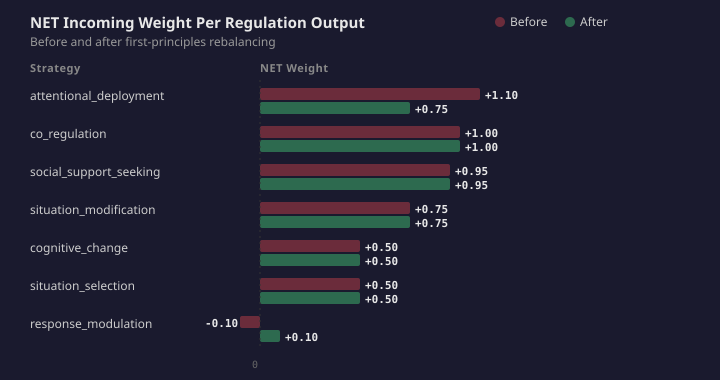
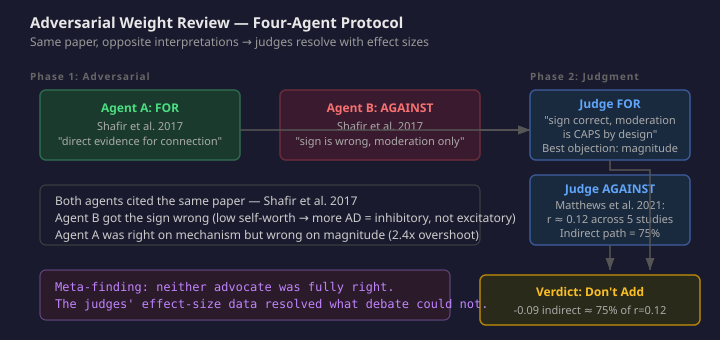

# Every Weight Has a Citation

The regulation topology is literature-grounded. Every connection weight has a source. `arousal_level → attentional_deployment` at +0.45 comes from Baranczuk's 2019 meta-analysis where neuroticism-to-attentional-deployment correlates at r ≈ .30–.40. `self_efficacy → cognitive_change` at +0.45 comes from Gross and John (2003) where openness-to-reappraisal correlates at r = .36. `BIS_activation → response_modulation` at +0.40 comes from the same study where neuroticism-to-suppression correlates at r = .30. Every weight has a citation.

The network settled wrong in all five scenarios.

## 1. The Audit

The paired comparison eval ran five scenarios with five different personality profiles — an avoidant agent who should favour situation selection, an analytical agent who should favour cognitive change, a competitive agent who should favour response modulation. In every case, CAPS settled to attentional deployment as the top regulation attractor. Every personality. Every emotion. Every situation. AD at 0.661, situation selection at 0.609, margin 0.052.

Individual weights looked right. The question was whether the network as a whole was right. I audited the total incoming weight per regulation output node — not the individual connections, but the NET sum of all excitatory and inhibitory connections feeding each output.

Attentional deployment: NET +1.10. Three excitatory connections, zero inhibitory. Cognitive change: NET +0.50. Three connections, one inhibitory. Response modulation: NET −0.10. One excitatory, two inhibitory — the most common regulation strategy was being actively suppressed at baseline.

The individual weights were defensible. The aggregate was not. Each weight mapped correctly to a published correlation. But a correlation of r = .35 from arousal to AD and a correlation of r = .36 from openness to reappraisal do not mean those connections should carry the same weight. Arousal activates broadly across all personality profiles in all negative emotion scenarios. Self-efficacy activates selectively, only for agents with the right personality configuration. The structural advantage is not in the individual weights — it is in the activation landscape that feeds them.

This is what happens when you convert published correlations to connection weights one at a time without auditing the aggregate. Each conversion is locally correct. The network-level effect is wrong.

## 2. First Principles, Not Number Fitting

The temptation after a failed eval is to tweak weights until the numbers work. That path leads to overfitting — a topology calibrated to five scenarios instead of grounded in theory.

I ran a first-principles review. For each proposed change, the question was not "does this fix the eval?" but "is this connection justified by published evidence, and is the magnitude within the range the evidence supports?"

Four changes survived the review. One was adding an inhibitory connection that the topology was missing: `self_efficacy → attentional_deployment` at −0.25, sourced from Sheppes and Gross (2011). Their process-specific timing hypothesis demonstrates that cognitive resources enable reappraisal over distraction — agents with high self-efficacy choose to engage with emotional content rather than redirect attention away from it. The CAPS topology had no way to express this competitive exclusion because output nodes are computed independently. Without cross-output competition, the only way to model "reappraisal reduces distraction" is a direct inhibitory connection from the reappraisal-enabling construct to the distraction output.

A second change corrected an overshoot: `arousal_level → attentional_deployment` dropped from +0.45 to +0.35. The design spec cited Baranczuk's meta-analysis range of r ≈ .30–.40. The original weight exceeded the top of the cited range. Midpoint is +0.35.

Two more changes softened over-inhibition on response modulation: the inhibitory connections from `self_worth` and `self_efficacy` each dropped from −0.25 to −0.15. Baranczuk's data for openness → suppression gives r ≈ −.10 to −.15. The original weights were nearly double the evidence.

One proposed change was dropped. A fifth reviewer — an automated first-principles check — argued that `self_worth → attentional_deployment` at −0.20 was not needed because the effect was mediated through `threat_sensitivity` and `arousal_level`. That reasoning assumed an indirect path that did not exist in the topology. self_worth does not connect to threat_sensitivity. self_worth does not connect to arousal_level. The assumed pathway was phantom. The conclusion — don't add it — happened to be right for the wrong reason. Finding out why it was right required a deeper analysis.

## 3. The Adversarial Review

I asked whether the dropped connection was actually correct to drop. One incorrect pathway analysis is not sufficient for a decision about a connection that affects every agent's regulation dynamics. I ran an adversarial review: four agents, two rounds.

Round one: two adversarial agents. One argued FOR adding `self_worth → AD` at −0.20. One argued AGAINST. Both searched the literature independently. Both found the same key paper — Shafir, Guarino, Lee and Sheppes (2017), which directly measured self-esteem's effect on distraction versus reappraisal choice in an evaluative context.

They interpreted it in opposite directions.

The FOR agent read Shafir et al. as direct evidence for the connection: low self-esteem participants chose distraction more under evaluative threat. High self-esteem participants showed no bias. An inhibitory connection (negative weight) means high self_worth suppresses AD, low self_worth releases it. The empirical direction matches the proposed weight sign.

The AGAINST agent read the same paper and concluded the sign was wrong — "low self-worth drives MORE distraction, so self_worth should have a POSITIVE connection." This is an error. In CAPS, a negative weight from self_worth to AD means: when self_worth activation is HIGH, the contribution to AD is negative (suppresses it). When self_worth activation is LOW, the contribution is near zero (does not suppress — AD activates freely). A positive weight would mean high self-worth drives MORE distraction. The AGAINST agent reversed the logic.

But the AGAINST agent made a stronger point: Shafir et al. found a moderation effect under evaluative threat, not an unconditional direct predictor. The effect only manifests for low self-esteem individuals under threat. A permanent connection weight fires unconditionally.

Round two: two judges, each steelmanning one side.

The FOR judge resolved the moderation objection: CAPS produces conditional behaviour from unconditional weights by design. Evaluative threat activates threat_sensitivity and arousal_level, which drive AD. self_worth's inhibitory effect moderates that drive. Under low-threat conditions, AD drive is already low, so the inhibition has negligible practical effect. The moderation pattern emerges from the network dynamics without needing a conditional connection. This is Mischel and Shoda's (1995) core claim — fixed connection weights produce situation-contingent behaviour through network interaction.

The AGAINST judge brought the decisive data. Matthews, Webb, Shafir et al. (2021), a systematic review of 219 studies identifying 18 determinants of emotion regulation choice, reports five studies measuring self-esteem specifically. The effect sizes: r = 0.08, 0.08, 0.09, 0.12, 0.25. Sample-weighted average: approximately r = 0.12.

The existing indirect path — `self_worth → self_efficacy (+0.35) → AD (−0.25)` — produces an effective contribution of approximately −0.09. That indirect path already captures 75% of the measured empirical effect. Adding −0.20 direct would give −0.29 total — 2.4 times the evidence.

The AGAINST judge also cited Judge, Erez, Bono and Thoresen (2002), who found self-esteem and self-efficacy correlate at r = .59. With 35% shared variance, the distinction between identity-based (self-worth) and competence-based (self-efficacy) mechanisms is conceptually clean but empirically muddied.

The verdict: do not add the connection. The indirect path is appropriately sized. The evidence supports the connection's existence at a magnitude that is already mostly captured.

## 4. What This Methodology Reveals

Neither adversarial agent was fully right. The FOR agent had the sign correct and the mechanism right, but proposed a magnitude 2.4 times the evidence. The AGAINST agent had the sign wrong — a basic error in how CAPS weights work — but brought the effect size data that settled the question. If I had accepted either agent's conclusion without the judge round, I would have made a different error: either adding a connection three times too strong, or dismissing valid evidence because of a sign mistake.

The original first-principles reviewer was wrong about the mechanism (assumed a phantom pathway) but right about the conclusion (the indirect path is sufficient). Without the adversarial review, that error would have been invisible — a correct answer from incorrect reasoning, which is worse than a wrong answer because it cannot be debugged.

Four agents. Two rounds. One paper interpreted three different ways. The effect size data resolved what argument could not.

## 5. Why This Matters Beyond CAPS

Any cognitive architecture that grounds its parameters in published research faces this translation problem. A meta-analysis reports that neuroticism correlates with attentional deployment at r ≈ .30–.40. That correlation describes a relationship between two constructs measured in human populations. A connection weight in a CAPS topology describes the strength of activation flow between two nodes in a computational network. These are not the same thing.

The conversion from correlation to connection weight introduces at least three distortions the literature did not measure:

First, **activation landscape asymmetry**. Some mediating nodes activate broadly (arousal, BIS — they fire in all negative emotion scenarios). Others activate selectively (self-efficacy, self-worth — they fire at different levels depending on personality). A connection weight of +0.35 from a broadly-activated node produces more total influence than +0.35 from a selectively-activated node, even though both carry the same weight.

Second, **inhibitory gap asymmetry**. The literature reports correlations, which are undirected. Converting to directed connection weights requires choosing both sign and magnitude. Some strategies receive only excitatory connections (AD had three, all positive). Others receive mixed connections (cognitive change had two positive and one negative). The inhibitory connections were derived from inverse correlations — neuroticism inhibits reappraisal — but the decision about which strategies get inhibited and which do not is a topology design choice, not a direct reading of the evidence.

Third, **aggregate blindness**. Individual weight review checks each connection against its source. Aggregate audit checks the NET incoming weight per output node. The first can pass while the second fails. AD at +1.10 and response modulation at −0.10 were both composed of individually defensible weights. The 1.20 gap between them is a network-level property that no individual weight review would catch.

The fix for these distortions is not better weights. It is better methodology. Audit aggregates, not individuals. Run the eval before trusting the citations. Use adversarial review to surface reasoning errors that single-agent analysis cannot catch. And build the architecture with a cascade — so when the newest layer is wrong, the validated layers catch the fall.

The topology settled wrong despite every weight having a citation. The weights have been rebalanced. Three of five scenarios now settle correctly. The cascade deferred in the other two — once because the safety gate correctly overrode the personality prediction, once because a disposition mapping gap meant the network had no personality bias toward the correct strategy. Neither was a weight calibration failure. Both have filed issues.

Every weight still has a citation. Now the network-level behaviour matches too.
