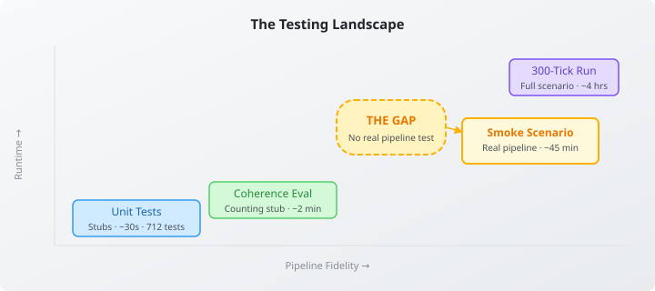
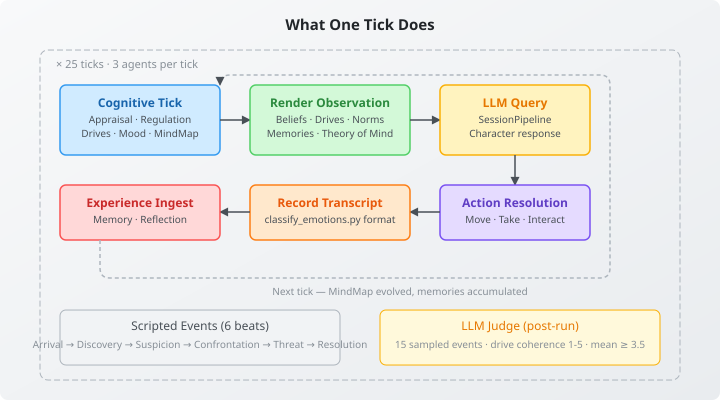

# The Test That Was Missing

We had unit tests. Seven hundred of them, running in thirty seconds, covering every cognitive component in isolation — drives, appraisal, regulation, mood, MindMap seeding, CAPS settling. Each test stubs the pipeline, verifies its own component's logic, and moves on. We also had the 300-tick scenario run: the full production pipeline with seventeen characters across six rooms, taking four hours and producing transcripts that classify_emotions.py scores for drive coherence. Both are valuable.

Neither catches a broken pipeline.

The unit tests prove that `MoodOrchestrator` computes mood correctly when given the right inputs. They don't prove the inputs arrive. The 300-tick run proves the whole thing works — eventually, if you have four hours and are willing to read three hundred events looking for the moment something went wrong. Between these two extremes, there was nothing.



I discovered this gap the hard way. A previous session exposed several silent failures: `bridgeToMood` never firing because the mock participant wasn't registered. A `generate()` override with a signature mismatch that compiled fine against the stub but threw at runtime. An appraisal strategy that parsed JSON correctly in the unit test but choked on code fences in real LLM output. Each of these passed every unit test. Each broke the actual pipeline. Each was only found by running the full scenario and watching characters produce flat, emotionless responses.

## What the Smoke Test Does

The smoke scenario is a `@QuarkusTest` tagged `llm-eval` that sits in the gap. Three agents — Vincent Marsh (scheming antagonist), James Hartwell (protective protagonist), Clara Bellingham (social mediator) — run through the full cognitive pipeline for twenty-five ticks.

Full pipeline means full pipeline. `ManorCognitivePipelineBuilder` wires up real components: `CognitionCore.tick()` runs appraisal and regulation. Drive orchestration reads real MindMap state. The observation builder renders real beliefs, real norms, real cognitive sections derived from real situation classification. `SessionPipeline` sends real prompts and gets real responses. Actions resolve against real world state. Experience ingest writes real memories.



Six scripted events — injected at specific ticks — span the emotional range the characters need to navigate. Arrival sets the social context. A torn letter discovered in the library triggers Vincent's scheming. James notices Vincent hiding it. A direct confrontation tests the conflict dynamics. A falling bookcase puts Clara in physical danger, activating James's protection drive. Resolution reveals the letter was a century-old document, not a current threat, and the tension recalibrates.

After the run, an LLM judge scores fifteen sampled events for drive coherence on a 1-5 scale. The test asserts: mean score at least 3.5, no individual event below 2.0.

## What the First Run Showed

The first run produced 137 events across 25 ticks, evenly distributed across the three characters. The judge scored fourteen events at 5.0 and one at 4.0. Mean: 4.93.

That's not just above threshold. That's the pipeline producing personality-coherent responses — characters with distinct drives behaving consistently across situations — without any of the mocking and stubbing that makes unit tests easy. The cognitive pipeline works end-to-end. Formation memories survive consolidation. Drives activate from MindMap state. Appraisal shapes what reaches the LLM. The characters feel like themselves.

More interesting than the score was what the test exposed about infrastructure.

## The Infrastructure Findings

Building the test required fighting CDI resolution failures that had been invisible. `InformationGapDetector` — a class used by `CuriosityDrive` — had no CDI scope annotation. `CuriosityDescriptionGenerationPhase`, an `@ApplicationScoped` consolidation phase, injected it directly. Without the annotation, Quarkus CDI validation fails at boot. This was masked because no test had previously booted the full CDI graph with all cognitive components active. The fix was a single `@Dependent` annotation, but the failure had been silently blocking all `@QuarkusTest` execution.

A separate dependency issue: `CognitionCoreFactory` references `EntityIdentityCache` from the `entity-token-cdi` module, but that module is declared `<optional>true</optional>` in the cognition POM. Every downstream consumer must independently discover and add it. The fix for wacky-manor was explicit — add the dependency. The proper fix is making it non-optional in neocortex.

The most consequential finding was in `LlmSituationClassifier`. Every call to `classify()` opens a new LLM session with a random UUID:

```java
var sessionId = "classifier-" + java.util.UUID.randomUUID();
var session = pipeline.openSession(sessionId, init);
```

Three agents, twenty-five ticks, two classification calls per agent per tick. That's a hundred and fifty cold session opens, each paying the full system prompt cost for the CAPS topology. The test ran forty-four minutes. Most of that time was spent repeating the same system prompt to the same model for the same agent. A sticky session per agent — `"classifier-" + agentId` — would amortize the system prompt and likely cut the runtime by more than half.

This isn't just a classifier problem. The cognitive pipeline has multiple LLM interaction points: appraisal, regulation, reflection synthesis, mental model updates, user model updates. Each may or may not reuse sessions. The smoke test made the cost visible for the first time because it runs enough ticks to feel the accumulation.

## Why This Matters Beyond Testing

The smoke scenario is not just a test. It's a validation instrument for the cognitive architecture itself. When we add a new cognitive component — a new drive source, a new appraisal dimension, a new regulation strategy — the unit test proves the component works. The smoke test proves the component integrates. That distinction is the difference between "the code is correct" and "the system behaves."

The forty-four minute runtime is a feature, not a bug. It's long enough to see propagation effects that ten-second unit tests can't reveal: how drive intensities drift over consecutive ticks, whether memory accumulation changes the observation builder's output, whether regulation strategies compound correctly across emotional episodes. These are the dynamics that matter for believable cognitive agents, and they only manifest at scale.

The 4.93 score is a starting point, not a destination. The GENERIC profile uses original character IDs — no pop-culture priors to inflate scores. As the cognitive architecture grows more sophisticated, the smoke test becomes the canary: if a change to appraisal or regulation degrades drive coherence, the score drops before the 300-tick run ever starts.

Twenty-five ticks. Three characters. One gap, closed.
