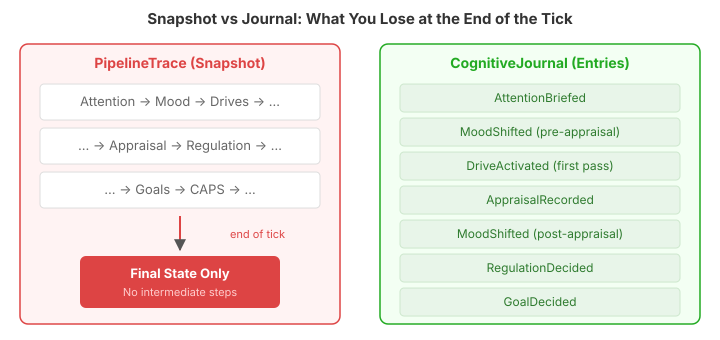
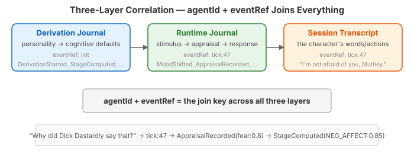

# The Journal That Sees Everything

I've been building cognitive agents for a while now. Characters that appraise situations, regulate emotions, form goals, consolidate memories overnight. The pipeline works — personality shapes behaviour in ways we can measure. What I couldn't do was explain *why*.

Given a 300-tick scenario transcript, a character says something interesting at tick 47. Fear drove it, clearly. But which facet score made the appraisal fire? What regulation strategy was considered and rejected? What mood shift preceded the drive activation? The data existed somewhere in the system, but "somewhere" was five different mechanisms with three different correlation models.

## Five Mechanisms, None of Them Sufficient

The observability story had grown organically. Each subsystem added its own:

| Mechanism | What it captured | Correlation key |
|-----------|-----------------|-----------------|
| DerivationObserver | Static derivation steps | agentId + eventRef |
| PipelineTrace | End-of-tick final state | tick number (implicit) |
| MemoryRecallObserver | Recall events | agentId only |
| GraphMutationRecorded | Graph mutations | tenantId only |
| PipelineSnapshotStore | Persisted snapshots | tenantId + agentId + tick |

Five mechanisms, three correlation models, two capture paradigms (events-as-they-happen versus end-of-tick snapshot). None of them could answer the question I actually wanted to ask.

The worst offender was PipelineTrace. It captures a snapshot at the end of each tick — what the final appraisal result was, what CAPS settled to, which drives activated. A photograph of the finish line. But a cognitive pipeline isn't a destination, it's a journey. Mood ticks twice per cycle (pre and post appraisal). Drives tick twice. The appraisal-to-mood bridge fires signals that never appear in any snapshot. Goal decisions happen and leave no trace.

## One Interface, Sixteen Types, Zero Tension

I wanted something that would eliminate all five mechanisms and replace them with one. Not a sixth mechanism alongside the other five — the replacement for all of them.

The design landed on three things:

**CognitiveEntry** — a sealed interface. Every cognitive state change in the system is one of sixteen record types. Every entry carries `tenantId`, `agentId`, `EventRef`, and `timestamp`. The sealed hierarchy means adding a new pipeline stage is just adding a new record type — consumers using exhaustive `switch` get a compile error telling them exactly what to handle.

**CognitiveJournal** — one method: `record(CognitiveEntry)`. That's it. The interface never changes. A NOOP sentinel means zero cost when disabled.

**CognitiveTrace** — an in-memory accumulator with predicate filtering and query API. Scoped per event boundary via ThreadLocal, so tick entries and consolidation entries never interleave.

The sixteen entry types span three domains:

| Domain | Types | What they replace |
|--------|-------|-------------------|
| Derivation | DerivationStarted, StageComputed, DataFlowed, DerivationCompleted | DerivationObserver callbacks |
| Runtime tick | AttentionBriefed, MoodShifted, DriveActivated, AppraisalRecorded, RegulationDecided, GoalDecided, CapsSettled | PipelineTrace snapshot |
| Memory/consolidation | MemoryRecalled, MemoryFormed, GraphMutated, Consolidated, ObservationCacheRefreshed | MemoryRecallObserver, GraphMutationRecorded |

## Why Sealed Types Matter Here

Java's sealed interfaces get a lot of attention for pattern matching, but the real value in this design is *compile-time exhaustiveness*. When someone adds `NarrativeRecorded` to the hierarchy next month, every `switch` expression over `CognitiveEntry` in every consumer — the journal store, any analysis tool, any future visualiser — breaks at compile time. Not at runtime. Not silently. The compiler tells you exactly which types you haven't handled.

This is the difference between "we might miss something" and "we can't miss something." For a primary observability mechanism, that distinction matters.

The single-method interface is the other half of the design. `CognitiveJournal` has one method: `record(CognitiveEntry)`. When the sealed hierarchy grows, the interface doesn't change. Producers add entries; the interface stays stable. The type system absorbs the complexity that would otherwise land on the wiring layer.

## EventRef — A Value Type, Not a String

The correlation key across all three layers — derivation, runtime, and transcript — is `agentId + eventRef`. Early in the design I had eventRef as a raw string: `"init"`, `"tick:47"`, `"consolidation:tick:120"`. The decision review caught this: a primary correlation key used by sixteen entry types, joining three observability layers, cannot be a bare string. A typo like `"ticks:47"` silently corrupts the join.

`EventRef` is now a sealed interface with factory methods: `EventRef.tick(47)`, `EventRef.init()`, `EventRef.consolidation(EventRef.tick(120))`. The factory methods enforce format. The sealed types enable pattern matching at query time. The `toString()` produces the string format for serialisation. `parse()` reconstitutes from strings. Compile-time safety for the join key.

## The Practicality: What This Enables

With the journal recording entries at the point of computation — not at the end of the tick — I can now trace any character behaviour backward through the full pipeline:

1. Character says something at tick 47 → look up the **session transcript** at `tick:47`
2. What drove that response? → **AppraisalRecorded** at `tick:47` shows fear at 0.8
3. Why fear? → **MoodShifted** (pre-appraisal) at `tick:47` shows arousal spike
4. What personality trait shaped the appraisal? → **DerivationStarted** at `init` shows the PID-5 facet scores that configured the appraisal thresholds

Four queries joining on `agentId + eventRef`. The answer to "why did Dick Dastardly say that?" is no longer a manual trawl through logs — it's a structured trace through typed entries.

This matters for explainable AI agents in general. The industry talks about explainability as a post-hoc problem — build the agent, then try to explain its behaviour. But if the pipeline doesn't record its intermediate states as structured, typed, correlatable entries, explainability becomes reconstruction rather than retrieval. Reconstruction is expensive, unreliable, and always incomplete.

The journal makes explainability a recording problem. Record at the point of computation. Correlate by construction. Query at analysis time.

## What Coexists and What's Gone

Not everything was replaced. PipelineTrace and PipelineSnapshotStore stay — they capture the pipeline's *output* (rendered prompts, final CAPS state). The journal captures the pipeline's *process* (what state changes happened and why). These serve different query patterns and coexist cleanly.

What's gone: CompactionObserver and ObservationCacheObserver had zero references — dead code, deleted. MemoryRecallObserver and DerivationObserver are bridged through adapter classes that convert their callbacks to journal entries. The interfaces survive at their original module layers; the observability role is subsumed.

## What's Next

The infrastructure is in place. Several stages still need instrumentation — narrative, strategy learning, reflection, per-subject mental models. Each is a mechanical addition to the sealed hierarchy. The CDI wiring that activates the journal in production is a separate task. And the GraphMutationRecorded CDI event needs `agentId` enrichment before mutations can be correlated with agents in the journal.

The real test will be running a 300-tick scenario with the journal active and tracing a surprising character behaviour backward through every pipeline stage to the facet score that shaped it. That's the trace that five separate mechanisms couldn't produce.
