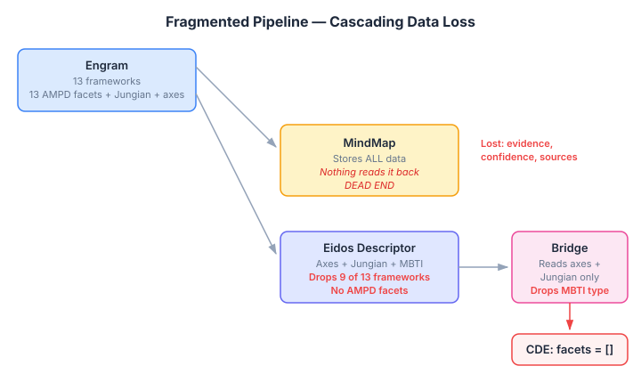
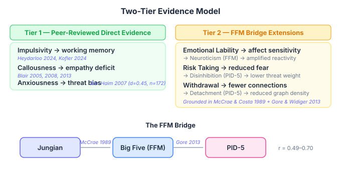
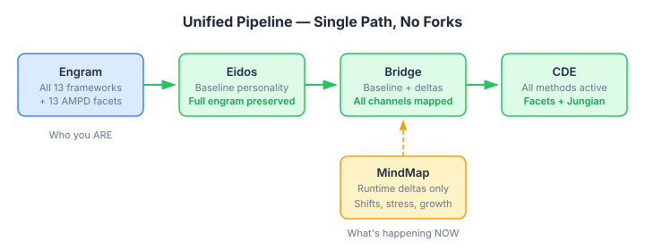

# Two Lenses on Personality

Most personality models pick a lane. The Big Five measures traits. Myers-Briggs measures cognitive style. The DSM measures pathology. Each tells you something real, and each leaves gaps the others fill.

I've been working on the CognitiveDerivationEngine — the part of neocortex that takes a character's personality profile and derives the cognitive defaults that shape how they think, feel, and act. Until now it's operated on two inputs: Jungian function weights (Ti, Te, Ni, Ne and the rest) for cognitive style, and disposition axes (categorical labels like "bold", "cooperative", "strict") for personality traits. The Jungian channel works well. The disposition axes are too coarse — they collapse continuous personality variation into three or four buckets.

The fix looked obvious: replace the categorical axes with the continuous PID-5 facet scores that our biography pipeline already extracts. Thirteen facets, each scored 0 to 100, covering dimensions like Callousness, Anxiousness, Impulsivity, Withdrawal. Dimensional personality assessment from the DSM-5 Alternative Model for Personality Disorders (Krueger et al. 2012). We already had the data. The CDE already had five methods that accept facet inputs.

Then Claude surfaced something I hadn't noticed.

## The Pipeline Nobody Reads

The biography extraction pipeline (`extract_personality.py`) scores each character across thirteen personality frameworks independently. OCEAN, MBTI, Jungian stack, Enneagram, DISC, Belbin, AMPD — the full battery. All thirteen frameworks get written to MindMap as flat key-value properties. `personality-ampd-callousness: 20`, `personality-ampd-anxiousness: 70`, and so on.

Nothing reads them back.

The Eidos agent descriptor — the thing that actually feeds the CDE — only carries disposition axes, Jungian weights, MBTI type, and Enneagram type. Nine of thirteen frameworks are silently dropped at the import step. The bridge between Eidos and the CDE drops even more: it ignores the MBTI type and Enneagram type that Eidos does carry, and passes an empty list for personality facets. Every time.

Those five CDE methods that accept facets? Dead code in production. They always receive empty lists and fall back to defaults. The personality-shaped behaviour they would provide — expression styles tuned to grandiosity and callousness, search budgets modulated by anxiousness and impulsivity, recurring thought thresholds driven by emotional lability — none of it has ever fired.

The MindMap personality store is the worst kind of technical debt: it looks authoritative. A future developer — human or AI — finding `personality-ampd-callousness` in MindMap would naturally build a reader for it, creating a third bridge that bypasses Eidos entirely. Two stores for the same data, no clear owner, and the temptation to wire into whichever you find first.

## What vs How

The deeper question was whether PID-5 should replace Jungian inputs or complement them. I started by assuming replacement — if PID-5 facets provide continuous scores on personality dimensions, why keep the categorical Jungian functions?

The answer comes from what each model actually measures.

PID-5 measures **what** maladaptive traits a character exhibits. High Callousness means reduced empathy. High Impulsivity means degraded impulse control. High Anxiousness means amplified threat sensitivity. These are the observable surface — the behavioural patterns a clinician would score on the 220-item inventory.

Jungian cognitive functions measure **how** the character processes information. Dominant Ti means the character leads with introverted analytical thinking. High Ne means they generate possibilities through extraverted intuition. These are cognitive architecture — the machinery underneath the behaviour.

A character can have dominant Fi (deep personal values, introverted feeling) and high Callousness (reduced empathy). That's not a contradiction — it's a specific kind of person: someone who feels intensely about their own values but struggles to extend that feeling to others. That's a recognisable character. The combination of the two lenses produces something neither lens produces alone.

Replacing Jungian inputs with PID-5 would lose the cognitive style dimension entirely. PID-5 doesn't tell you whether someone thinks analytically or intuitively — it tells you whether their analytical thinking is impulsive or deliberate, whether their intuition is anxious or exploratory.

## The Evidence Question

This creates a design challenge. If the CDE needs both channels, it also needs to know how they interact. When high Impulsivity meets a Jungian-derived working memory span, how much does the impulsivity degrade it? When high Callousness meets a feeling-function-derived relationship bias, how much does the callousness reduce it?

I'm not willing to guess. The CLAUDE.md rule — never guess at psychological models, always validate against published literature — exists because intuitive reasoning that "sounds right" has led us wrong before.

For some interactions, the evidence is direct and strong:

- **Impulsivity degrades working memory.** Heydarloo et al. (2024) in *Memory* and Kofler et al. (2024) in *Frontiers in Psychiatry* both show this consistently across clinical and non-clinical populations.
- **Callousness reduces empathy processing.** Blair's work spanning 2005 to 2013 in *Nature Reviews Neuroscience* documents the amygdala-mediated mechanism.
- **Anxiousness creates attentional bias toward threat.** Bar-Haim et al. (2007) meta-analysed 172 studies in *Psychological Bulletin* and found an effect size of d=0.45.

For other interactions, there's no direct study. Nobody has published a paper on how PID-5 Emotional Lability interacts with Jungian-derived affect sensitivity in a cognitive agent architecture. That specific intersection hasn't been researched because the two models come from different research traditions that don't typically talk to each other.

But there is a bridge.

McCrae and Costa (1989) mapped MBTI dimensions to the Five Factor Model. Gore and Widiger (2013) mapped PID-5 domains to the same Five Factor Model. The FFM serves as a statistical intermediary — both Jungian typology and PID-5 have validated connections to it, even though they don't have validated connections to each other.

This gives us a two-tier evidence model. Tier 1 modulations cite a specific paper for the specific interaction. Tier 2 modulations document a reasoning chain through the FFM bridge — Emotional Lability maps to high Neuroticism (FFM), which maps to amplified emotional reactivity, which is a reasonable extension to affect sensitivity. The chain is grounded in peer-reviewed links at each step, but the composition hasn't been tested as a unified model.

The code documents the evidence tier for every modulation. Tier 1 cites the paper. Tier 2 shows the reasoning chain and explicitly marks the gap between what the literature establishes and what we're extending.

## The Unified Pipeline

The fix is architectural, not just algorithmic. One path, one source of truth.

The engram — the complete personality extraction output — flows into Eidos, which carries the full personality profile. The bridge reads everything from Eidos and maps it to the CDE. MindMap stores runtime personality state: situational shifts, stress degradation, experience-modulated capacities. Baseline personality belongs in Eidos. Runtime deltas belong in MindMap.

This separation matters for future work. Issue #712 describes shadow archetypes — situation-dependent personality degradation profiles where a character's personality shifts under stress. The shadow archetype *rules* (what kind of degradation happens) are part of the character definition and belong in Eidos. The *current activation state* (is the shadow active right now, how deep) is runtime state and belongs in MindMap. The CDE bridge merges baseline and delta to compute what the character is like right now.

## What This Opens Up

The practical result: a character defined with high Callousness, dominant Fi, and high Risk Taking will have reduced relationship extraction bias, deeper personal value processing, and attenuated fear responses — all derived mechanically from the personality profile, all grounded in either published evidence or a documented reasoning chain.

The broader point is about honesty in design. It would have been easy to map PID-5 facets to Jungian functions with confident-sounding rules and no citations. The non-peer-reviewed sources I found do exactly that — they present the mapping as established fact when the direct evidence doesn't exist. What does exist is a well-validated indirect bridge through the Five Factor Model, and a handful of direct findings for specific interactions.

Building on that foundation — transparently, with the evidence tier documented in every code comment — means the system can be improved as more evidence becomes available. A Tier 2 modulation that consistently improves character coherence in eval testing becomes a candidate for promotion to Tier 1 when someone finds or publishes the supporting evidence. The architecture accommodates what we know and what we don't know, without pretending the boundary doesn't exist.
