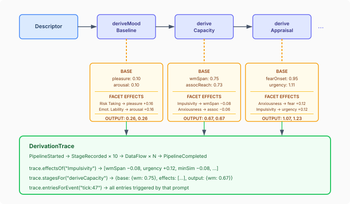

# The Debugger for Personality

*Continues from [Two Lenses on Personality](2026-11-13-mdp01-two-lenses-on-personality.md).*

The design blog explained why PID-5 facets and Jungian functions measure complementary dimensions, and why the personality pipeline needed unifying. This entry is about what happened when we built it — and the observability tool that emerged from a simple question about knowing whether it works.

## The implementation gap

Set a character's Impulsivity to 0.9. Run the scenario. Observe that the character acts more impulsively than one with Impulsivity at 0.1. That tells you the pipeline is doing *something*. It tells you nothing about *what*.

Which CDE method used the Impulsivity score? How much did it shift the output? Was the shift from the base axes value or from the facet modulation? Did the shifted value feed into a downstream method, and if so, how much of the downstream output traces back to the original facet versus the Jungian profile?

Before we built the journal, answering those questions meant reading the CDE source code and mentally tracing the arithmetic. For ten methods, each with different facet interactions, that's not a debugging strategy — it's an archaeology expedition.

## What the journal captures

The derivation journal is an observer that sits on the `derive()` call and records every computation. Not samples. Not summaries. Everything.

Each stage in the pipeline produces a `StageComputation` record with three layers:

**Base values** — what the axes and Jungian profile produced before any facet touched it. In `deriveMoodBaseline`, that's the pleasure, arousal, and dominance values from the categorical axis lookups. In `deriveCapacity`, it's the working memory span and associative reach from the Jungian function weights.

**Facet effects** — each PID-5 facet's contribution as a named delta. Not "the output changed by 0.08" but "Impulsivity at score 0.9 shifted workingMemorySpan from 0.75 to 0.67." The facet name, the facet's own score, the target field, the before value, the after value. Every modulation is individually attributable.

**Final values** — what left the stage and entered the cognitive defaults.

Between stages, the journal captures `DataFlow` records — when one method's output becomes another method's input. The connective bias from `deriveGraphStructure` feeds into `deriveSearchBudgetDefaults` as a parameter. That causal link is explicit in the journal, not implicit in the code.

The full pipeline lifecycle is bracketed: `PipelineStarted` carries the complete descriptor context (axes, Jungian weights, all facet scores, goals), and `PipelineCompleted` marks the end. Every entry carries an `agentId` and an `eventRef` — a tick number or event identifier that correlates the journal to the scenario script. "What happened to this character at tick 47?" is a query, not a code review.

## Two observation patterns

The observer interface supports two usage patterns that serve different needs.

**Per-node** — implement `DerivationObserver` with custom logic at each stage. A logging observer that prints every facet effect. A validation observer that flags when a modulation exceeds a threshold. A metrics observer that counts how many facets had non-zero effect per character.

**Propagation context** — use `DerivationTrace`, the built-in accumulator. It collects every event across the full `derive()` call and provides query methods: `effectsOf("Impulsivity")` returns every stage where Impulsivity had an effect. `stagesFor("deriveCapacity")` returns the full computation cell for that method. `entriesForEvent("tick:47")` slices by script position.

The trace accepts a stage filter predicate for constraining capture. `new DerivationTrace(m -> "deriveMoodBaseline".equals(m))` records only the mood computation. Full capture by default, restrict when you need focus.

## Why this matters beyond debugging

The journal records are structured data — sealed interfaces with typed records, not log lines. Three uses that go beyond finding bugs.

**LLM analysis.** Serialize a character's journal to JSON and ask an LLM: "Why is this character's fear threshold so low?" The LLM reads the trace backward — Anxiousness=0.9 amplified fearOnsetThreshold in `deriveAppraisalWeights`, but Risk Taking=0.8 partially offset it. Compare two characters' journals side-by-side: "Why do these two behave similarly despite different profiles?" — because their modulations converged through different paths. The structured records give the LLM specific values to reason about, not prose to interpret.

**Visual replay.** The journal entries are ordered by execution. A visualization tool reads them sequentially and animates the pipeline: descriptor enters, each stage lights up showing its base computation, facet deltas paint on top, arrows show values flowing to downstream stages, and the cognitive profile emerges at the end. The data model was designed with this in mind — `StageComputation` has everything a renderer needs.

**Eval harness integration.** Instead of asserting on final cognitive defaults (which tests do already), the eval harness can assert on the trace: "Impulsivity=0.9 must reduce workingMemorySpan by at least 0.05." That tests the modulation mechanism, not just the output. When a modulation weight is tuned, the eval shows exactly which downstream effects changed and by how much.

## The provenance question

The journal currently traces from facet score to cognitive default. The next step — filed as a design issue — extends the trace backward: *where did the facet score come from?*

`PersonalityFacet` already carries an `origin` field. The bridge sets it to `"eidos"` when mapping from the engram descriptor. For facets that shift at runtime — through MindMap personality deltas, consolidation-driven changes, or stress degradation — the origin would carry the tick or event that produced the shift. `"mindmap:tick:23"` or `"consolidation:cycle:3"`.

That completes the provenance chain: scenario prompt → cognitive state change → derivation default → facet value → input source. Every node traceable backward to its cause. An LLM or visualization tool doesn't just show what the pipeline computed — it shows why, all the way to the data that entered the system.

The architecture accommodates this today. The runtime cognitive pipeline — CAPS appraisals, regulation strategy selection, mood shifts — produces the same kind of structured events, just not journaled yet. The observer interface is there. The correlation key (agentId + eventRef) is there. The instrumentation of each runtime stage is the remaining work.

## What's running now

Ten CDE methods fully instrumented. Three tiers of modulation — Category A (facets modulate axes-derived values), Tier 1 (peer-reviewed: Impulsivity→WM, Callousness→empathy, Anxiousness→fear), Tier 2 (FFM bridge extensions). The Eidos descriptor carries AMPD facet scores. The bridge maps them into the CDE. The journal records every computation in between.

The personality-to-cognition pipeline went from a black box to something you can open, inspect, query, and replay. The next time I need to understand why a character with high Callousness and dominant Fi processes relationships the way they do, I won't be reading source code. I'll be reading a trace.
