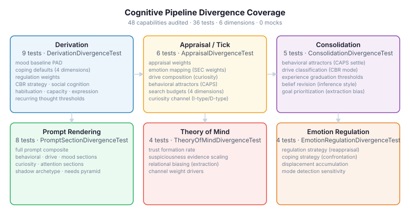

# Thirty-Six Proofs That Personality Is Structural

*Continues from [The Attractor That Proved Personality](2026-11-19-mdp01-the-attractor-that-proved-personality.md).*

The last session proved that CAPS behavioral attractors diverge between personalities. One test, one layer. The cognitive pipeline has 48 capabilities that derive from personality — mood baselines, coping defaults, appraisal weights, regulation strategies, search budgets, curiosity channels, expression styles, recurring thought thresholds, graph structure biases, goal prioritization parameters. If any of those capabilities produce identical output for two different personalities given the same situation, that capability isn't doing its job.

I audited all 48. Six had tests. Forty-two had none.

## The audit

The cognitive pipeline processes personality through six distinct stages. Each stage takes the personality definition — disposition axes, facets, weighted terms, goals — and produces measurably different behaviour.

**Derivation** is the base layer. `CognitiveDerivationEngine.derive()` transforms a `DescriptorView` into a `CognitiveDefaults` record — hundreds of parameters controlling every downstream component. Mood baseline PAD values, coping tendencies, regulation capacities, CBR retrieval modes, social cognition defaults, habituation thresholds, cognitive capacity limits, expression styles, recurring thought sensitivity. All derived deterministically from the personality definition. No tick, no pipeline, no state — pure function.

**Appraisal** is the first tick-level stage. After an observation hits the pipeline, the appraisal weights determine how urgently the agent treats it, how much relationship context matters, how quickly fear onset occurs. The search budget computation allocates cognitive breadth, depth, and laterality differently. The curiosity channel selector routes I-type (interest-driven, exploratory) or D-type (deprivation-driven, gap-filling) curiosity based on the agent's anxiousness facet score. These are runtime divergences — same observation, different processing.

**Consolidation** runs between ticks, during the sleep cycle. Graduated experience memories flow through CAPS — a 120-node network where activation propagates through personality-weighted connections until it settles into stable attractor basins. An open agent with adventure and curiosity drives settles into approach-oriented attractors. A cautious agent with suspicion and self-preservation drives settles into avoidance-oriented attractors. Same network architecture, different wiring, different settling.

**Prompt rendering** is where divergence becomes visible. Each prompt section — mood, drives, curiosity, attention, behavioral attractors, needs — renders differently because the upstream state it draws from already diverged. The full rendered prompt for two agents given identical observations reads as if written for two different people. Because it was.

**Theory of mind** determines how agents model each other. Trust formation rate — how quickly an agent moves from cautious to trusting — is derived from the disposition axes. Suspiciousness facet scores scale how much weight threat evidence receives. Relationship biases determine how prominently relational context features in the agent's extraction of meaning from observations.

**Emotion regulation** is the most consequential divergence. Reappraisal capacity versus suppression capacity — an open agent reframes stressors, a cautious agent buries them. Confrontation tendency versus avoidance tendency — the coping strategy selection when under pressure. The anxiousness and emotional lability facet gaps (open: 0.2, cautious: 0.85) guarantee that situational displacement accumulates faster for the cautious agent. Same stress, different regulatory response, different long-term personality trajectory.

## The OPEN/CAUTIOUS methodology

The test suite uses two synthetic personalities designed to maximise differentiation while remaining psychologically coherent.

**OPEN** — cooperative, moderate rule-following, bold risk appetite, high autonomy, cooperative conflict resolution. Low anxiousness (0.2), low emotional lability (0.2), low withdrawal (0.1), high risk-taking (0.8), low suspiciousness (0.2). Cognitive functions Ne (extraverted intuition) and Se (extraverted sensing). An agent that explores, engages, and trusts.

**CAUTIOUS** — independent, strict rule-following, conservative risk appetite, low autonomy, avoidant conflict resolution. High anxiousness (0.85), high emotional lability (0.8), high withdrawal (0.8), high suspiciousness (0.7), low risk-taking (0.2). Cognitive functions Si (introverted sensing) and Te (extraverted thinking). An agent that conserves, monitors, and mistrusts.

These aren't caricatures. The facet scores are drawn from the PID-5 (Personality Inventory for DSM-5) dimensional model — each score maps to a clinical dimension with empirical grounding. The dispositions use the five axes the derivation engine maps to cognitive defaults: social orientation, rule-following, risk appetite, autonomy, and conflict mode.

The key property: every derivation pathway that depends on personality should produce different output for these two profiles. If a capability produces identical results for OPEN and CAUTIOUS, the personality isn't reaching that capability — it's a gap in the pipeline.

## What the shared fixtures enable

`DivergenceFixtures` extracts the personality definitions, derivation calls, and harness builders into a shared utility class. The test classes don't construct personalities — they call `DivergenceFixtures.openDefaults()` and `DivergenceFixtures.cautiousDefaults()`. For tick-level tests, `pairedBuilder()` returns a pre-configured harness with both agents registered. For consolidation tests, `fullBuilder(store)` adds behavioral synthesis and CAPS.

The MindMap seeding — experience nodes, drive-intensity nodes, cognitive subgraph structure — is centralised in `seededCognitiveStore()`. The attractor comparison logic — stream attractors by category, compare strengths within tolerance — is `assertAttractorsDiverge()`. Two test classes were using identical 40-line blocks for this; now they call two methods.

This matters for maintenance. When a new personality facet is added to the PID-5 mapping, the fixture updates in one place and all 36 tests pick it up. When a new derivation capability is added, a new test method is a 10-line function calling the shared fixtures.

## What this proves

Thirty-six tests, six dimensions, every test deterministic, every test under 500ms, no LLM calls, no mocks (except the NPE fix in InnerLifeOrchestratorTest — that's a mock-correctness fix, not a mock-driven test). The suite proves that personality flows through every stage of the cognitive pipeline and produces measurably different output at each stage.

The implication for cognitive agent architecture: personality is not a prompt prefix. It is not a system message that says "you are cautious." It is structural — it determines the weights in the network, the thresholds in the regulators, the biases in the extractors, the strategies in the coping system, the basins in the attractor landscape. Two agents with different personalities given the same observation will appraise it differently, regulate it differently, consolidate it differently, and act on it differently. Not because they were told to, but because their cognitive architecture routes information differently.

That's what the 48-capability audit and the 36-test suite exist to prove. And to catch the moment any refactoring, any new capability, any pipeline change breaks that guarantee.
