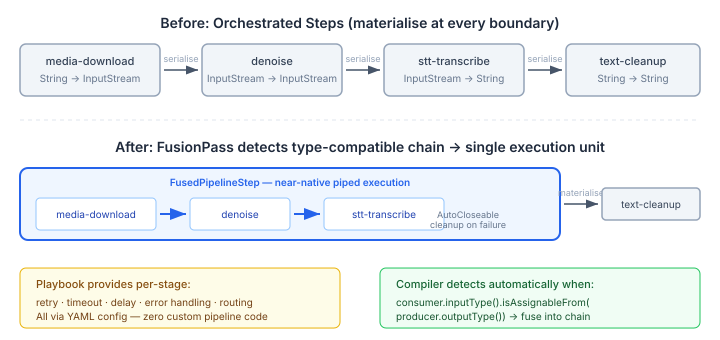
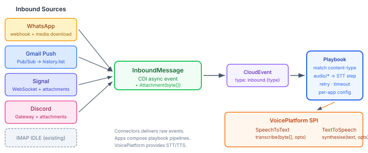

# Your Workflow Engine Is a Data Pipeline

A WhatsApp voice note arrives. It needs downloading, denoising, transcribing to text, and delivering to whichever agent handles the conversation. That's a pipeline — four stages, binary data flowing between them, each stage needing its own retry policy and timeout.

The obvious move is to build one. A custom `AudioPipeline` class with a chain of processing stages, explicit wiring between them, manual retry logic, and resource cleanup when something fails mid-chain. I've built these before. Everyone has. They work, and they all look the same, and none of them are the interesting part of the system.

We were designing this pipeline for casehub's real-time inbound channels — WhatsApp, Gmail push, Signal — when the question surfaced: could the platform's playbook engine handle this?

## The mental model that gets in the way

Workflow engines orchestrate human and agent tasks. Assign a ticket, wait for review, escalate if no response. That's the mental model. It's not wrong — but it's incomplete.

A playbook step takes an input, does work, produces an output. It can retry on failure, timeout after a deadline, route to different branches based on the output. Strip away the human-task framing and what you have is a typed transform with orchestration decorators.

That's exactly what a pipeline stage is.



## Typed steps and automatic fusion

The platform's `StreamingStep<I, O>` interface makes this concrete. A step declares its input and output types at runtime:

```java
@Plugin(value = "stt-transcribe", streaming = true)
public record SttTranscribePlugin(
        @Optional String language,
        @Optional String model) {

    @Execute
    public TranscriptionResult apply(byte[] audio,
                                      VoicePlatform voicePlatform) {
        return voicePlatform.speechToText()
                .transcribe(audio, TranscriptionOptions.defaults()
                        .withLanguageHint(language));
    }
}
```

The `@Plugin(streaming = true)` annotation generates a `StreamingStep<byte[], TranscriptionResult>` adapter at compile time. The first parameter of `@Execute` is the streaming input; additional parameters are resolved from CDI.

The compiler's `FusionPass` then walks the playbook's step list. When consecutive steps have compatible types — `consumer.inputType().isAssignableFrom(producer.outputType())` — it fuses them into a single `FusedPipelineStep`. Three separate steps become one execution unit with near-native piped execution, automatic `AutoCloseable` resource cleanup on mid-chain failure, and per-stage retry and timeout decorators applied inline.

The consuming application writes YAML, not pipeline code:

```yaml
steps:
  - stt-transcribe:
      audio: "${event.data.attachments[0].content}"
      language: en
    step: transcript
    timeout: 120s
    retry: { max: 2, delay: 5s, backoff: exponential }
```

No custom pipeline framework. No explicit wiring. The orchestration engine you already have provides retry, timeout, routing, error handling, and CloudEvent triggers. The fusion compiler optimises the data path.

## Why this matters for voice

Voice is the channel that makes this pattern non-optional. Text messages are small and fast — you can get away with ad hoc processing. Voice notes are binary, they need multiple processing stages (download, denoise, transcribe, clean up the text), and each stage can fail independently. An STT service that's down shouldn't block message delivery. A failed download should retry before giving up. A 120-second transcription shouldn't hold open a webhook connection.



These are orchestration concerns, not data concerns. Building a custom pipeline means reimplementing them. Using the workflow engine means getting them for free — and getting them right, because they've been tested across every other workflow the engine runs.

## The typed contract is the key

The insight that makes this work is the typed step contract. `StreamingStep<I, O>` is the same abstraction as a Unix pipe or a Java `Function<I, O>`. The workflow engine adds orchestration semantics around it — retry, timeout, routing, resource cleanup — but the data flow is just function composition.

When a future `denoise` step produces `byte[]` and the existing `stt-transcribe` step consumes `byte[]`, the fusion compiler chains them automatically. No configuration change, no new wiring code. The type system handles it.

This is the direction we're taking casehub's inbound processing. Connectors download media and fire events. Playbooks route those events through processing steps. VoicePlatform provides the STT and TTS capabilities behind those steps. Each layer does one thing, and the workflow engine — the thing we built for task orchestration — turns out to be the data pipeline we didn't have to build.
