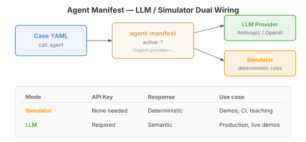
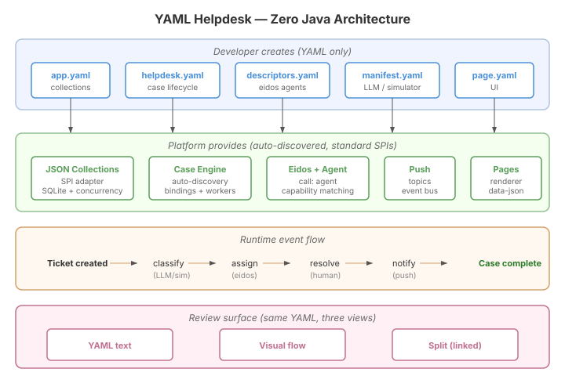

# When YAML Replaces Java

The existing helpdesk example has 20 Java classes. Four are domain model. The rest are infrastructure — dispatchers, CDI observers, WebSocket push, MCP operations, demo bootstrap, REST endpoints. All doing the same thing: wiring a ticket through classify → assign → resolve → notify.

I wanted to know: how much of that is essential complexity, and how much is just the cost of Java?

The answer, it turns out, is that the entire application — data model, case lifecycle, agent descriptors, LLM classification, reactive bindings, dashboards, forms, demo scenarios — fits in seven YAML files and some seed JSON. Zero Java. Zero compilation. Same behaviour.

## What the Java version actually demonstrates

Before I could design the YAML version, I had to look honestly at what the Java version was doing. Not just the ticket lifecycle — the agentic pattern underneath.

The case definition YAML already defines workers with capabilities, capability-based dispatch, and dynamic routing. `KeywordClassifierDispatcher` is a simple agent that classifies tickets. `NotificationDispatcher` is an agent that notifies customers. `HelpDeskCaseHub.augment()` wires agents to capabilities. The 20 Java classes are implementing an agentic pattern — they just don't use eidos for it, and the classification is keyword matching, not LLM.

The YAML version doesn't add new capabilities the Java version lacks. It formalises the same agentic model using eidos descriptors and upgrades the classifier from keywords to LLM. Same pattern, declarative syntax, better classification.

## The file set

```
helpdesk-apps/
  app.yaml                 # tickets + agents collections, typed schemas
  helpdesk-ticket.yaml     # case lifecycle: bindings, workers with do: blocks
  descriptors.yaml         # eidos agent descriptors (classifier + specialists)
  agent-manifest.yaml      # LLM/simulator dual wiring
  helpdesk.page.yaml       # dashboards, forms, tables, charts
  helpdesk-demo.yaml       # playbook: teaching walkthrough + integration test
  data/*.json              # seed tickets and agents
```

Each file has one job. `app.yaml` defines what data exists. `helpdesk-ticket.yaml` defines what happens to that data. `descriptors.yaml` defines who handles it. `agent-manifest.yaml` defines how they're wired. `page.yaml` defines what users see. The playbook defines how to demonstrate and test the whole thing.

## LLM classification via `call: agent`

The case engine already has `FlowWorkerFunctionProvider` for inline Serverless Workflow steps — `call: http`, `switch:` with JQ expressions. Claude and I explored what it would take to add `call: agent` — a new step type that resolves an eidos agent by slot, renders the system prompt via `SystemPromptRenderer`, and calls the LLM via agent-config.

The case YAML looks like this:

```yaml
workers:
  - name: ticket-classifier
    capabilities: [classify-ticket]
    agent: classifier-agent
    do:
      - classify:
          call: agent
          with:
            prompt: >
              Classify this support ticket.
              Categories: HARDWARE, SOFTWARE, ACCESS, OTHER
              Subject: ${ .subject }
            output-schema:
              category: { type: enum, values: [HARDWARE, SOFTWARE, ACCESS, OTHER] }
              priority: { type: enum, values: [LOW, MEDIUM, HIGH, URGENT] }
```

The `agent:` field references an eidos descriptor. The `call: agent` step invokes it. The engine resolves the agent, renders the prompt with the descriptor's personality context, calls the configured LLM provider, and maps the structured output back to the case context. The binding fires when status is OPEN and category is null — the classification happens automatically, reactively, with no Java.

## The simulator question

The helpdesk was built before the platform had simulation support. I brought this up — every demo should run without an API key. The agent manifest now dual-wires every agent:



Simulator mode is the default. Demos just work — deterministic responses, instant, no credentials. Flip a config property and the same app uses a real LLM for semantic classification. The simulator configuration doubles as a teaching tool: users see the keyword rules that approximate what the LLM does, and understand what the simulator replaces.

This should be the standard pattern for every example going forward. If a demo requires an API key to run, it isn't a demo.

## Playbooks that test themselves

The existing helpdesk playbook automates the UI to teach users — fill the form, click submit, watch the lifecycle execute. I wanted to push this further: if the playbook already drives the UI and verifies results, why not run it headless as an integration test?

```yaml
- name: verify-classification
  verify:
    endpoint: /api/apps/helpdesk/tickets
    expect:
      - match: { subject: "Laptop won't boot" }
        assert:
          category: HARDWARE
          status: TRIAGED
```

Same playbook, two modes. In the browser with the visualiser, it's a teaching walkthrough — users see each step execute, see bindings fire, see green checkmarks on verification steps. In headless Playwright via CI, the `verify:` steps become pass/fail assertions.

The playbook steps use ARIA selectors — `role: button, name: "Submit"` instead of CSS selectors. This means accessibility is tested as a side effect. If ARIA roles are broken, the playbook fails. Accessible-first testing as a default, not an afterthought.

Combined with the simulator, this means: **generate YAML → review in the visualiser → test headlessly with Playwright + simulator.** The same artifact is the teaching material, the review surface, and the test suite.

## The three-way viewer

The helpdesk demo has always shown YAML in a text viewer. With the graphical playbook viewer now available, the natural step is a three-way view: YAML text, visual flow, or split with linked navigation.

In split mode, clicking a visual node highlights the corresponding YAML block. Editing YAML live-updates the visual. The relationship between declaration and behaviour is explicit — "what does this YAML produce?" is answered visually, in real time.

This matters most for LLM-generated apps. An LLM generates the YAML. The visualiser renders the full lifecycle. The reviewer sees the behaviour, not the syntax. Reading YAML to verify an LLM's output doesn't scale. Walking through a visual playbook does.

## Two syntaxes, one runtime

Claude raised a good question during the design: if YAML bindings are the `@Observes` equivalent, what about TypeScript developers who think in code?

The paradigm is the same — bindings + workers + push topics — so it supports both syntaxes:

```yaml
# YAML
bindings:
  - name: assign-specialist
    trigger:
      on: context-change
      when: "${ .status == \"TRIAGED\" }"
    agent-task:
      capability: hardware-support
```

```typescript
// TypeScript — same runtime, same behaviour
@Observes('helpdesk:ticket-triaged')
async assignSpecialist(event: TicketEvent) {
  await createAgentTask({ capability: 'hardware-support' });
}
```

YAML for declarative apps and LLM generation. TypeScript decorators for web developers who prefer code. Both compile to the same execution model.

I want to pitch Pages to web developers. Having TS decorators as a first-class authoring mode — not a wrapper, but a peer syntax — makes the platform accessible to that audience.

## The architecture



The developer creates the top layer. The platform provides the middle layer — auto-discovered from classpath YAML, standard SPIs, no wiring code. The runtime executes the bottom layer — reactive bindings fire, agents dispatch, events flow through push topics.

## What this requires

This isn't just a new example. It drives foundation work across four repos:

| Work | Repo | Why |
|------|------|-----|
| Case YAML auto-discovery | casehub-engine | Eliminate the one mandatory Java class |
| JSON collection SPI adapter | casehub-engine + data-json | Standard persistence, uniform data access |
| `call: agent` worker step | casehub-eidos + engine | Eidos agents invokable from YAML |
| `agent-task:` binding type | casehub-engine | Capability matching via eidos registry |
| Push topic REST endpoint | casehub-pages-push | Workers publish events via `call: http` |
| TS decorator framework | casehub-pages | `@Observes` / `@Publish` wired to push topics |
| Three-way viewer | casehub-pages | YAML / visual / split |
| Headless playbook runner | casehub-pages | Playwright integration for CI |

The plan has 10 batches across these repos, each independently deliverable. The first four batches are foundation — they can run in parallel. Batch 5-6 is the YAML helpdesk itself. Batches 7-10 are the extended capabilities.

## What this opens up

The obvious win is developer experience — fewer files, no compilation, instant feedback. But the deeper thing is the LLM generation story.

If an application is fully described in YAML, an LLM can generate it. If the playbook visualiser can render the full lifecycle, a human can review what the LLM generated without reading code. If playbooks run headless with assertions, the generated app can be tested automatically. If the simulator provides deterministic responses, the tests are reliable in CI.

Generate → review → test. All from YAML. No Java in the loop.

The helpdesk is the proof of concept. If a seven-file YAML app can replicate (and improve on) a 20-class Java application with full case lifecycle, eidos agents, and LLM classification — then YAML-first is a viable authoring model for case-managed applications.

The existing Java helpdesk stays alongside for comparison. Same agentic model, two authoring approaches, side by side. The comparison tells the story better than any documentation could.
